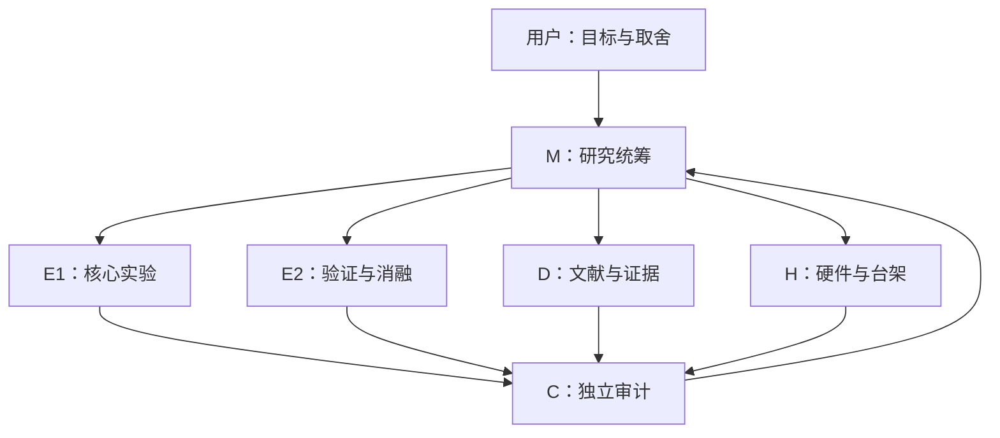

# 多窗口组织架构

2026-10-23 建立。适用于本仓库，后续可复用到本机其他项目。每个项目保留自己的任务卡与证据目录，不把所有项目塞进一个总聊天。

## 谁负责什么



| 角色 | 默认负责 | 交付物 | 职责边界 |
|---|---|---|---|
| M | 问题定义、优先级、依赖、分配、验收和集成 | 任务卡分配、决策、当前摘要 | 不把全部检索与实验日志搬进主聊天 |
| E1 | 原始 baseline、实现与主结果 | 代码、运行来源、结果解释 | 不自行调整验收指标以迎合结果 |
| E2 | 消融、统计、边界条件、独立复核 | 验证方案、独立输出、差异报告 | 不并发修改 E1 的在做代码或覆盖其输出 |
| C | 只读审查实现、来源、对照公平性及主张 | 带文件定位的评审记录 | 不边审边改被审文件；需运行时先确认写入行为 |
| D | 文献原件、作者源码版本、来源清单、证据索引 | 来源表、缺口表、资料导航 | 不把文献结论或旧机器检查当作本机实验 |
| H | 板级适配、设备绑定、固件部署与台架测量 | 硬件配置、检测工具、实测来源 | 不把串口枚举、fixture或主机测试当无线实测 |

用户主要在 M 提需求；细节在对应角色窗口完成。以上箭头代表交付关系，不表示系统已自动建群、调度或发送消息。

## 目录归属

```text
D:\Multi-Agent Network\
├─ START_HERE.md                新窗口入口
├─ AGENTS.md                    全仓库协作约定
├─ coordination\              本机研究工作的组织管理
│  ├─ CURRENT.md               简短快照，链接研究依据
│  ├─ TASKS.md                 任务索引，不重复保存状态
│  ├─ WINDOWS.md               角色与聊天、工作副本对应关系
│  ├─ DECISIONS.md             当前有效的组织决定
│  ├─ roles\                  六个角色的启动提示词
│  ├─ tasks\                  每项任务的状态与交接检查点
│  ├─ reviews\                独立评审记录
│  └─ templates\              任务卡、运行来源模板
├─ research\agent_native_network\  研究问题、文献、方案与证据
├─ simulation\                现有仿真代码与协议
│  ├─ results\                已跟踪的历史/正式结果
│  └─ outputs\                新运行临时输出，按任务分目录
├─ data\                      数据、作者源码和权重，Git 忽略
└─ .venv\                     本机环境，Git 忽略
```

`outputs/`、`data/`、`.venv/` 是后续使用约定，本次未创建环境或下载数据。已有文件不搬家、不批量改名。D 默认维护 `research/` 资料，但研究问题和路线变更由 M 决定，并在任务卡中划定具体可写文件。

## 任务怎么流转

`backlog → ready → running → review → done`；任何未完成状态都可进入 `blocked`，解除后回到任务卡记录的前一状态。

- **backlog**：待办构想，不执行。当前新研究任务均在这里。
- **ready**：M 已明确目标、唯一负责人、可写路径、依赖、验收标准，并保留写入范围；所需工作已包含在用户授权范围。
- **running**：负责人已核对工作副本与文件归属并接手。每个角色默认只做一项运行中的任务。
- **review**：负责人保存结果和交接，停止修改本次交付文件；指定审查者核对固定提交，或列明的未提交文件及哈希。需修订则回到 running。
- **done**：M 核对验收依据后关闭。研究性任务按任务卡要求附 C/E2 审查；文档小改可用链接和差异检查验收，不增设无关实验。
- **blocked**：写清缺什么、已完成什么、如何恢复；不能把等待或失败记成完成。

任务卡是唯一任务状态来源，`TASKS.md` 仅提供索引。负责人维护执行状态；M 负责 ready 和 done 的转换，交接时串行编辑任务卡。审查者另写评审文件，不抢写执行者任务卡。

## 并行写入和 Git

第一阶段使用同一主目录：M 写共享管理文件；E1、E2、D 写各自任务指定文件；C 只读研究文件。分配前检查所有 ready/running/review 卡，以及尚未释放范围的 blocked 卡，可写路径是否相交。ready 即保留范围；暂停、取消、关闭任务时，先确认相关进程停止，再由 M 在卡内记录释放。恢复前重新分配。冲突由 M 串行安排或拆出独立 worktree，不能靠“同时注意一下”避免。

进入共享代码的并行开发时，E1/E2 使用独立 worktree。M 在 `coordination/WINDOWS.md` 登记绝对路径、起始提交与分支；先确保组织文件已进入所用起点。任务卡登记权威任务卡的绝对路径，执行者始终读取该主卡，不修改 worktree 内的副本。主卡不可读时，停止依赖其状态的修改，不凭旧副本继续。

不能直接写主目录时，M 代为维护主卡，并登记为状态写入者。先由 M 将主卡改为 running、确认保留范围，再开始执行；阶段交接写入任务专属文件，由 M 回填。交审、换窗或释放写入范围前先完成回填，避免主卡仍显示旧状态。传递交接文件不要求自动发送跨聊天消息。

M 在双方停止写入后检查完整差异，只集成任务内的改动。worktree 隔离文件修改，但不会消除后续合并冲突。环境、权重、数据分别检查；CPU/GPU/长任务并发额度在任务卡登记，未声明预算时不启动长批次。

Codex 的 worktree 用法参考 [OpenAI 官方文档](https://learn.chatgpt.com/docs/environments/git-worktrees)。这里的角色分工、任务卡和写入规则是本项目约定，并非应用自动执行的权限系统。

## 换窗口时保留什么

聊天负责当前讨论；任务卡负责恢复工作。每个阶段结束时更新一段简短检查点：最后完成项、证据、未决问题、下一步、正在运行的进程。大段命令输出和历史讨论放到对应结果文件，任务卡只留链接。

换话题、新研究阶段、反复纠正上下文或聊天开始冗长时，可以开同角色的新聊天。旧窗口先交接并停止写入，新窗口核实任务卡与当前文件，再恢复。已完成任务卡留在原路径供追溯，不搬动以免链接失效；过长的旧检查点另存为任务专属附件，只保留最新恢复摘要。


2026-11-03新增[H | Hardware](roles/H.md)：板级适配、只读枚举与绑定、台架工具和真实测量来源。具体授权及写入范围仍由主任务卡管理。
