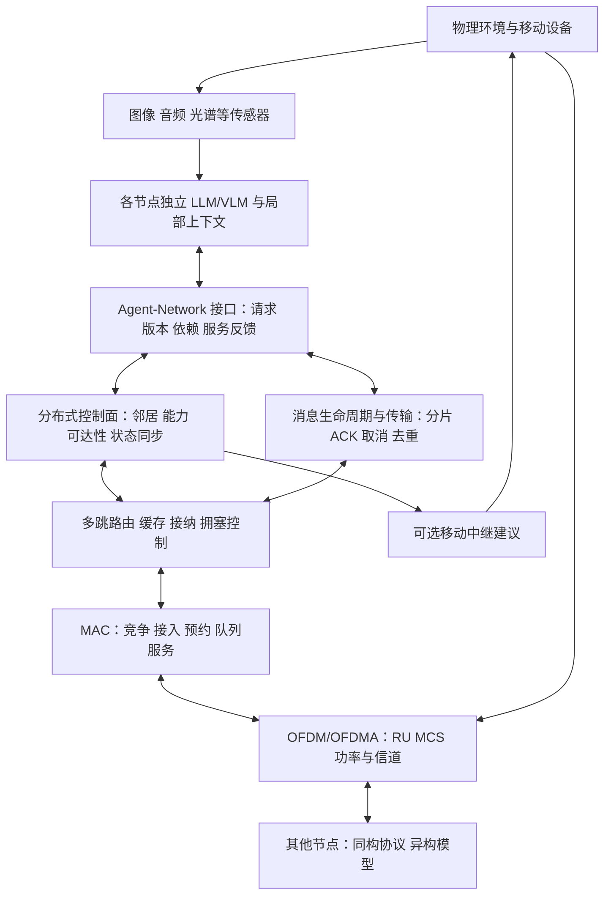
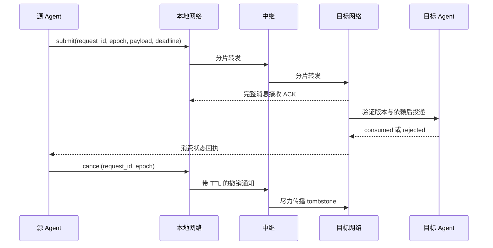
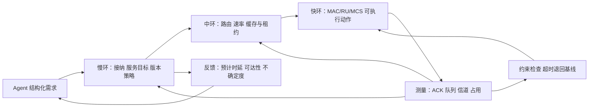
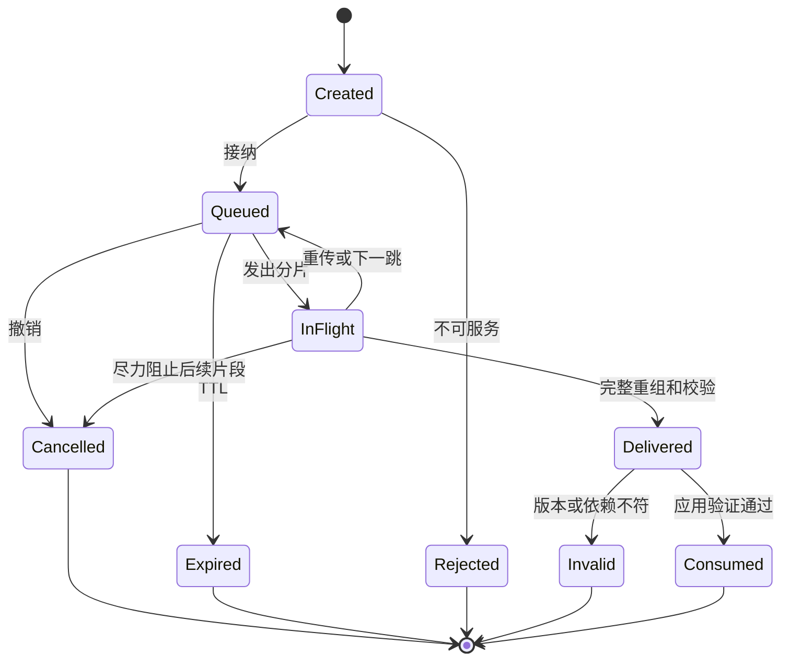

# 完整系统架构与 V0 数学模型

**当前模型入口：** [AGENT_COLLAB_MODEL.md](AGENT_COLLAB_MODEL.md)（2026-10-22）。已实现局部任务状态、逐跳缓存传输与请求—结果协作执行，并完成首轮实验。本文件保留早期完整系统候选架构，具体机制随当前任务模型逐项接入。

2026-10-20。本文所有协议结构、参数区间和优化形式均为**本项目建议性设计**，未实现、未验证。文献基础为 [P01/P05] 的闭环接口、[P15–P17] 的状态时效及 [P21] 的队列控制；具体边界见 [RELATED_WORK.md](RELATED_WORK.md)。不宣称下述混合离散、非凸、部分可观测系统已有最优解。

## 1. 统一抽象与系统范围

采用“**带版本和依赖的通信请求**”作为跨层对象。请求包含可由应用声明的结构化元数据；网络不读取模型隐藏推理链，也不要求所有模型共享 latent space。推理阶段仅使用 `observing / computing / waiting / acting / recovering` 等可外部观测状态。置信度是待校准估计，不能视为可靠性真值。

搜救例子：无人机请求地面节点确认某坐标是否有人；第二次观测发现该位置只是热源，新版本撤销旧请求。网络需要停止尚未发出的片段，尽力通知中继与接收方，并防止旧应答解除新请求的等待。已被消费的旧结果无法靠撤销包“收回”，只能产生带新版本的更正事件。

### 系统结构

### 数据流

### 控制流

### 分层状态和控制权限

以下时间尺度是原型设计起点，最终由设备和业务实测决定。

| 层 | 持有状态 / 向上提供 | 接收控制 / 实际可改变量 | 时间尺度 | 中央依赖 |
|---|---|---|---|---|
| 环境与感知 | 位置、传感器读数、时间戳 | 采样频率、合法移动目标 | 10 ms–秒 | 无；任务安全控制独立保留 |
| 模型 Agent | 局部上下文、阶段、请求依赖 | 接收消息/服务反馈；改变后续请求 | 100 ms–数十秒 | P1 无；P2 共享服务器仅验证功能 |
| 接口 | 请求表、版本、有效期、预算 | submit/update/cancel/subscribe | 事件触发 | 无 |
| 分布式控制面 | 邻居表、能力、带龄期的链路估计 | beacon 周期、gossip、局部租约 | 100 ms–数秒 | 无全局强制协调者 |
| 路由/传输 | 每目的队列、分片、重传和去重表 | 下一跳、接纳、速率、缓存、取消 | 10–500 ms | 局部信息；集中算法只作离线上界 |
| MAC | 争用、退避、局部队列、预约 | 暴露的接入/队列/调度参数 | 帧级至几十 ms | Wi-Fi OFDMA 域内 AP 负责调度 |
| PHY | 信道增益、误包率、噪声估计 | 支持的 RU、MCS、功率、信道 | 符号/帧级 | 由驱动/仿真器/SDR能力决定 |

去中心化目标允许弱中心无线簇：各簇 AP 负责本域 OFDMA，簇间多跳转发；AP 角色不承担全网任务决策。纯 ad-hoc/mesh 先用竞争接入基线。不能把基础设施 Wi-Fi 的 AP 调度直接当成去中心化 OFDMA。跨簇频时同步、租约碰撞、AP 故障恢复均属于未解决工程问题。

## 2. 状态、消息与时间

物理时间为 \(\tau\)（秒），网络离散时隙为 \(t\)，\(\tau=t\Delta\)，\(\Delta>0\) 秒。Agent 的第 \(k\) 次完成事件在 \(\tau_i^k\) 发生，不要求所有节点同步推理。

\[
\mathcal G(t)=(\mathcal V,\mathcal E(t)),\quad
\mathbf p_i(t)\in\mathbb R^3,\quad E_i(t)\in[0,E_i^{\max}].
\]

\(\mathbf p_i\) 单位 m，能量 \(E_i\) 单位 J；节点计算能力用实测服务曲线 \(C_i(\text{model},\text{context},\text{load})\) 表示，不把异构 token/s 简单相加为通用算力。内存上限 \(M_i\) 用 byte，网络缓存 \(Q_i^d(t)\) 用 bit，队列按目的节点 \(d\) 分类。

邻接边表示在所选模式下有潜在单跳服务能力；“有边”不代表可以同时激活。另建冲突图 \(\mathcal I(t)\) 约束空间复用。广播发现与数据服务可能使用不同速率，应分别记录可达集合。

Agent 状态：
\[
z_i^k=(o_i^k,h_i^k,\phi_i^k,\nu_i^k,\mathcal D_i^k),\qquad
(\mathcal R_i^{k+1},z_i^{k+1})
=F_{\theta_i}(z_i^k,o_i^{k+1},\mathcal M_i^k,\widehat n_i^k,\xi_i^k).
\]

\(o\) 为局部观测，\(h\) 为状态摘要/上下文引用，\(\phi\) 为阶段，\(\nu\) 为状态版本，\(\mathcal D\) 为当前依赖；\(\mathcal M\) 是**实际交付且通过验证**的消息，\(\widehat n\) 是带估计时间的网络反馈，\(\xi\) 含模型采样随机性。\(F\) 是待实测的黑盒转移，不假定 Markov 性或可微性。模型运行耗时 \(\ell_i^k\) 必须进入事件时间。

消息 \(m\) 的元组：
\[
m=(id,s,d,b,a,\delta,\rho,\mathcal P,e,v,\kappa,c).
\]

其中 \(b\) 为 payload bit 数，\(a,\delta\) 为生成/截止物理时间（秒），\(\rho\in[0,1]\) 为期望及时有效交付概率，\(\mathcal P\) 为前置消息集合，\(e\) 为工作流 epoch，\(v\) 为版本，\(\kappa\) 为类型（请求/回应/取消/状态），\(c\) 为 correlation id。逻辑对话可以循环；依赖图通过 epoch 与实例编号展开为事件 DAG，禁止把未来消息伪作已知依赖。

V0 先支持单播，组播按目标拆成独立交付状态；无线广播节省量不能在单播模型中重复记账。消息分片携带原消息 id、片号、hash；重传不产生新的有效 payload。

真实有效性：
\[
V_m(\tau)=\mathbf1\{\tau\le\delta_m,\ e_m\text{仍有效},\
v_m\text{兼容接收状态},\ \mathcal P_m\text{满足}\}.
\]

这是应用语义判定。中继只持有 \(\widehat V_{im}\)，可能因撤销通知丢失而过时。版本只在同一对象/epoch 内可比较，不允许对所有业务按一个全局版本号淘汰。时间有效性可用剩余 TTL；测量时记录时钟误差上界 \(\epsilon_{\rm clk}\)，临界判定使用保守余量。

## 3. 无线与资源可行性

路径损耗增益的 V0 近似：
\[
g_{ijr}(t)=g_0\!\left(\frac{\max(d_{ij}(t),d_0)}{d_0}\right)^{-\alpha}
10^{X_{ij}(t)/10}|h_{ijr}(t)|^2 .
\]

\(d_0,d_{ij}\) 单位 m，\(g_0,g,h^2\) 无量纲，\(X\) 是 dB 阴影项，\(\alpha\) 为路径损耗指数。遮挡与运动导致的时间相关性待校准，不能默认独立同分布衰落。

令 \(x_{ijr}\in\{0,1\}\) 表示 RU \(r\) 的时隙分配，\(P_{ir}\) 用 W，\(W_r\) 用 Hz，\(N_0\) 用 W/Hz：
\[
\gamma_{ijr}=
\frac{x_{ijr}P_{ir}g_{ijr}}
{N_0W_r+\sum_{(u,v)\ne(i,j)}x_{uvr}P_{ur}g_{ujr}} .
\]

同 RU 的邻域复用产生干扰；同步且正交的不同 RU 在该近似下不互扰。异步跨簇、邻道泄漏、多径超出保护间隔时须扩展干扰矩阵。香农式 \(\sum_rW_r\log_2(1+\gamma)\) 只作容量上界，不直接用于实现吞吐。

实际模式服务率取：
\[
R_{ij}(t)=\sum_r x_{ijr}W_r\eta(q_{ijr})\zeta_{ijr}
 \bigl[1-\operatorname{PER}(q_{ijr},\gamma_{ijr},L_{ij})\bigr].
\]

\(\eta\) 是 MCS 对应 bit/s/Hz，\(\zeta\in[0,1]\) 合并导频、保护间隔、竞争、帧头和 ACK 等有效占比，\(L\) 是帧长。此处 \(R\) 是成功服务 bit/s 的**期望近似**；实现中以逐包 ACK 后的成功服务 bit 计数，不能再次扣 PER。重传占用时间必须计入 \(\zeta\) 或逐包事件，二者不可重复扣除。

约束至少包括：

\[
\sum_r P_{ir}\le P_i^{\max},\quad P_{ir}\ge0,\quad
x_{ijr}\le\mathbf1\{(i,j)\in\mathcal E(t)\}.
\]

对每个干扰冲突集合 \(\mathcal C\)，\(\sum_{(i,j,r)\in\mathcal C}x_{ijr}\le1\)；单射频半双工节点不能同时收发。域内 AP 按标准允许的 RU 组合、触发帧与 TXOP 调度，必须加入相应离散可行集合 \(\mathcal X_{\rm hw}\)。普通硬件未开放的变量从动作空间移除，不通过优化符号假定其可控。

## 4. 多跳、排队与消息生命周期

令 \(\mu_{ij}^d(t)\) 是时隙内成功转交的独特数据 bit，\(A_i^d\) 是实际接纳的新 bit，\(D_i^d\) 是取消/超时/溢出移除的排队 bit：
\[
Q_i^d(t+1)=Q_i^d(t)-\sum_j\mu_{ij}^d(t)-D_i^d(t)
+\sum_h\mu_{hi}^d(t)+A_i^d(t).
\]

\[
\sum_j\mu_{ij}^d+D_i^d\le Q_i^d,\qquad
\sum_d\mu_{ij}^d\le\Delta R_{ij},\qquad
\sum_dQ_i^d\le Q_i^{\max}.
\]

新到数据下一时隙才可转发。目的节点作为吸收端不加入后续转发队列；缓存溢出在接纳前或作为显式丢弃记账。随机逐包服务版本用实际成功值替代 \(\Delta R\)。V0 采用不复制的单路径 store-and-forward；若 ACK 丢失导致暂存副本，单独统计重传保留缓存，不能计入独特数据守恒两次。

消息只有所有必要分片到达才完成重组；端到端时延含模型生成等待（单独报告）、接纳、各跳排队、竞争、发送和重传。队列稳定不保证截止时间；有限缓存和主动丢弃也可能制造“稳定”假象，因此必须同时报告接纳率及请求完成率。

每节点维护 tombstone `(id, epoch, version, expiry)`。取消通知和数据经过不同路径时可能乱序；接收方必须在入队和消费前再次检查。消费后取消只产生更正，不改写历史。中继本地撤销、远端收到撤销、应用消费必须分别 ACK。tombstone 留存到最大报文寿命加时钟/重传余量；重启通过持久 epoch 防止旧包复活。

控制消息同样占用队列、带宽和能量，使用有限保留配额防止取消风暴。网络分区期间允许退化为本地推理，恢复时交换摘要和缺失版本；不承诺分区期间全局强一致。身份验证/完整性是必要接口元数据，不能证明内容真实。

## 5. 移动与能量

\[
\mathbf p_i(t+1)=\mathbf p_i(t)+\Delta\mathbf v_i(t),\quad
\|\mathbf v_i(t)\|\le v_i^{\max}.
\]

移动改变距离、遮挡、邻居和冲突图，再影响路径与服务。网络只能建议可移动中继的速度/位置；任务机器人运动优先服从执行与安全约束 \(\mathbf v_i\in\mathcal U_i^{\rm task}\)。先以外生移动轨迹验证，再考虑联合移动控制。

\[
E_i(t+1)=\min\{E_i^{\max},
E_i(t)-\Delta(P_i^{\rm tx}+P_i^{\rm rx}+P_i^{\rm idle}
+P_i^{\rm compute}+P_i^{\rm move})+H_i(t)\}\ge0.
\]

功率状态应按设备互斥/重叠关系测量，\(H\) 是可选补充能量 J，初期设为 0。没有功耗仪或可信传感器时，能耗结果标为估计，不能用 GPU TDP 直接替代实测 J。

## 6. 优化目标、因果关系与控制实现

选择因果策略 \(\pi_i:\mathcal H_i(t)\mapsto u_i(t)\)，\(\mathcal H_i\) 仅含本地及已收到的信息。控制向量包括接纳、取消传播、缓存保留、速率、下一跳、MAC 接入、可控 RU/MCS/功率和可选移动；消息本身的需求由 Agent 与网络反馈共同产生。

不能直接最小化所有消息时延：策略可通过拒绝困难请求作弊。以外部给定任务 episode 集合 \(\mathcal J\) 为固定分母，先要求任务成功率不低于预注册阈值 \(S_{\min}\)、请求接纳率不低于 \(a_{\min}\)，再在相同任务与模型预算下研究 Pareto 前沿：

\[
\min_\pi \left(
\operatorname{CVaR}_{0.95}(T_j^{\rm capped}),
\frac{\text{无线总 airtime}}{|\mathcal J|},
\frac{\text{总能耗}}{|\mathcal J|}
\right)
\]

约束还包括：

\[
\Pr(T_m^{\rm arr}\le\delta_m,V_m(T_m^{\rm arr})=1
\mid m\text{接纳且未被应用撤销})\ge\rho_m,
\quad \text{control airtime fraction}\le c_{\max}.
\]

对于失败 episode，\(T_j^{\rm capped}\) 取预注册超时上限，失败率单独报告。可靠性条件需按业务类估计置信区间，不能承诺所有负载均可行；不可行时明确拒绝并反馈。所有实际取消仍进入取消率、总开销与固定任务分母，避免选择偏差。

这是一组约束目标，不把 bit、秒、J 和抽象任务效用直接相加。若实现标量化，必须声明单位归一化及权重敏感性。有效 goodput 另以字节口径衡量，不等同于内容质量或成功率。

因果顺序为：

\[
(o,z)\rightarrow\mathcal R\rightarrow(A,\text{route},x,P,q)
\rightarrow(\mu,Q,\text{实际到达})
\rightarrow(V,\text{consumed})\rightarrow z'.
\]

慢环输出服务类别及不超过租期的约束，中环使用队列与局部链路估计配置路由/速率，快环在有效租期内执行确定性调度。反馈附采样时间；过期参数退回基线。用滞回、最短保持时间及变化幅度限制减少振荡，具体数值待测。LLM 不直接处在符号级调度路径中。

## 7. 必须补齐的模型缺口

| 缺口 | 影响 | 下一步证据 |
|---|---|---|
| \(F_{\theta}\) 与通信到达的因果关系 | 无法推断网络改善是否改变后续业务 | 真实模型轨迹与匹配干预 |
| 依赖/版本正确率 | 错误标签可能删除必要信息 | 人工审核子集、错误率与退化策略 |
| PER、airtime 与驱动边界 | 理论速率可能不可实现 | ns-3逐包校准、硬件能力清单 |
| 取消通知传播与旧包竞态 | 可能比 TTL 更浪费或导致错误 | 延迟/丢包/分区的事件级检查 |
| 时钟与跨簇同步 | TTL和OFDMA正交性可能失效 | 时钟误差注入、先分域建模 |
| 移动、能耗及计算争用 | 多时间尺度耦合不确定 | 实测耗时、外生轨迹、功率记录 |
| 策略稳定性与公平性 | 状态加权可能破坏吞吐稳定区 | 固定到达基准与拥塞压力测试 |

首版不证明一般收敛、全局最优或稳定性。可以先在固定拓扑、有限消息寿命与有界取消延迟条件下研究队列安全性和无旧版本消费等局部性质。
