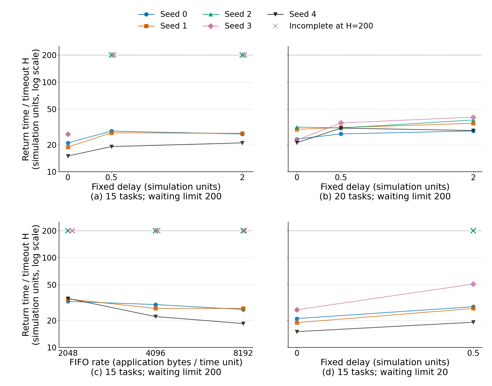

# 因果任务执行与共享服务诊断

2026-10-25启动，2026-10-26收尾，M-006；承接[全面分析](SCALABILITY_COMPREHENSIVE_ANALYSIS.md)的X0–X2。本轮完成真正执行缓存动作的任务闭环、共享应用消息服务、58个有限任务回合及6次固定业务回放。研究推进到可解释任务损失和业务反馈的阶段。

## 本轮研究问题

此前的延迟实验保持原任务轨迹，只比较影子动作。本轮让各节点实际执行由自身缓存选出的动作，检查消息交付改变任务的过程；在同一执行器上增加共享FIFO服务，得到任务、生成负载和排队反馈的第一组测量。

原作者环境与新执行适配分别保留。新执行器用实际到场及能力满足判断开工，区分预约计划、现场事实和远端消息；原权重继续使用。所有通信条件共享这些执行规则。

## 比较范围

- 固定9机器人，15/20任务，seed0–4是已有回归实例，不是新留出集。
- 即时信息、固定交付延迟用于诊断任务对信息的依赖；共享FIFO加入实际应用字节服务预算，两者资源条件分列。
- 单次广播计一次服务费用，各接收者到达分别记录；当前不含MAC竞争、误码或重试，不换算为实机无线容量。
- 先检查即时信息下适配是否成立，再解释延迟和排队下的结果。完整保留失败、超时及未交付需求。

验收口径在运行前固定，见[M-006采纳标准](../../coordination/reviews/M-006-acceptance.md)。发现失败后增加的等待和极小延迟定位已单独登记，未覆盖主矩阵。

## 1. 可运行交付

- [因果执行器](../../simulation/heteromrta_causal.py)和[10项终版因果测试](../../simulation/test_heteromrta_causal.py)：固定原权重、输入布局和原任务实例，独立维护真实位置、现场队伍、工作锁定、每节点缓存及事件议程。任务只能由实际到场且能力满足的队伍开始，远端事实通过实际送达消息获得。所有初态与原复现归档吻合。
- [共享消息服务](../../simulation/message_service.py)、[10项服务测试](../../simulation/test_message_service.py)及[回放入口](../../simulation/service_replay.py)：记录生成、准入、排队、在服、传播、逐接收者交付与拒绝，按截止时刻计实际已服务字节。
- [执行报告](HETEROMRTA_CAUSAL_EXECUTOR.md)、[服务报告](MESSAGE_SERVICE_DIAGNOSTIC.md)、[独立审查](../../coordination/reviews/C-006.md)。C不调用研究执行器，直接从既存事件重建58回合的6030次决策、11091条消息和750次现场开工；缓存、完整观测、mask、分支、物理到场和服务记账均核对一致。

新执行器是共同的因果适配。原环境的未来预约、全局唤醒和回溯出发保留在原复现入口；新入口采用静态任务catalog、同钟及现场任务可观察假设，空闲节点有统一1单位重试计时。当前使用完整自身状态快照与现场任务事件，没有增加感知大正文或重训练。

## 2. 主矩阵：同一任务策略实际执行自己的动作

等待上限为原值200，观察上限H=200。下表每行5个实例；时间为作者模拟单位。成功要求全部任务完成且9个机器人实际回站。失败回合的时间分数记H，用于全回合描述；它不是失败任务的实际完成时间。

| 任务数 | 信息/服务条件 | 成功 | 平均完成比例 | 成功回合返回时间均值 | 含失败H截断均值 |
|---:|---|---:|---:|---:|---:|
| 15 | instant | 5/5 | 1.00 | 21.53 | 21.53 |
| 15 | 固定延迟0.5 | 3/5 | 0.60 | 24.89 | 94.93 |
| 15 | 固定延迟2 | 3/5 | 0.60 | 24.72 | 94.83 |
| 15 | FIFO 2048 | 3/5 | 0.60 | 34.10 | 100.46 |
| 15 | FIFO 4096 | 3/5 | 0.60 | 26.42 | 95.85 |
| 15 | FIFO 8192 | 3/5 | 0.60 | 24.02 | 94.41 |
| 20 | instant | 5/5 | 1.00 | 25.58 | 25.58 |
| 20 | 固定延迟0.5 | 5/5 | 1.00 | 30.79 | 30.79 |
| 20 | 固定延迟2 | 5/5 | 1.00 | 34.09 | 34.09 |

FIFO单位为应用字节/模拟时间，共同容量65536字节；所有主回合均无容量拒绝。15任务的两个失败种子在主正延迟/FIFO条件中均零完成。20任务的全部条件完成，部分单实例对延迟的响应也不单调。因此当前结果首先解释具体任务关系与执行机制，不以任务数量直接排序难度。

图展示45个主回合和10个后加等待敏感性回合；叉号是到H未完成，纵轴明确使用对数刻度。[完整图注](../../simulation/results/2026-10-25-E1-004-causal/figures/caption.md)、[55行源数据](../../simulation/results/2026-10-25-E1-004-causal/figures/source_data.csv)、[矢量PDF](../../simulation/results/2026-10-25-E1-004-causal/figures/figure.pdf)均保存。

## 3. 第一种损失：并发分派与恢复规则

15任务seed2的正延迟回合，t=0时机器人0–2同时选择任务12，3–8选择任务8。前一队缺少任务所需的第三种能力，后一队缺少第二种能力。约3.04–3.82时全部到场等待，最早重新决策在203.04以后，超过H。27条广播、216份接收副本全部交付，现场仍不能开工。

instant在同一t=0逐节点决策，并在下一节点决策前立即共享上一节点的新意图；正延迟则让9个节点先完成各自初始选择。这一离散差异用两例delay=0.000001进一步定位：seed2/3仍零完成，且初始9个动作与较大延迟相同。高FIFO速率仍失败，不能据此识别容量阈值。

随后采用全部5种子的共同等待上限20敏感性。instant仍5/5成功且轨迹不变；delay0.5由3/5提高到4/5，seed3恢复，返回时间50.81。全5回合H截断时间均值从94.93降至65.09。剩余seed2出现81次等待超时、90次派遣，在两个不完整队伍间重复往返；351条消息全部交付。短等待提供了恢复机会，但没有完全解除确定性节点间的同步重复分派。

**该证据要求下一组基础对照具有明确的并发冲突处理和恢复规则。** 错相启动、随机/确定性退避、预约撤销与有界重试都应先以共同、可计费的机制建立。之后再评价任务价值更新和发送算法。零延迟理想参照仍适合归因，不能代替可部署的通信对手。

## 4. 第二种损失：排队改变行动，行动再改变负载

E2固定回放采用首个pilot的141条消息、42674字节，共同目录和H不变。FIFO 2048/4096/8192的已交付延迟p95为3.2555/0.5631/0.2235，显示平均负载附近的突发排队。H恰好包含最后生成时刻，尾部未交付按截尾保留，不自动判定任务失败。

闭环中消息目录不再固定。以三档FIFO均成功的同一组seed0/1/4定位行为链：2048与8192下的平均返回时间分别为34.10和24.02，平均发布应用字节为103553和60311。逐实例对照为：

| 种子 | 发布字节：2048 / 8192 | 到达已开工或完成任务的次数：2048 / 8192 |
|---:|---:|---:|
| 0 | 109387 / 60598 | 58 / 14 |
| 1 | 93093 / 61512 | 44 / 10 |
| 4 | 108180 / 58822 | 62 / 14 |

这些是同实例、同一任务策略改变实际行动后的测量。较慢服务对应更多晚到访问及状态/现场消息，给出了“服务→行动→新增负载”的初步证据。该三实例分析用于解释机制；总体成败仍以上表全部5个实例为分母。降低无效重复访问与维护流量、在到达时重新评价状态消息，是接下来可检验的改善方向。

## 5. 下一阶段的优先级

1. 在共同执行器中建立合理的分布式分派与恢复基础：错相/退避、等待期间的本地重评估、必要预约/撤销事件；所有远端确认与维护费用进入同一服务队列。
2. 固定该基础后，比较周期、事件触发、完整快照latest-state、FIFO/EDF及合理限速。检查何种信息迟达造成了重复行动，以及简单机制之后还剩多少可改善损失。
3. 再接MOCHA同步事件与任务价值调度，最后扩到节点数、依赖度和动态强度，以及L2竞争无线。先解决小规模对照的因果和恢复条件，能使后续扩展曲线具有解释力。

当前成果把研究从影子动作诊断推进到实际任务闭环，并识别两种机制。本轮尚未比较AVUS或给出扩展性边界；下一步创新判断将依据共同强对照之后的剩余损失。

## 6. 证据保存

[任务执行归档](../../simulation/results/2026-10-25-E1-004-causal/README.md)保存58回合及全部失败，[服务归档](../../simulation/results/2026-10-25-E2-005-service/README.md)保存测试和6次回放。共750份原始证据按原始/存储/解压三方hash校验，既有445份代码、数据与历史结果继续保留。绘图只读归档，不运行新策略。执行进程全部结束；独立验收与Git交付状态见[当前摘要](../../coordination/CURRENT.md)。
