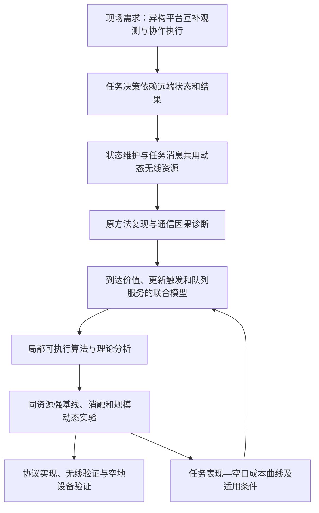

# 动态具身集群的协作状态更新与消息调度：科研与实验链条

2026-10-25；首版方案 V0.1（保留）。当前主线和优先级由[动态网络可扩展性全面分析 V0.2](SCALABILITY_COMPREHENSIVE_ANALYSIS.md)更新：把规模—负载—实际服务—任务反馈及达标运行域作为中心，本文件继续提供详细实施基础。应用入口为救灾空地协作，研究主体为去中心化无线网络。本文件记录首版模型、算法和实验设计；其“下一步”按V0.2及最新实测报告执行，已有实验事实以原始归档为准。

**建议主线：根据消息预计到达时的决策价值，联合决定协作状态何时更新、状态与任务消息如何排队，并用实际服务反馈调整发送负载。** 目标是在相同无线资源下改善任务完成表现，或以更少空口成本达到相同任务表现，进而扩大可支持的团队规模。

已有任务价值通信、事件触发、机会同步和资源调度都提供可用起点。我们要形成的贡献是一个可计算、可分布执行、能在共享无线介质中取得更好性能—成本折中的具体机制。当前最值得深入的是更新与服务之间的耦合；传播对象选择、互补观测、多跳及MAC/PHY优化按实验发现逐步展开。

配套文件：[最新文献与研究位置](framework_20261025/LITERATURE_FRONTIER.md)、[模型与算法推导](framework_20261025/MODEL_ALGORITHM.md)、[数据与实验设计](framework_20261025/EXPERIMENT_DESIGN.md)。这三份文件保存详细来源和推导，本文负责串起研究论证和实施顺序。

## 1. 研究链条与核心判断



**动机成立的基础。** 空地平台确有互补信息需求，野外通信确有间歇性，自治节点需要用有限信息维持协作。增加设备能够增加感知与执行能力，也会增加状态变化、协商和并行信息请求。研究要量化这两方面怎样共同影响任务性能，而不是先假定某个节点数量一定发生拥塞。

**核心思想。** 一条更新是否值得产生，取决于它何时可能送达、送达后会影响谁的什么决策，以及为它让出的空口本来能够交付什么消息。更新触发影响队列，队列又影响更新到达时的价值；把这两项控制放进同一反馈过程，有明确的建模与优化意义。

**实施基础。** 本机已经跑通HeteroMRTA原权重与作者Greedy，得到可重复的小实例；MOCHA/AutoCast关键组件和通信接口已定位。第一步可在现有任务执行器外加入消息缓存和无线服务，不需要先训练新的任务模型，也不需要先完成大型实地测试。

## 2. 背景要由哪些事实和需求支撑

### 2.1 有来源的任务链

DRZ的实际灾后部署中，无人机为地面机器人提供外部视角，钢筋混凝土环境中的Wi-Fi中断影响点云等辅助功能；文中估计该次建筑内作业约70%的时间具有足够质量的Wi-Fi。这提供了“观测—传输—判断—行动”的具体需求及链路障碍。[DRZ原文§IV-C](https://arxiv.org/html/2212.09354v1)

语言驱动空地协作系统已经将紧凑语义地图、任务请求和MOCHA机会通信接入实际导航。它表明自主任务可以依赖跨平台信息，同时表明有效协作可以采用紧凑表示。[Air-Ground Collaboration，§3–5](https://arxiv.org/html/2505.09108v1)

本项目据此采用两层任务：先用异构组队任务研究协作状态；再用有实际消费动作的观测请求与结果研究状态流和数据流竞争。救灾应用最终承接“无人机发现/观察目标—地面机器人核查—结果改变后续部署”的闭环。原现场部署中有人类操作员参与，将接收端替换为自主策略属于我们的实验设计。

### 2.2 背景证据与下一步测量对应

| 需要说明的事实或需求 | 当前依据 | 本项目需要补充的测量 | 支撑哪一部分论证 |
|---|---|---|---|
| 远端信息会影响实际行动 | DRZ外部视角、空地语义地图；HeteroMRTA组队能力约束 | 每类远端字段的消费者、读取时刻、改变的动作 | 为什么要维持协作状态 |
| 状态更新与任务结果分享无线资源 | 拟采用同一无线接口；已有协议提供实现起点 | 序列化字节、发送次数、重传、忙时、队列等待 | 为什么需要联合分配资源 |
| 状态价值随任务进展而改变 | 组队/任务完成/改派改变决策依据 | 生成、送达、消费时刻；版本与任务epoch；送达时的决策影响 | 为什么仅看生成时价值或年龄可能不够 |
| 团队扩展增加什么负担 | 更多状态源与协作关系；具体增长率由工作负载决定 | 每节点订阅度、每任务消息数、控制空口、并发请求、局部竞争度 | 扩展性矛盾发生在哪里 |
| 动态环境要求在线适应 | 移动接触、任务变化及断连恢复 | 状态事件率、链路切换、可达窗口、恢复积压 | 如何设计反馈速度与适应实验 |
| 合理已有方案之后仍有改善空间 | 周期/事件触发、MOCHA、价值调度等可作强对照 | 同资源、同信息、同调参预算下的任务—成本曲线 | 为什么具体机制值得提出 |

首轮最有信息量的测量是**序列化后的实际业务负载、消费时状态差异、消息等待位置和任务后果**。这些量能决定问题主要来自状态过时、队列竞争还是接触缺失，并据此安排后续投入。小消息、稀疏关系和轻负载同样纳入，形成完整工作区间。

## 3. 当前论文进展与我们的研究位置

最新来源核查以2026-10-25为时间点，具体版本、全文读取范围和链接见[文献记录](framework_20261025/LITERATURE_FRONTIER.md)。以下按与核心问题的关系组织。

| 研究路线 | 已有能力 | 本项目最有价值的进一步比较 |
|---|---|---|
| MOCHA、ACHORD | 机会接触、版本/主题同步、分类传输和速率控制等机器人通信机制 | 同步交换实际占用的空口、数据等待、断连恢复以及规模变化下的任务表现 |
| AutoCast、C-MASS | 接收者相关性、对象价值/大小、互补信息选择和动态资源处理 | 形成调度依据的消息也经受限网络；多个接收者/发送者的实际服务与预测是否一致 |
| CoSMO、Co-Scheduling/MGF | 决策目标驱动更新、缓存状态、计算通信联合优化 | 更新后进入队列的时间价值、固定共享无线资源下的扩展及可实现的局部控制 |
| [AC-DMTA](https://www.mdpi.com/2504-446x/10/7/523)、[CommHG v1](https://arxiv.org/html/2609.32935v1)等2026任务协作方法 | 前者按分配稳定性触发交换；后者已有接收缓存、查询/遥测与回复/控制资源竞争，并联合学习任务与通信 | 在已有耦合模型上比较到达时价值、联合队列服务、低开销估计与跨负载泛化；保留其原任务结果和机制适配两条记录 |
| Planned synchronization、信息请求型POMDP | 获取信息、执行与协调计划具有代价；通过规划权衡信息与行动 | 把抽象获取代价展开为消息生成、排队、部分交付和共享空口；用低开销在线近似执行 |
| ARMA/CORA | 应用、无线接入与计算服务之间动态协调 | 借鉴阶段预算和反馈接口；本项目先验证邻居信息不完备下的分布式版本 |

例如，Planned synchronization已显式区分执行、观测和重新协商计划三种成本，并提供Bellman形式的求解。由此出发，我们可以研究这些成本如何随实际无线竞争改变，以及在线算法如何使用滞后的局部信息。[正式全文§3.2–3.3、§4.3.1](https://link.springer.com/article/10.1007/s10514-025-10225-4)

CommHG使比较进一步具体：其模型已经包含受限资源下的信息获取与任务执行。因此，第一版算法需要直接检验可解释的联合控制能否在同条件下改善任务—成本折中、训练依赖或计算开销。CommHG原生学习任务与冻结HeteroMRTA策略的机制适配分别报告，任务策略本身的变化单独控制。[CommHG §III–V](https://arxiv.org/html/2609.32935v1)

研究位置可概括为：**在已有决策价值更新与任务感知发送机制之上，研究可获得的局部状态、预计交付时间和共享无线服务共同决定的更新—发送策略。** 相同问题下更优的解、较低计算/控制开销、更可靠的理论结论和更好的动态适应性，都可以构成主要贡献。

## 4. 拟回答的问题与贡献候选

| 研究问题 | 主假设 | 拟议改善 | 必须对应的实验或理论 |
|---|---|---|---|
| RQ1：在什么条件下，独立设置更新频率和发送规则会损失任务性能？ | 生成时有用的更新可能排队到失效；过量维护又推迟必要结果 | 建立状态变化—队列—消费动作的因果测量与联合模型 | 更新周期×负载×动态强度曲面；延迟/空口诊断；逐事件任务追踪 |
| RQ2：怎样用局部可得信息控制这一耦合？ | 预计到达时的决策影响和本地服务反馈能够指导更新与排序 | 同一价值/成本准则用于更新接纳、队列重排与发送负载反馈 | 与强触发/强调度对照；更新-only、调度-only、固定反馈及联合消融 |
| RQ3：改善是否能随团队规模保持？ | 抑制低到达价值维护、优先及时可用信息，可推迟任务性能退化 | 控制信息与计算开销随局部相关关系增长；适应竞争和接触变化 | 固定资源规模曲线、断连恢复、外部分布、局部估计误差与复杂度 |

建议论文形成三个相互支撑的贡献：

1. **模型与解释结果：** 给出任务依赖、局部知识和共享服务统一的网络模型，量化更新与交付耦合对协作扩展的影响；导出可计算的触发/服务准则或性能界。
2. **算法与协议：** 实现根据到达价值联合控制更新和发送的分布式机制，说明它需要哪些消息、多少计算、如何根据实际服务修正预测。
3. **实验与系统：** 在原任务、统一机制适配和救灾工作流中，提供任务—空口成本曲线、扩展性和机制消融，并用协议/设备实验验证实现代价。

主贡献集中在第2项，第1项解释和支撑设计，第3项检验效果。初期优先实现可解释的规则与优化方法；若价值预测成为瓶颈，再学习该估计器，并保持相同发送与资源接口进行比较。

### 可实施点与可拓展点

| 层次 | 现在能做的内容 | 后续扩展及触发它的实验发现 |
|---|---|---|
| 协作状态 | HeteroMRTA任务/能力/位置/执行状态序列化；冻结策略；送达缓存 | 状态变化高维且规则估计误差大时，引入学习式价值预测 |
| 更新与队列 | 周期、错峰、事件触发、latest-state、分类限速；联合更新/排序 | 消息成组才有用时加入互补集合调度，参考C-MASS |
| 无线服务 | 单冲突域时隙模型→统一MAC执行器，记录实际服务 | 主要损失来自冲突时，研究MAC接入/预留；来自速率适配时，再研究PHY |
| 接触和路由 | 固定传播集合、共同路由与移动规则 | 有效信息主要被路径/失联限制时，加入多跳、机会转发或接触安排 |
| 真实应用 | 文献支持的观测请求—结果—行动；来源清晰的地图/传感数据 | 关键机制稳定后用现有无人机/机器狗进行小规模验证与参数校准 |

## 5. 初步理论模型

### 5.1 世界状态、局部知识与任务策略

设节点集合为 $V$，时隙长度为 $\Delta t$。$G_t$描述可通信链路，$H_t$描述干扰关系，$D_t$描述当前任务的信息依赖。物理状态 $X_t$包含机器人位置、能力、任务执行及环境状态，由仿真器演化；节点只读取本地观测 $o_i(t)$和已送达消息形成的知识 $\mathcal I_i(t)$。

固定任务策略：

$$
a_i(t)=\pi_i^{\mathrm{task}}\big(o_i(t),\mathcal I_i(t)\big),\qquad
M_i(t)=\operatorname{mask}\big(o_i(t),\mathcal I_i(t)\big).
$$

任务说明、能力目录等开局共同知识单独列入初始化契约；后续远端执行状态通过消息到达更新。物理环境按真实能力、位置和任务状态执行动作，策略的远端观测与mask采用其可得信息。过时信息造成的无效请求、等待和重复投入进入日志及任务结果。接入还须检查Worker中`feasible_assignment/no_choice`等直接读全局状态的控制分支，以及环境拒绝/完成反馈的可见时刻。

网络几何单独维护：原`agent_step`在派遣时就把`location`设为目的地，原字段继续保留其调度语义；无线位置由出发点、出发时刻、路径、速度和到达时刻重建。还要检查原环境按上一任务结束时刻计算出发的规则。原条件等价回归保留原规则；若受限信息运行需要改变执行时间以保证因果性，则独立记录为任务适配，并由全部网络方法及即时信息参照共同使用。后收到的信息不能决定已经发生的移动。

每条消息记录源、固定接收集合、任务/主题键、版本、生成时刻、序列化长度及生命周期。可覆盖状态保留最新版本；请求、承诺、完成事件按各自交付语义处理。首轮不同时改变任务策略和传播对象集合，便于定位更新与发送的作用。

### 5.2 生成、排队、发送与接收

每个节点决策微步依次处理到期交付、更新本地知识并作该节点的任务决策、标记本地状态变化、合并/接纳待发候选，再提交网络服务。新快照可以参与本次提交，传输完成后的消息在交付时才影响接收者。已交给传输层的包按在途状态处理。

HeteroMRTA在同一仿真时刻仍有逐机器人执行次序。E0保留原`release_agents`顺序和随机流：每次`agent_step`后，把零延迟诊断更新排空到缓存，再处理同一时刻的下一机器人。正延迟运行按未来交付时间推进，下一机器人只能看到此时已到达的信息。下面的时隙方程用于理论分析与离散服务近似；执行器使用上述事件顺序，不把同一时刻的机器人改成同时决策。

用 $k\in\{c,d\}$表示协作维护与任务消息，字节队列满足

$$
Q_i^{k,+}(t)=Q_i^k(t)+A_i^k(t)-R_i^k(t),\qquad
Q_i^k(t+1)=Q_i^{k,+}(t)-\mu_i^k(t).
$$

$A$包含本地接纳与转入字节，$\mu$为按该消息交付语义成功出队的字节，$R$为服务前版本替换或明确取消移除的字节；$0\leq R\leq Q+A$，$0\leq\mu\leq Q^+$。这里$Q$包含未确认在途记录，$R$仅作用于可取消的待发部分，调度器不会再次选择尚未到重试时刻的在途包。尝试发送、重传和ACK均产生空口成本，成功出队量与发送成本分别记录。

单冲突域的初步无冲突服务约束为

$$
\sum_{m\in S_t}\tau_m(t)+\tau_{\mathrm{idle}}(t)\leq\Delta t,
$$

其中 $\tau_m$包括所选模型内的帧头、传输与确认时间。引入实际MAC后，服务集合由MAC和信道事件产生；源端只能控制提交负载和顺序，预算请求不直接变成可用空口。多冲突域用可并发链路集合扩展。广播的发送成本计一次，接收价值按实际受益接收者计算。

### 5.3 主目标与算法代理

设 $T$为全部任务完成并按原任务要求返回的时间，未完成时 $T=\infty$；$H$为固定评价时限，$T_H=\min(T,H)$。一个可用的研究目标是

$$
\min_{\pi^{\mathrm{net}}}\mathbb E[T_H],\qquad
\Pr(T\leq H)\geq1-\varepsilon,
$$

同时满足实际无线服务约束和给定空口预算。通过扫描资源预算得到任务表现—成本曲线。完成比例、失败原因和原始成功makespan分别报告；$T_H$是限制时间内完成表现的统计量，不能改名为原论文makespan。

直接求解整个部分可观测任务网络代价较高。可实施算法采用消息到达价值近似：对消息 $m$及接收者 $j$，估计其在预测交付时刻 $t+\widehat d_m$被消费后减少的任务代价 $\widehat v_{mj}$，并结合交付概率 $\widehat p_{mj}$和预计空口 $\widehat\tau_m$排序。所有估计输入来自本地状态、已送达需求/版本摘要、历史交付反馈及冻结的估计模型。精确任务价值用于定义研究目标和离线诊断，在线估计器的误差单独评价。

在尚无可靠任务代价估计器时，第一版使用经过开发集校准的决策影响分数，名称与单位明确保留为代理分数；实验检验它是否改善主指标。请求/结果在实际任务等待链中的位置、状态变化是否影响候选集合、预计送达时是否仍需该信息，是三个可实现的输入。

## 6. 算法设计与理论推进

### 6.1 主算法雏形：在提交机会联合选择更新与发送

状态发生变化时，先将对应主题标为待更新，不立即产生一串等待发送的快照。每个提交机会比较四类动作：发送已有快照；生成当前快照并提交；发送任务请求/结果；暂缓提交。已在途的包继续按原协议处理。该设计把“现在更新什么”和“现在把服务交给谁”合并为一次选择，预计排队越长，越应检查更新到达后是否还有用途。

对候选动作 $a$，使用同一效用尺度计算

$$
\widehat S_i(a)=\widehat V_i^{\mathrm{arrival}}(a)
-\lambda_i\widehat\tau_i(a)-\kappa_i C_i^{\mathrm{gen}}(a).
$$

$\widehat V^{\mathrm{arrival}}$为考虑交付概率及接收者已有信息后的到达价值；$\widehat\tau$为预计空口，$C^{\mathrm{gen}}$为生成/编码成本，$\lambda,\kappa$将资源成本转换到同一评分尺度。第一版逐次提交，在可执行候选中取最高正分动作，等待动作评分为零；有多个可并发提交机会时再解相应预算选择问题。维护必要事件的最低服务与重试规则，避免低评分使可靠任务消息长期停留。

这是一项在线近似决策。它的作用是把有限空口的机会成本反馈到更新动作，最终优劣由任务指标评价；不同消息大小、服务预测误差及可靠性要求进入比较和消融。

| 算法所需量 | 从哪里获得 | 第一版实现 |
|---|---|---|
| 本地状态变化、任务等待与生成成本 | 本地任务执行器和计时 | 按主题记录dirty标志、状态键、生成时间和成本 |
| 接收者需求、已知版本与用途 | 已送达的请求/兴趣摘要、ACK或原协议版本交换 | 维护接收者知识估计，未收到反馈则保留不确定性 |
| 预计交付等待和空口 | 本地队列、传输提交/完成、ACK和无线可得统计 | 分消息类的平滑估计；变化时缩短反馈窗口 |
| 更新对决策的影响 | 已知需求与本地状态；开发集训练/标定的估计器 | 先用任务候选变化、等待链和需求有效窗口评分 |
| 本地资源价格 | 实际发送负载相对本地目标预算的偏差 | 慢时间尺度更新，避免每个状态事件同时突发推送 |

接收者摘要本身也要发送和计费，可与既有请求/ACK合并。没有足够信息时采用年龄/变化量等基础规则，并在实验中记录回退比例。局部价格用于调节业务提交，实际共享介质由MAC执行；各节点的价格不会自动产生全局无冲突时隙表。

```text
交付事件：更新本地缓存、需求/版本估计与传输统计
任务事件：执行当前可得信息下的任务策略；更新dirty主题和必要事件队列
提交机会：
    枚举已有状态、新快照、任务消息及等待
    估计预计交付时刻、接收价值、空口和生成成本
    在预算、生命周期和最低服务规则下选择候选
    仅为选中的新快照编码；提交后标记在途
传输反馈：记录真实空口与结果；修正服务估计和本地价格
```

候选数为 $K_i$、每条消息相关接收者不超过 $d_i$时，逐候选评分成本约为 $O(K_i d_i C_V)$，其中 $C_V$是一次价值估计的计算成本；选择一个动作再需 $O(K_i)$。估计器成本、缓存维护和控制字节均实测。第一版固定接收集合，后续可用稀疏订阅和候选裁剪降低开销。

### 6.2 怎样形成算法创新

三个部件应分别可检验：

1. **面向预计到达的更新。** 比较生成时评分、仅按年龄触发和按预计交付时刻评分，观察有用更新比例、任务等待及估计开销。可研究低开销估计如何逼近更昂贵的任务价值评估。
2. **更新与发送共同选择。** 把刷新快照看作会占用服务的候选动作，与已排队任务消息比较。研究在有版本替换、可靠事件和不同长度消息时，怎样求得更好的在线决策。
3. **实际服务反馈。** 用交付与竞争反馈修正更新强度和本地负载，比较固定阈值、固定价格和自适应反馈在负载变化、规模增长及恢复接触时的表现。

在相同任务与资源条件下，这些部件可以改善性能、控制开销或求解复杂度；理论可以解释何时值得刷新、延迟预测误差怎样影响选择，以及反馈能否维持可用的服务状态。主方法先围绕上述部件形成完整机制，再扩展互补对象集合、传播对象和跨层动作。

### 6.3 理论工作的先后顺序

**第一步：小模型精确解。** 建立一个发送节点、少量接收者、状态与任务消息两类业务的有限时域模型。保留状态变化、接收缓存、反馈延迟、不同发送时间和任务等待，枚举动作或用动态规划求精确策略。让精确策略使用与在线方法相同的信息历史；再单独计算全知参考，用于区分信息限制和求解近似。输出随状态变化率、任务等待和服务速度变化的策略区域，以及在线方法距精确策略的差距。

**第二步：支持实现的基础引理。** [模型分项](framework_20261025/MODEL_ALGORITHM.md)给出评分误差与单次选择损失、局部预算反馈、动作一致性的初步推导。它们用于约束估计器和实现，属于分析工具。尤其动作一致性需要相同可行动作集合及可用的分数扰动界，不能据缓存年龄就断言远端决策不变。

**第三步：围绕主机制形成理论结果。** 从小模型中寻找可证明的触发/刷新结构，分析队列等待、更新寿命和任务需求怎样移动决策边界；进一步把服务预测误差、反馈延迟与在线近似损失联系起来。对于长期运行，分别研究可靠事件队列的服务条件和可替换状态的有效更新率。有限任务的makespan改善通过闭环实验检验，理论首先给出所研究模型内的决策性质和代价关系。

这样可以让理论回答算法为什么这样设计、何时有用、误差会带来多少损失，同时保持第一版代码可直接实施。

## 7. 数据、任务与复现材料

| 层次 | 采用的来源 | 在本研究中的作用 | 当前状态 |
|---|---|---|---|
| 原始异构任务 | [HeteroMRTA作者代码](https://github.com/marmotlab/HeteroMRTA)、随机实例生成器、公开权重及原测试集入口 | 任务可行性、策略原条件复现；产生自然的协作状态 | 固定提交与权重；20次正常运行已归档，作者原测试集尚未评估 |
| 原始协同感知 | [AutoCast](https://github.com/hangqiu/AutoCast)及其固定AutoCastSim子模块、CARLA场景 | 接收者相关性、对象大小、感知数据竞争与任务后果 | 组件已核查；完整仿真依赖与场景待恢复 |
| 救灾结构与传感数据 | [OSRF SubT](https://github.com/osrf/subt)、[TRADR Amatrice](https://www.tradr-project.eu/resources/datasets/amatrice-datasets/) | 地图/拓扑、异构观察关系、传感内容和负载校准 | 已有固定SubT拓扑历史；详细数据可得性见分项设计 |
| 需求与流程证据 | DRZ、空地语言任务、iHERO等原文及项目材料 | 定义谁需要什么信息、收到后改变什么动作 | 论文/项目证据；不代替本项目网络测量 |
| 网络执行与参数 | 显式受限服务模型、后续ns-3、协议日志及设备测量 | 延迟/竞争因果诊断、无线验证与参数校准 | 先实现统一服务接口；当前没有新无线效果结果 |

数据集由三部分组成：任务实例，外生场景/信道随机流，以及运行中自然产生的消息与动作轨迹。每份记录保存来源版本/许可、初态哈希、配置、随机种子、策略版本、环境版本和完整运行状态。不同方法在同一实例和同一外生随机场上运行；闭环动作改变位置后，链路和消息应重新生成。固定轨迹回放用于服务机制诊断，闭环运行用于任务结论。

公开传感数据适合评价表示、感知和载荷；完整任务性能还需要决策闭环。HeteroMRTA第一层只发送它实际使用的状态，观测数据层由AutoCast原任务和救灾请求流程承载。数据来源、处理步骤、原任务复现与机制适配分别建manifest。

## 8. 指标、对照与实验设计

### 8.1 指标口径

| 层次 | 主指标 | 辅助解释与记录要求 |
|---|---|---|
| 任务 | 全部完成率、完成任务比例、原makespan、失败/超时 | 单独给出 $T_H$；按成功配对比较makespan，并保留全体运行的完成曲线 |
| 网络效率 | 每完成任务的空口成本、同任务表现所需空口预算 | 状态、任务数据、协议帧、重传分项；零完成回合保留总成本和失败，归一化值记未定义 |
| 信息服务 | 必要信息及时消费率、有效交付率、P95/P99交付时延 | 明确消息-接收者或请求分母；未交付数量、过期/覆盖数量同时报告 |
| 扩展性 | 节点数/动态强度—完成率、时间与成本曲线 | 固定资源和资源同比扩展分开；能力满足、任务规模与几何条件单独记录 |
| 机制 | 消费时年龄、版本差异、任务等待、重复投入、反馈收敛 | 决策变化只表示影响，后果通过任务轨迹分析 |
| 可部署性 | 每次决策CPU时间、峰值内存、控制字节、接入反馈开销 | 包括估计器和需求/ACK消息；记录运行硬件及分位数 |

广播空口按发送计，接收效用按接收者计。多跳资源消耗报告逐跳发射时间之和，局部信道忙时另按时间并集统计；这两个量分别衡量资源消耗和竞争度。可靠事件的积压、版本替换、过期丢弃单列，避免把删除消息造成的短队列解释为可靠交付改善。

### 8.2 共同条件与对照

固定任务策略后，比较：调参后的周期/错峰同步＋latest-state＋分类队列/限速；事件/年龄或决策影响触发＋同一服务；MOCHA原机制适配；任务兼容时的AutoCast价值调度；以及拟议联合方法。CoSMO、决策一致性方法和MGF作为第二批有针对性的强对照，C-MASS用于互补信息条件。每个新增基线均写清原算法、适配接口和调参预算。

latest-state对照加入“提交时取最新快照”变体，单独量化延后编码带来的收益；随后比较到达价值评分和联合选择的增量。这样主算法的贡献能落到实际起作用的机制上。

同一任务策略、同一规模的即时信息运行用于归因。HeteroMRTA包含必须组队的任务；该参照保留任务能力约束。作者Greedy保留原行为；另建合理规则变体时，显式定义回站和等待，并独立命名。网络论文的效果比较首先在同一任务策略内完成。

### 8.3 依次开展的实验

| 实验 | 控制变化 | 直接回答的问题 | 输出 |
|---|---|---|---|
| E0 接口等价 | 原入口与零延迟送达缓存 | 接入是否保留原任务语义和决策 | 初态、动作、mask、完成事件与指标逐项核对 |
| E1 信息与成本诊断 | 延迟/免费、即时/计费等2×2诊断，再闭环实际送达 | 信息与计费干预如何改变任务和队列 | 完成曲线、消息事件、干预总效应及交互；人工干预格明确标注 |
| E2 更新—服务折中 | 频率、触发阈值、共享预算和状态变化率 | 是否存在随负载移动的较优更新区间 | 任务性能—空口曲线和响应曲面 |
| E3 方法与消融 | 更新-only、调度-only、联合；生成时/到达时价值；固定/动态反馈 | 收益来自哪个机制及交互 | 主指标配对差、成本和估计开销；负载/动态分层 |
| E4 扩展性 | 节点数、任务量、面积、密度分别控制 | 团队增长时何处退化，方法能改善多少 | 四组规模曲线，局部竞争度和状态关系度解释 |
| E5 动态恢复 | 移动、任务变化、链路断开恢复、节点加入退出 | 控制能否跟随真实变化 | 恢复时间、积压峰值、恢复期间任务损失与控制成本 |
| E6 外部任务与无线验证 | AutoCast原任务、救灾闭环、共同无线执行器 | 任务价值机制与资源计算是否可迁移 | 感知/任务效果、真实队列/重传以及仿真差异 |
| E7 设备验证 | 小规模空地设备或硬件在环 | 消息接口和计算/通信代价能否落地 | 协议日志、端到端时序、CPU/内存、重复任务表现 |

E1先用共同外生需求或固定消息回放，固定延迟过程与计费注入规则，核对四格。即时信息/计费格通过诊断通道提供信息并注入对应无线负载；延迟/免费格施加信息滞后而不占空口。进入任务闭环后，各干预还会改变动作和后续消息，因此报告特定干预的总效应及交互，结合事件证据解释机制。协议排名使用实际送达、实际计费的完整闭环。

E3在固定资源下比较基线、仅更新、仅调度和联合四组。除分别报告改善外，可对 $J=-\mathbb E[T_H]$计算交互量 $J_{\mathrm{joint}}-J_{\mathrm{update}}-J_{\mathrm{schedule}}+J_{\mathrm{base}}$及配对区间，同时检查完成率。该量用于判断联合设计的收益是否超出两个模块各自效果；成本改变时先沿任务—成本曲线匹配，不能把多占资源记为交互收益。

E4先采用与已复现配置兼容的机器人数量；候选为9、18、36、72，每个规模先检查原策略输入支持和即时信息表现。固定总任务量与固定每节点任务量分开；固定区域加密与固定密度扩区域分开。初步用一组标准任务/节点比形成主曲线，再补关键交叉条件，避免早期铺开所有参数组合。动态任务的插入/取消需要支持该语义的执行器，先保留静态任务、移动和状态变化这一层。

固定带宽与功率时，扩区域仍可能增加空间复用和全网总服务量。单冲突域与多冲突域分别报告，后者由共同干扰模型产生可并发集合，并给出每个局部域的竞争度；不能把固定频谱直接等同于固定的全网吞吐上限。

开发、验证、测试实例分离，按任务实例和信道种子配对。先导样本用于估计运行代价、方差与选参；配置冻结后扩大留出样本，报告配对置信区间和效应大小。地图/场景内的多次运行按场景分层，避免把同一轨迹的消息条数当作独立样本量。全部候选与失败结果保留。

## 9. 完整实验产出构思

| 预期论文图表/材料 | 内容 | 支撑的论点 |
|---|---|---|
| 图1 系统与任务信息链 | 本地决策—消息生成—队列/无线—送达缓存—下一动作 | 问题和可控制变量清楚 |
| 图2 基线任务—空口成本曲线 | 周期、事件、MOCHA、价值调度在不同动态下的工作区间 | 已有能力及具体改善空间 |
| 图3 状态与服务耦合 | 更新频率×负载/动态响应面，配合典型任务时间线 | 为什么需要联合控制 |
| 图4 主结果 | 联合方法与强基线的完成率、原makespan和成本 | 性能—成本改善 |
| 图5 规模曲线 | 四种扩展条件、即时信息参照、局部竞争解释 | 团队扩展时的收益与代价 |
| 图6 消融与估计误差 | 更新/发送、到达价值、反馈、信息估计误差 | 算法收益来源与可实施性 |
| 图7 动态及任务迁移 | 断连恢复、负载变动、AutoCast/救灾任务 | 适应性与跨任务证据 |
| 表1 相关工作与实现接口 | 控制动作、信息来源、成本口径、验证层次 | 研究位置及比较条件 |
| 表2 数据与实验配置 | 来源、版本、任务/网络条件、分割和重复次数 | 可复现性 |
| 表3 系统实现成本 | CPU、内存、控制字节、消息头/反馈和失败率 | 部署代价 |
| 公开材料 | 固定来源清单、配置、运行入口、全体原始结果、事件schema、汇总/绘图脚本 | 每张图可追溯和重建 |

上述是计划中的图表及其应回答的问题，数值和趋势由后续实验填入。首篇工作优先完成E0–E5和至少一种共同无线执行验证；真实救灾任务及设备验证用于增强外部证据，按资源分阶段接入。若主要改善来自更新触发，则深入触发与交付模型；若来自服务竞争，则深入调度与接入；若估计成本吞噬收益，则优先研究低开销估计与反馈。这些结果决定贡献重心。

## 10. 实施顺序和阶段交付

| 阶段 | 立即工作 | 完成时应交付 | 后续依赖 |
|---|---|---|---|
| S0 已有基础 | 保留原策略/Greedy20次正常运行、失败诊断及14项通信组件探针 | [任务评估](HETEROMRTA_REPRODUCTION.md)、[通信组件](NETWORK_BASELINE_RUNTIME.md)、原始归档 | 已完成；提供执行起点 |
| S1 可信通信接口 | 拆分物理真值/本地缓存；检查观测、mask、微步顺序及反馈；分离网络位置与原调度位置 | E0零延迟等价、移动/决策时序核对、实际消息大小及schema、原协议最小运行记录 | 供所有网络方法共用 |
| S2 基线性能与机制 | 周期/错峰、事件、MOCHA适配；统一服务和资源账本 | E1–E2及可定位任务后果的事件轨迹 | 选定主改善机制与参数范围 |
| S3 算法雏形与理论 | 到达价值估计、联合触发/服务、局部反馈；小模型精确参考 | 算法实现、理论推导、E3及强基线比较 | 冻结第一版方法 |
| S4 规模与动态 | 四种规模条件、变化恢复、独立测试集 | E4–E5、置信区间、控制和计算成本 | 判断贡献强度及后续扩展 |
| S5 无线与外部验证 | 原协议/感知任务恢复、ns-3或硬件在环、空地小队 | E6–E7、实现包与可重建图表 | 论文系统证据 |

**下一项实际编码工作是S1。** 先建立可重复的零延迟等价，再跑9机器人15/20任务的延迟与负载小矩阵，同时恢复MOCHA最小同步实例和AutoCast可执行场景。S2结果出来即可迭代模型与算法；理论和实验相互校准。

本次只建立科研与实验设计，没有新增仿真结果。已有运行均采用原条件的即时状态，网络指标仍未测得；当前文档中的方法和改进方向是待实施方案。阶段完成后按任务卡、配置、源码版本、原始输出、解释文档和独立审查共同归档。
