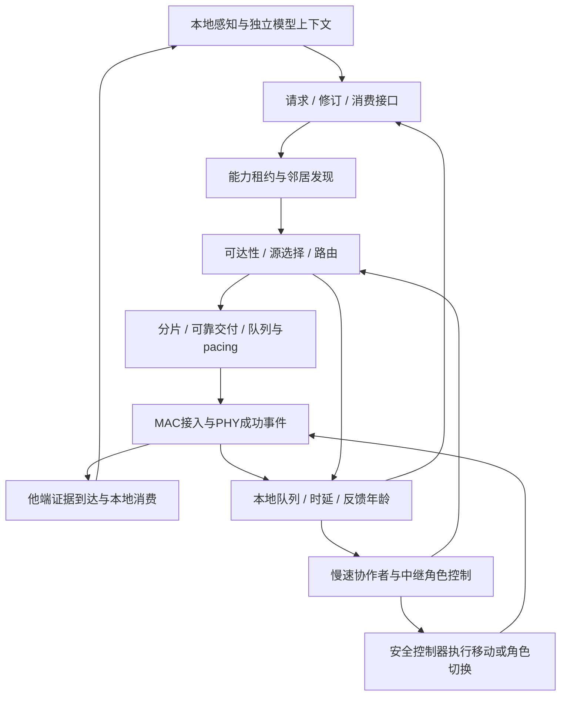

# Scalable and Adaptive Networking for Distributed Embodied Edge Intelligence

面向分布式具身边缘智能的动态可扩展无线网络。研究方向修订，2026-10-27。

本研究以**承载自主模型交互的动态无线网络**为主体：设备各自感知和推理，按需要请求他端证据；移动、失联、多跳竞争和控制面维护影响证据何时可得，模型据此改变后续交互。目标是在明确无线、计算与移动资源下，扩大能够持续提供有效服务的运行范围。近期同时建设真实模型负载和成熟动态网络两条验证链，再依据测得的损失选择主要机制。

本文给出总体问题、模型、三个系统候选和推进顺序。细节分别见[文献与版本核查](reorientation_20261027/LITERATURE_REVIEW.md)、[架构与模型](reorientation_20261027/ARCHITECTURE_AND_MODEL.md)、[验证方案](reorientation_20261027/VALIDATION_PLAN.md)。本轮完成检索、分析与规划；下述新实验均为待执行方案。

## 1. 原路线偏差及其具体原因

此前路线用已有HeteroMRTA策略建立了可执行任务，再加入缓存、维护消息和简化无线服务。这样较快取得了可追踪的消息—状态—行动证据，但实现的便利逐步影响了研究对象和优先级。

| 偏差来源 | 对研究问题的实际影响 | 本次调整 |
|---|---|---|
| 把先取得的任务执行器长期当作主要智能体 | 冻结策略、给定能力和任务结构替代了模型自主生成需求；新增节点主要改变分工 | 用多个真实模型的独立上下文测量请求生成、协作者改变及证据后的终止/追加；旧执行器作传统业务对照 |
| 由已定位的版本缺失继续选择下一问题 | 修复状态同步成为连续主线，发现、路由、分区与多跳竞争长期后置 | 同期建立动态多跳基线；同步与版本恢复作为控制面构件，按测得损失决定其投入 |
| 以任务规模实验承担网络扩展解释 | 9/18/36节点的任务收益与消息增长没有隔离密度、直径、空间复用和计算资源 | 分开无线节点数、模型实例数、区域与负载；评价控制成本、服务范围及失效原因 |
| 简化无线条件已足够支持功能实验，遂沿用到问题选择 | 单竞争域、低平均busy下的局部碰撞与版本差异，被赋予了过强的承载边界含义 | 保留原现象；在成熟PHY/MAC与动态路由中重新测量服务，不预设拥塞已经存在 |
| 宏观相关工作与局部机制比较脱节 | 容易把接口、联合优化或反馈本身当成区别，低估机会网络、机器人Mesh和Agentic MAC的已有能力 | 以具体控制权限、信息、时效、开销和同条件性能建立对照，保留强基线的原有能力 |

[009无线结果](WIRELESS_EXECUTION_STAGE.md)中的平均busy低于0.3%，latest在固定回放中减少约25.5%发射时长，任务完成时间有升有降。这些是对应业务与配置下的有效结论，支持研究维护成本和局部行为影响；它们没有测出大规模容量瓶颈。新的路线从实际模型需求及真实网络竞争出发寻找损失，也允许得到传统机制已经足够的结果。

## 2. 研究定位与五个核心问题

长期系统由无人机、机器狗、手机和工业节点等异构设备组成。设备可运行LLM、VLM、小型多模态模型或专用感知模型，保留自己的观测、上下文和行动能力，通过D2D、多跳、局部弱中心或间歇连接协作。救灾巡检与跨视角观测提供应用入口，具体载荷大小、频率和依赖从模型行为测得。

部署证据采用统一口径：**P1**为多实体设备各自本地推理，**P2**为共享硬件上的独立模型上下文/逻辑实例，**P3**为远端模型API，**P4**为一个模型跨设备切分。近期P2降低行为验证成本，之后用P1验证设备计算和无线执行；两者的结果分别报告。P3、P4可以提供组件对照，但不替代独立端侧模型组网证据。

| 科学与技术问题 | 需要解释的网络现象 | 可测结果 |
|---|---|---|
| Q1 动态形成与服务恢复 | 加入退出、能力变更、移动断链、失效与分区后，发现和可达性如何恢复，业务为何继续或中断 | 发现时间、首条可用路径时间、持续服务恢复、控制开销、服务空窗 |
| Q2 推理与需求共同演化 | 新证据改变协作者、模态、粒度或后续分支时，哪些在途传输仍有用，哪些新请求需要及时服务 | 真实修订/追加/终止率、依赖等待、到达与消费差额、无效传输、外部目标质量 |
| Q3 网络扩展边界 | 加密、扩区域、加长路径、增多模型实例和增大需求怎样分别改变干扰、状态维护和服务 | 达标运行域、尾延迟、控制状态/CPU、空间复用、不同失败原因与边界 |
| Q4 跨层控制与时间尺度 | 推理阶段、排队和路径反馈如何协调请求、传输、接入与慢速拓扑动作 | 同资源下的有效goodput、连续性和开销改善；反馈过时与执行时限敏感性 |
| Q5 最小双向接口 | 哪些能力、依赖及服务状态值得维护，局部信息何时足够 | 每项字段/反馈的获取和传输成本、错误与过时容忍度、去掉该信息后的收益变化 |

统一问题是：**在可达性和推理需求都变化时，如何以有界的控制成本把无线服务提供给仍可影响后续推理的交互，并使这种服务随网络规模扩展。** 接口和双图承担观测、表达及执行作用；贡献由其支持的发现、转发、资源或重构机制及证据建立。

## 3. 先行工作覆盖了什么，还值得改善什么

本次按2024—2026关键词与网络会议/期刊定向检索，保留MOCHA、ACHORD这两项直接系统先例，深读12篇方法或框架资料。版本、部署、规模、控制深度和未读范围均在[文献矩阵](reorientation_20261027/LITERATURE_REVIEW.md)逐项登记。该矩阵是一轮有界核查，不据检索未命中宣称领域空白。

| 直接比较对象 | 已有能力及证据 | 本项目进一步比较的具体范围 |
|---|---|---|
| [MEAN](https://arxiv.org/html/2610.26297v1)、[Joint Agent–Network Design](https://arxiv.org/html/2609.37094v1)、[Agent-Native Wireless](https://arxiv.org/html/2605.15873v1) | 已有具身任务—网络框架、消息/拓扑/资源联合设计和多时间尺度开放接口；Joint包含固定V2I算例 | 在独立模型实际请求和移动多跳下，给出局部可实现控制、付费反馈及服务连续性结果 |
| [AgentComm](https://arxiv.org/html/2604.13558v1)、[AgentComm-Bench](https://arxiv.org/html/2603.20285v1) | 前者使用闭源模型角色、语义编码和PHY保护；后者对4个网格策略Agent做系统损伤测试，所读实现没有LLM推理记录 | 保留合理内容适配，分清逻辑轮次和物理包转发；让需求变化来自实际模型，网络损伤来自执行机制 |
| [HAFS](https://arxiv.org/html/2607.22854v1) | 真端侧llama.cpp、AP/SFU网络、上下文与实时多流协调；已研究应用引导传输 | 对照其合理流控，在多跳与可达性改变时研究双向请求预算；3–9上下文流不解释成3–9台设备 |
| [语言空地协作](https://arxiv.org/html/2505.09108v1)、[MOCHA](https://arxiv.org/html/2309.15975v1) | 真实机器人、紧凑语义图、机会交换、存储携带和通信感知移动；前者依赖GPT-4o API，MOCHA原真机试验采用单跳交换 | 继承小消息与机会协作能力，测真实模型是否需要额外证据，以及多跳/分区时的有效服务成本 |
| [ACHORD](https://arxiv.org/html/2206.02245v1) | 实地多跳MANET、分类可靠交付、流控、网络反馈、回连和自主中继投放；最多6探索机器人，一次场测13无线投放节点 | 同移动、能耗和覆盖预算下，比较推理需求改变后的协作者/中继选择与持续服务 |
| [CoSMO](https://arxiv.org/html/2609.01082v1) | 目标导向更新、异步缓存和卸载闭环；4UE及固定两跳回传的ns-3评价 | 作为效用更新/反馈模块强对照，进一步处理自主多模态请求、动态路径及控制费用 |
| [Agentic MAC](https://arxiv.org/html/2510.10895v1)、[Resilient Semantic MAC](https://arxiv.org/html/2505.21518v1) | 前者有受约束协议生成、BS/UE博弈和资源组控制，评价用户/信道变化与模型开销；后者有蒸馏、协议切换和变化适应 | 在相同控制权限下比较反馈时效、推理成本和快速安全执行；若进入多跳，则另核多竞争域与端侧时限 |

Agentic MAC的主配置为3/4/5UE，扩展图为2–10UE，所读v1使用服务器模型而非逐端实体部署。其TMC出版记录与v1分开引用，本轮没有混用版本数值。Resilient Semantic MAC主要评价2→3UE，控制信道假定无错。两项工作都是直接机制先例，新的方案应具体比较适应成本与服务表现。[文献版本说明](reorientation_20261027/LITERATURE_REVIEW.md)

补充检索发现[AgenticDTN的官方摘要](https://ieeexplore.ieee.org/abstract/document/11726473)报告16节点、双射频802.11s及LLM/数字孪生控制。其完整算法和模型驻留仍待核对，应在选择Mesh智能控制前优先补读。传统基线包括AODV、OLSR、Babel、batman-adv以及BPv7配具体DTN路由；具体版本与平台适配后采用。传统MRTA和固定DAG卸载继续提供辅助工作负载，不再组织核心相关工作。

## 4. 完整系统架构与可执行控制

### 4.1 从本地推理到实际无线交付

| 层次 | 可获得状态 | 可执行动作与典型时间尺度 | 需要核算的代价 |
|---|---|---|---|
| 模型/应用 | 本地观测、已到达证据、上下文、带年龄的服务提示 | 推理完成后生成/改选/追加/终止请求，选择证据粒度或本地降级；按实际推理步发生 | 模型时延、算力/内存、额外调用和感知质量 |
| 控制面 | 已收到的邻居、能力声明、租约、请求修订；失联状态带不确定性 | 事件触发加有限周期维护；有界候选发现、更新合并、epoch隔离 | 发现/租约/撤销报文、维护CPU与状态空间 |
| 网络层 | 局部链路估计、协议路由及已观测路径时延 | 现有路由修复、下一跳/来源切换、短期缓存；约几十ms至秒，具体由栈决定 | 探测、扩散、重传、中断、缓存 |
| 传输/队列 | ACK、RTT、分片进度、队列、剩余预算 | 可靠交付、并发窗口、优先级、pacing、有效撤销；按RTT/队列事件 | 数据及头部、ACK、重试、无效在途字节 |
| MAC | 合法可读的CCA/接入结果、局部竞争及流量队列 | DCF/EDCA入队与优先级；有AP调度权限时控制RU；帧/时隙级由快速协议执行 | 争用、退避、触发/反馈、碰撞及空间复用 |
| PHY | 实测/仿真的链路质量与误包、驱动开放的状态 | 支持的MCS、功率、信道；必须满足无线与驱动权限 | 频谱、能耗、重配置和测量费用 |
| 慢速拓扑 | 本地需求热点、接触历史、角色租约、电量/安全边界 | 秒至几十秒级协作者/中继角色或移动目标调整，安全控制器执行 | 移动能耗、失去的观测覆盖、连通中断与角色同步 |

这是统一的研究架构，各候选只改变其所需控制环。普通Wi-Fi ad-hoc原型首先控制队列与传输；OFDMA在支持的AP域或可控仿真中单独验证，SDR再承担更深的PHY动作。上述时间尺度为设计范围，正式实现使用测得的推理和协议时延。[ns-3 Wi-Fi官方设计](https://www.nsnam.org/docs/models/html/wifi-design.html)

### 4.2 物理图、交互图与依赖

物理机会图为 \(G_P(t)=(V(t),E_P(t))\)：边表示参考帧长、PHY设置及误包阈值下的潜在有向链路。它与共享信道干扰共同决定可同时服务的链路集合；一条边存在不意味着此刻必然交付。在线控制只读取已获得的探测/协议状态，完整图留给离线解释。

模型侧保留三种不同投影：

- \(G_A^{\rm cand}\)：按当前能力与观测可能满足需求的候选来源；发现费用随候选集合维护产生。
- \(G_A^{\rm sel}\)：实际选定来源、已发起而未终结的活动请求。**全文默认交互图 \(G_A\) 指这一投影**，按请求修订保留边的生命期。
- \(G_A^{\rm del}\)：实际交付记录的时间投影，供事后分析；不能把它当在线已知拓扑。

多个证据必须共同满足时用依赖超边或AND组表达，等价视角用替代组表达。这样可以区分“还缺一个必需证据”和“任一候选到达即可停止其他请求”。双图提供这些关系的表达，真正需要评价的是其如何改变发现范围、路径与队列服务。

### 4.3 最小双向接口

每条请求记录源、目标/候选能力、外部目标ID、依赖/替代组、正文对象及分片ID、剩余等待预算、修订号和终态。设备ID配启动epoch，避免重启后旧请求被当作新请求。模型输出`request / revise / cancel / consume`；网络返回带采样时间、年龄与不确定性的`service_hint / reachability / delivery_status`。能力采用有期限的声明，区分“声称支持”和已测可用。

字段从本地推理输出、序列化正文、协议事件和已收到反馈取得；实际编码后的字节与处理时间进入成本。全局时钟同步若必要则单独付费，默认用本地剩余预算并扣除已耗时。收到取消只撤销对应修订和消费者；同一正文还有其他合法消费者时继续服务。消费日志可以本地保存，只有网络使用它时才计入上送费用。详细事件语义见[架构稿§4](reorientation_20261027/ARCHITECTURE_AND_MODEL.md)。

## 5. 初步模型：动态节点、内生需求与共享服务

### 5.1 节点和请求共同演化

节点集合满足

\[
V(t+1)=(V(t)\setminus L(t))\cup J(t),
\]

其中加入、暂时不可达、永久失效分别记录。离线设备的持久队列随设备保留，永久数据损失另入故障账本；仿真中预建节点的激活不冒充任意时刻创建完整协议栈。

设备 \(i\) 在一次真实推理结束后产生

\[
(h'_i,\mathcal R_i^+,\mathcal R_i^{\rm rev},a_i)
\sim\pi_i(h_i,o_i,Y_i^{\rm delivered},\widehat F_i,\xi_i),
\]

分别为上下文、新请求、修订和行动；输入只含本地观测、已交付证据及有年龄的反馈。未到达数据不进入上下文。每台设备受计算、显存/内存和并发预算约束；GPU服务用测得的推理时延与资源占用表示，计算完成前不发布结果。

外部目标强度 \(\lambda_0\) 与策略产生的请求强度 \(\lambda_{\rm req}^{\pi}\) 分开。降低请求数可能来自证据已足，也可能来自拥塞放弃；因此共同报告外部目标质量、拒绝/降级和所有请求终态。

### 5.2 多跳队列、目的端吸收与无线约束

为使收支清楚，采用架构稿修订版的单副本、固定目的端模型，以下量统一换成bit。\(Q_i^k(t)\)是流 \(k\) 在非目的端 \(i\) 的网络队列，\(S_{ij}^k\)是本时隙成功交给下一跳并从发送队列释放的量，\(X_i^k\)是到期/有效撤销/溢出等明确丢弃，\(B_i^k\)是注入网络的新量。非目的端步内新到达下一步可服务：

\[
Q_i^k(t+1)=Q_i^k(t)-\sum_jS_{ij}^k(t)-X_i^k(t)
+\sum_jS_{ji}^k(t)+B_i^k(t),
\]
\[
\sum_jS_{ij}^k(t)+X_i^k(t)\le Q_i^k(t),\quad i\ne d_k.
\]

目的端为吸收边界，\(Q_{d_k}^k=B_{d_k}^k=X_{d_k}^k=S_{d_kj}^k=0\)，成功接纳的唯一数据直接进入累计交付账本：

\[
D_k(t+1)=D_k(t)+\sum_{j\ne d_k}S_{jd_k}^k(t).
\]

本地生成并消费的内容不注入网络。目的端未重组或未消费的数据仍占接收存储；存储无法接纳时不计成功\(S\)，实际发射费照计。对初始交付及累计删除为零的固定类，在含暂离线存储的身份全集上，网络队列余额、累计交付\(D_k\)与累计删除之和，等于初始队列加累计注入。

应用接收缓存另按“交付—实际消费—应用丢弃”记录，因而网络出队、有效到达和消费是不同事件。协议尚未完成ACK确认的副本保留在可靠交付状态中，重试全部计费；单副本守恒按唯一所有权记录。DTN复制、多播、在线改选目的端及共享正文需要显式复制/迁移/合并账本，不能直接套用上述固定类公式。[架构稿§5.3与静态算术核对](reorientation_20261027/ARCHITECTURE_AND_MODEL.md)

服务向量受 \(s(t)\in\mathcal S(H(t),V(t),z(t),\text{radio},\text{MAC})\) 约束，其中\(H\)为信道状态、\(z\)为协议与队列配置，包括半双工、共享信道、载波侦听、合法MCS和误包过程。对链路 \(i\to j\) 的接收SINR可写为

\[
\mathrm{SINR}_{ij}=\frac{P_i g_{ij}}{N_0W+\sum_{u\in\mathcal T\setminus\{i\}}P_u g_{uj}}.
\]

这里\(\mathcal T\)是同信道同时发射节点集合，\(P\)为发射功率、\(g\)为链路增益、\(N_0\)为噪声功率谱密度、\(W\)为带宽。实际成功服务取自仿真或实机事件。DCF/EDCA中的策略动作是可实现的排队、优先级和pacing；集中最优服务只作明确标注的上界。对短期限业务，期限内没有时间可达路径就应计失败；容许等待的业务才转入存储携带模式。

### 5.3 请求守恒与控制成本

每个请求修订保留父请求和外部目标关联，采用互斥结算：

\[
R=R_{\rm useful}+R_{\rm cancel}+R_{\rm expire}+R_{\rm reject}
+R_{\rm fail}+R_{\rm censored}.
\]

先有效消费再取消的请求仍属完成；已付传输费保留。因证据足够、任务转向、拥塞退让和设备失效而终止分别标记。窗口末未终结者列为截尾，主分母保留所有已发起请求，再补接纳请求口径。

控制成本按发现/租约、路由、请求修订、撤销、ACK/探测、角色同步互斥分类；数据报文头部随该报文计一次。逐跳发射和重试均计入bit和airtime，另报维护状态大小、CPU、计算/通信/移动能耗及覆盖损失。全网发射时长之和与各位置的CCA忙时区间并集分别报告，前者可因空间复用超过观察时间。

### 5.4 统一指标及可扩展运行域

主表统一使用**bit/s**，原始byte计数乘8；有效到达与实际消费分别计量：

\[
G_{\rm valid}=\frac{8\sum_{(o,d)}b_{od}\,1\{\text{首次完整、有效且按期到达}\}}{T},\qquad
G_{\rm consumed}=\frac{8\sum_{(o,d)}b_{od}\,1\{\text{首次有效且按期被实际消费}\}}{T}.
\]

\((o,d)\)为唯一正文对象—目标对，\(b_{od}\)单位byte，共享该对象的多个请求不重复计量。部分消费单列，不与整对象完成重复相加。按期消费的预算须在应用合同中冻结；增大编码正文会改变goodput，因此同时报告正确性、任务质量与字节—质量关系。

| 指标 | 主口径 |
|---|---|
| 吞吐与多跳交付 | 逐跳wire吞吐、端到端去重payload吞吐及多跳请求交付率分别计；广播目标对口径注明 |
| 时延 | 生成后完整到达、到达后消费、生成前模型计算分别计；成功子集p95/p99配全部请求的超期/失败/截尾 |
| 网络重构 | 事件→发现检测；事件→首条可用路径；事件→持续业务恢复分别计，队列排空另列 |
| 持续恢复与连续性 | 建议连续3个1Hz探测均满足成功/时延阈值后确认持续恢复；探测付费，60秒仍未恢复记截尾；空闲时段不自动算服务成功 |
| 控制和无线效率 | 控制bit/s、airtime、状态/CPU；有效goodput除以实际使用的不同频谱Hz，另报单位面积和局部busy；RU时长与PPDU时长分开 |
| 应用服务 | 固定外部目标集的成功率/证据正确性、降级/拒绝、等待和每成功目标资源；模型自评只作辅助 |

扩展配置写作

\[
\omega=(N,N_A,A,\rho,D_P,\bar h,\nu_V,\nu_E,
\lambda_0,\text{模态/尺寸},\text{计算与无线资源}),\qquad\rho=N/A.
\]

其中\(N\)为无线节点数、\(N_A\)为实际模型端点/实例数、\(A\)为区域面积；\(D_P\)为连通分量内直径分布，另报分区比例；\(\bar h\)分别报告已选路径与成功路径，\(\nu_V\)和\(\nu_E\)为节点加入退出及归一化链路变化速率。密度、直径和跳数存在联系，实验通过区域/部署/移动配置改变它们，并记录实际取值。

对给定观察窗和策略，定义满足及时率、尾延迟、控制预算、服务空窗、外部目标质量及拒绝上限的经验服务域 \(\mathcal F_{\pi,T}\)。阈值由应用与资源合同预先冻结，报告失败原因、队列趋势及不确定性。固定面积加密和固定密度扩区域各自求测试域，非单调时保留域的各分量。有限缓冲和TTL删除导致队列有界，不等同于稳定可服务；长期稳定域或容量定理需另设外生到达和拓扑过程假设。

## 6. 三个可以落地比较的系统候选

三个候选共享局部测量和请求生命周期，分别针对不同损失。近期用A/B验证链决定候选一或二的主投入；候选三依赖移动/中继执行证据。完整系统可以包含多个机制，但先通过消融确定各环节是否提供净收益。

### 6.1 候选一：需求修订下的发现—路径—传输联合服务

**实际需求与损失。** 模型请求另一视角，随后收到替代证据、改变来源或结束该分支；旧正文仍占转发队列，新来源尚未发现，路由修好时请求也可能已无效。单独修路和单独清理应用请求之间的等待与信息失配，是要测量的损失。

**具体机制。** 为请求修订维护有界候选集与剩余预算，联合比较请求到达、远端计算及响应返回的保守服务估计；未知状态保留普通可靠服务回退。一个修订号贯穿发现租约、已选来源、路径状态和分片队列。替代证据满足后，仅沿已经建立的服务关系传播撤销；共享正文检查其他消费者。断链时以可达性与剩余预算决定局部修复、改选来源或允许存储等待，分别核算控制与已传字节。

**最小可实现增量。** 在普通动态路由和分片可靠交付上新增请求版本表、有限候选能力缓存、剩余服务估计和有界修订传播；先不改PHY/MAC。选择保留数量、租约及反馈周期的规则要固定开发预算，并在测试场景冻结。

**强对照与可能贡献。** AODV/OLSR或Mesh路由加合理能力发现、RPC超时/截止、动态更新、取消及传播、相同分片/重试/pacing构成基本强方案。[gRPC已有deadline](https://grpc.io/docs/guides/deadlines/)和[取消传播机制](https://grpc.io/docs/guides/cancellation/)；[NDN Interest](https://docs.named-data.net/NDN-packet-spec/current/interest.html)已有命名请求、缓存匹配与生命周期控制，InterestLifetime的相对转发语义须按实现处理；分区下另用BPv7配具体DTN路由。增加“相同依赖/替代信息的通用RPC”对照，避免把信息优势当协议优势。MOCHA提供缓存/机会恢复，ACHORD提供可靠交付和流控比较。

值得争取的结果是同信息、同无线预算下，更少的无效逐跳服务、更短的有效依赖等待和更快持续恢复，同时保持外部目标质量。若真实轨迹几乎不修订，或普通取消与依赖RPC已解释全部改善，就报告通用请求服务的适用域，缩减这一候选；修订表的命名不承担贡献。

### 6.2 候选二：服务反馈驱动的请求节奏与传输/接入预算

**实际需求与损失。** 多模型同时追加证据时形成突发、多流互阻或长响应排队。普通传输控制能压低拥塞，但模型仍可能发起很快失去用途的请求；反过来，单纯少发请求也可能降低外部任务质量。要寻找保持目标质量的服务—需求折中。

**具体机制。** 快层用普通队列/RTT控制维持稳定发送节奏，网络按局部可测的路径服务、队列及反馈年龄给出并发和字节预算区间。模型只在下一真实推理阶段选择等待、缩小证据粒度、改选来源或本地降级。预算带租约、保守余量与过时回退，避免慢推理反复追逐毫秒级信道；控制状态只沿现有关系付费维护。

若后续确有AP可控接入域，可把已选请求的剩余预算映射到合法队列/RU资源，快层执行有限动作；PHY的MCS/功率在驱动或仿真允许时独立消融。多跳主实验先使用DCF/EDCA与可执行pacing，按实际竞争检验预算效果。

**强对照与可能贡献。** 普通限速/队列反馈、EDF、合理自适应RPC、固定/自适应并发、HAFS流协调、Joint联合设计、CoSMO效用更新，以及AgentComm的内容适配均保留。进入接入资源控制时，与Agentic MAC的受约束资源动作和Resilient Semantic MAC的协议适应/蒸馏比较；匹配CSI、控制信道误差和模型预算，保留其计算开销。快慢分工已有先例，本候选要检验的是有年龄的多跳服务预算如何改变实际请求并改善达标服务域。

评价固定外部目标与相同推理/无线资源下的有效goodput、尾延迟、质量和拒绝率。另做相同请求字节或相同目标质量的比较：如果收益仅由普通节流或多算几次模型解释，则采用更简单控制；若网络提示无法被真实模型稳定利用，先保留网络侧机制。

### 6.3 候选三：协作者与中继角色的多时间尺度重构

**实际需求与损失。** 能力较强的节点可能跨越分区或因移动即将失联；最短路可恢复连通，却未必能让关键协作在期限内继续。移动设备临时转为中继也会损失感知覆盖和能量。研究对象是有成本的角色分配与连续服务。

**具体机制。** 快层运行成熟路由/局部恢复；慢层根据带年龄的能力可达性、需求热点及队列反馈，在有限候选中设置协作者或中继角色租约，使用驻留时间与滞回避免震荡。设备可提出回连、驻留或移动中继目标，由安全控制器执行；分区时明确哪些请求容许存储携带，哪些应改用本地替代。

**强对照与可能贡献。** ACHORD的流控、网络反馈、回连/自主中继，MOCHA的通信感知移动，Babel/batman-adv的Mesh维护，以及合理连通/队列驱动中继和PRoPHET类DTN构成对照。比较时固定节点、无线、能量和运动预算，将损失的感知覆盖纳入应用质量；AgenticDTN全文应在这一方向立项前补核。Agentic MAC类快层适应可作为兼容模块，不能直接替代多跳重构的强对照。

可能贡献是相同资源下缩短持续服务中断、减少频繁改选/迁移，扩大移动与分区条件下的达标区域。若改善依赖免费未来轨迹、额外中继或未计覆盖损失，先补公平对照；若主要损失来自普通路由，则先解决路由与维护问题。

## 7. 三条相互关联的验证链

### 7.1 A：真实模型如何产生通信负载

第一步使用4个独立上下文的实际模型实例（P2），各自只见本地已释放观测；可采用小VLM与较强模型的异构配置，根目标发起者轮换。模型自主输出结构化请求、响应、补充视角/裁剪、改选、取消和结束；运行器只验证格式与资源约束。记录所有调用、输入/输出token、图片/正文、计算开始结束、发送到达消费及修订理由，不索取隐藏思维链。

候选输入是nuScenes mini的同步多摄像头记录或WILDTRACK多相机记录。它们用于跨视角证据，**同一车辆的多摄像头不等于多机器人空间部署**，静态摄像头也不支持移动行动世界的结论。标注仅供评价，尚未释放的未来帧不进入模型。SmolVLM2-500M-Video-Instruct、Qwen3-VL-2B等只是候选；许可、账户/数据访问、精确模型版本与本机内存/推理能力在准备阶段核实。具体官方入口与限制见[验证稿A](reorientation_20261027/VALIDATION_PLAN.md)。

| 有界开发阶段 | 设计及预算上限 | 能回答的问题 |
|---|---|---|
| A0 可行性 | 2模型×2输入，4次前向，每次最多256输出token | 能否按统一接口完成真实推理，序列化/时延是否可测 |
| A1 行为初查 | 6独立场景块（2开发、4评估）×本地独立/全收集/自主动态/远端不可用4条件，共24回合 | 是否主动请求、改选、追加或终止，以及外部目标质量 |
| A2 证据干预 | 同6块×延迟/缺失两种干预，共12回合，正常条件复用A1 | 在相同前缀下，收到证据是否改变实际后续需求 |

每回合最多12次模型调用、每次256输出token、12张图像/裁剪、600秒，共同视觉token上限在准备阶段冻结。A0–A2合计最多 \(4+36\times12=436\) 次前向，格式修复调用也纳入；这只是候选实验预算，不构成本轮执行授权。至少3个场景块出现证据驱动追加/终止且至少一个出现来源改变，作为继续机制开发的最低功能信号；小样本不估计普遍发生率。若主要行为是固定收集流程，调整任务/输入并保留负结果，不用脚本预写交互DAG充当模型自主需求。

### 7.2 B：动态无线服务与多维扩展

优先采用冻结版本的ns-3 ad-hoc Wi-Fi、真实传播/误包、干扰、ACK/重试及AODV/OLSR基线。3.46是候选版本，官方滚动文档不证明本机安装或该版本的全部功能。原生OLSR是v1，须与文献中的OLSRv2区别；AODV实现的局部修复/L2反馈限制也按所选版本登记。节点预建后激活、移动造成断连、显式接口关闭分别说明其语义。[验证稿B与官方来源](reorientation_20261027/VALIDATION_PLAN.md)

基线先用相同UDP分片/ACK/超时/重试合同，TCP作为单独敏感性实验。802.11s/HWMP、Babel/batman原型、BPv7与The ONE接触模拟分别建立支线；它们与IP ad-hoc、真实PHY、协议规范的证据边界逐项区分。AP域OFDMA是后续有权限的对照，不混入任意D2D网络。

| 阶段 | 变量、配对与数量上限 | 验收重点 |
|---|---|---|
| B1 无线微场景 | 静态3跳、断链改路、干扰/空间复用、分区重连并伴随服务退出4类×2路由×3种子=24次 | 逐跳路径和守恒、实际干扰、路由控制费用、首路恢复与持续服务恢复 |
| B2 无线规模初查 | 无线节点 \(N=8/16/32/64\)；固定面积加密、固定密度扩区域，两族共享N=8基点，共7配置×2路由×3种子=42次 | 密度与直径效应分开，固定业务回放的服务、控制状态与CPU趋势 |
| 后置敏感性 | 移动速度/拓扑变动、负载和模态尺寸、更多模型实例、Mesh/DTN/AP域 | 按前两阶段现象另立有限矩阵，避免无依据扩大组合 |

**B2固定实际模型端点数 \(N_A=4\)，其余节点为无线转发节点。** 因此最多64节点只证明无线规模，不能称为64个模型Agent。后续另设 \(N_A=4/8/16\) 的真实上下文/端点实验，分别固定总算力和固定每端算力；前者揭示计算争用，后者注明总计算资源增长。固定密度扩区域时 \(A=A_0N/8\)，固定面积族保持 \(A_0\)。报告实际连接分量、直径、平均跳数与空间复用，允许部分场景因分区失效。

B1+B2建议上限66次，初查观察窗为20秒预热、120秒观察、10秒排空，末尾未完成业务按截尾处理。低负载也保留，先沿实际来源的需求增长找边界。随后B3移动/负载矩阵等需独立预算确认；并不随本报告自动启动。至少3台实体无线设备、可观察2跳与各自本地模型的P1小原型用于核验关键链路，网络命名空间不能充当多实体证据。

### 7.3 C：可扩展机制与因果归因

固定请求轨迹回放用于隔离网络控制；真实模型闭环用于检验反馈怎样改变后续请求。计算时延驱动的仿真按测得服务时间推进，实机则按墙钟推进，均等待计算和网络完成后再消费。

主要对照为 \(N_0/N_1\)（传统/候选网络）×\(A_0/A_1\)（固定/自适应应用行为）的2×2设计。对同向评价量 \(Y\)，交互项为

\[
\Delta_{NA}=(Y_{11}-Y_{01})-(Y_{10}-Y_{00}).
\]

同时报告四格本身和固定回放结果。它们区分网络控制、自适应行为及其相互作用；非线性指标上的差分是操作性比较。各方法匹配外部目标、模型/调用、视觉token、算力、无线资源和控制信息，开发调参预算对齐；额外模型调用、撤销、探测、租约和角色迁移全部付费。再消融真实/打乱状态、反馈年龄、去掉修订传播、普通限速、相同依赖信息RPC以及各新增控制层。

一个主候选的开发后测试可用4冻结场景块×3网络种子×4格=48回合，每回合12调用，上限576次前向。该小矩阵只验证机制与执行，单独授权后开展，不与A链混成独立统计样本。正式性能主张需更丰富的独立场景/拓扑块；验证稿建议至少30块×3网络种子，按场景分层统计，摄像头和相邻帧不作为独立场景。置信区间、重采样规则及正式规模在新任务前冻结。

## 8. 现有成果在新体系中的五类位置

| 类别 | 当前依据或缺口 | 保留用途与扩展边界 |
|---|---|---|
| 1 已证明的状态维护和任务执行现象 | HeteroMRTA原权重/Greedy、缓存接口、因果执行、MOCHA原协议回环、latest/FIFO及009简化无线均有原记录 | 传统业务、协议语义、版本/重复/恢复回归；逐项沿用原执行条件和统计，不改写为新系统性能 |
| 2 端侧模型自主行为 | 当前冻结HeteroMRTA不提供LLM/VLM动态需求证据 | A链补实际模型、独立上下文、证据消费及请求修订轨迹；P2与P1分列 |
| 3 动态多跳网络 | 既有009单竞争域不足以证明移动多跳、动态发现及分区重连 | B1建立成熟栈和可追踪路径，旧无线只作功能/诊断对照 |
| 4 网络扩展实验 | 9/18/36节点主要是任务规模与业务量；没有上述多维无线边界 | B2分离密度、面积、直径；后续独立增加模型端点与请求负载 |
| 5 跨层净收益 | 既有状态—行动反馈支持某些因果现象，尚未检验三个新系统机制 | C链在强对照、同信息与成本下辨识机制；按失败原因选择进一步控制深度 |

继续保留[旧总体报告](RESEARCH_PROGRESS_AND_PROBLEM_STATEMENT.md)、[研究来源导航](RESEARCH_PROVENANCE_INDEX.md)、[MOCHA运行](MOCHA_RUNTIME_ENTRY.md)、[HeteroMRTA复现](HETEROMRTA_REPRODUCTION.md)、[需求执行](DEMAND_EXECUTION_STAGE.md)和[009无线报告](WIRELESS_EXECUTION_STAGE.md)。历史结果与manifest保持原记录。

停止沿“先把HeteroMRTA同步/恢复做全，再考虑真实模型与动态网络”继续扩张；不为维持同步主线追加大量传统MRTA筛查，也不通过统一放大正文或压低无线资源制造拥塞。选择性同步、关系维护和版本恢复继续作为控制面模块，在新测量确有相应损失时使用。

## 9. 下一阶段优先任务与决策依据

以下任务是建议的研究顺序，具体执行范围与预算以新主任务卡为准。当前唯一计划入口为[NEXT_STEPS](NEXT_STEPS.md)。

| 优先级 | 具体任务与依赖 | 可交付结果及决定 |
|---|---|---|
| P0 准备 | 核模型/数据条款与硬件，固定输入释放、根目标、接口及统计合同；核ns-3版本、路由限制和实际控制权限 | 部署映射、只读来源清单、事件schema及独立A/B有限任务；明确共同视觉token和应用阈值 |
| P1A 真实行为 | A0后开展A1/A2，依赖可用模型和输入；保存所有成功/失败/格式修复调用 | 测到请求尺寸、推理时延、修订/替代依赖、来源变化；判定候选一和二是否有真实负载基础 |
| P1B 动态服务 | 与A链并行准备B1，再用真实轨迹做B2；普通有限包源只验栈 | 路径/守恒和控制费用证据，密度/直径服务曲线；区分路由、无线、计算与请求过时损失 |
| P2 选择一个主机制 | 汇合A/B损失分解；补读直接机制与AgenticDTN全文，冻结强基线、实现动作与调参预算 | 若修订/源切换损失主导，优先候选一；若突发排队与可调需求主导，优先候选二；普通机制已达标则选成本或复杂度问题 |
| P3 因果评价 | 实现最小增量后做固定回放及2×2闭环，先完成有界小矩阵 | 四格结果、消融和失败记录；决定是否扩大场景/规模，明确收益来自哪个控制环 |
| P4 实体与条件扩展 | P1多设备验证关键时序、控制费用和端侧资源；按证据再扩模型数、移动/分区 | 把仿真与实机差异量化；只有AP/驱动/SDR权限成立才深入RU/MCS，只有需求与移动证据成立才投入候选三 |

最值得尽快验证的是两件事：**真实模型收到替代证据后，是否足够频繁地改变在途交互；同一批请求在动态多跳网络中，损失主要发生在可达性维护、竞争排队还是需求过时。** 前者决定Agent状态是否值得进入网络控制，后者决定具体控制层。它们比先指定某一同步算法更能约束系统设计。

未决项集中在真实模型负载代表性、有限设备计算能力、数据许可与输入规模、动态栈实际支持、反馈过时的代价、强基线适配及P1控制权限。准备和小矩阵先解决这些问题，再增加正式统计规模。预期贡献围绕可实现的服务协调机制、同资源下的连续性/运行域改善及清楚的成本分析组织；结果由后续实验确定。
