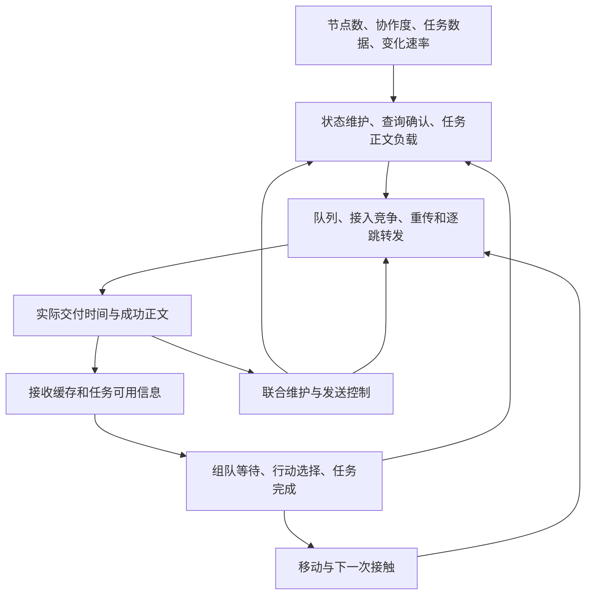

# 动态具身协作网络的可扩展性：全面分析

> 2026-10-26接续说明：当前研究目标、需求依据和实验顺序以[需求驱动研究链条](DEMAND_DRIVEN_RESEARCH_CHAIN.md)为准。本文保留005阶段的服务模型、文献定位和算法候选；服务率扫描只用于条件干预，实际扩展的负载由任务需求产生。本文“尚无因果执行”的进度已由[006结果](CAUSAL_SERVICE_STAGE.md)接续，原文作为历史阶段记录保留。

2026-10-25，V0.2；承接用户对“规模增长会改变网络可靠服务假设”的矫正。本文是当前研究判断、模型选择与实验优先级的总说明，更新[首版科研链条](RESEARCH_EXPERIMENT_CHAIN.md)的主次关系。原始baseline、源码、实测和历史判断保留原位。本轮进行分析和原文核查，未运行新实验。

配套：[应用与文献证据](scalability_20261025/EVIDENCE_POSITIONING.md)、[模型及识别实验](scalability_20261025/MODEL_AND_IDENTIFICATION.md)、[独立审读](../../coordination/reviews/C-005.md)。本文中的“候选算法”“拟测边界”和“理论目标”均为待实现或验证的研究设计。

## 1. 核心定位与本轮改动

**研究核心：当自主机器人团队的节点数、协作关系、任务数据和变化速率增长时，协作维护流量与任务流量如何改变无线网络的实际服务，进而影响团队任务；如何用可分布执行的网络机制扩大有效协作的运行范围。**

建议论文工作题目为“动态具身协作网络的可扩展信息维护与消息服务”。救灾空地勘察是应用入口，状态更新触发与发送调度是首个可实施控制层。MAC、路由、PHY及跨层优化由测得的主导损失决定。

| 方面 | 首版已建立的基础 | 本轮调整后的中心 |
|---|---|---|
| 科学问题 | 在有限带宽下选择更新与发送 | 规模和动态如何改变有效服务，什么机制决定可支持范围 |
| 网络可靠性 | 送达缓存、延迟与丢包约束 | 交付结果由业务、排队、竞争、接触及协议反馈共同产生 |
| 核心自变量 | 更新率、发送顺序、无线预算 | 节点规模、依赖度、任务负载、变化速度与资源增长方式 |
| 算法目标 | 改善任务性能—空口成本折中 | 同资源下扩大达标运行域，并解释代价与作用机制 |
| 实验组织 | 单点收益、消融后做规模扫描 | 从诊断阶段即测规模—负载—服务链；最后给完整运行域及边界 |
| 贡献依据 | 到达时价值和联合控制 | 可复核的退化机制、具体算法改进及受控条件下的理论/系统结果 |

“有效服务”包括正文能否到达、何时到达、到达时是否仍可被任务使用。物理信道即使无误码，也可能因排队错过消费时刻；网络在高负载下也可能保持高交付率而让任务表现下降。研究将这些过程分开测量。

## 2. 总体判断与证据成熟度

动机、方法入口和实现条件已经足以支撑继续推进。研究最有潜力的部分，是局部信息获取和实际消息服务之间的反馈，而不是增加几个网络参数。本轮不预设一种机制必然支配所有规模。

| 当前判断 | 依据 | 下一项决定性证据 |
|---|---|---|
| 空地协作有真实信息依赖 | 灾后部署中的外部视角、地图和后续勘察；自主地下探索的共享子图 | 把任务消费者、必要信息与行动对应到可执行工作负载 |
| 当前冻结策略对送达敏感 | E1-003十实例384决策点零延迟等价；0.5/2延迟改变138/215次影子动作 | 执行改变后的动作，测等待、完成与失效原因 |
| 通信协议具有可用入口 | MOCHA原状态机、SMACH和ZeroMQ双进程18项检查通过 | 共同无线执行器中的实际开销与服务；完整ROS链另验收 |
| 扩展可能改变有效服务 | 已有网络模型和相关工作提供机制起点 | 本项目的规模/负载扫描和共同服务日志 |
| 拟议联合机制有改善潜力 | 更新影响负载，服务影响到达价值，维护信息也有成本 | 充分调参对照及消融后的任务—成本曲线与达标运行域 |

已有结果定位于接口和协议验证。HeteroMRTA当前没有受限信息闭环任务结果，MOCHA当前没有无线拥塞结果。它们提供了可回归起点；本研究的规模退化和算法收益将由新实验建立。

## 3. 应用背景：从真实需求到最小研究任务

### 3.1 两类证据承担不同作用

DRZ在埃森火灾后的勘察中，使用无人机外部视角辅助地面机器人操作；钢筋混凝土造成Wi-Fi中断，点云辅助功能受影响。报告估计该次室内作业中足够质量Wi-Fi约占70%。TRADR的Amatrice任务也记录了空中视角辅助地面操作，并提供任务描述与ROS bag。这些现场材料证明跨平台信息需求与接触障碍；原部署有人类操作员参与。[DRZ §IV-C](https://arxiv.org/html/2212.09354)、[TRADR数据](https://www.tradr-project.eu/resources/datasets/amatrice-datasets/)

腿足与空中机器人自主探索工作在地下矿井进行了45分钟双机器人现场运行，可通信时共享子图以协调后续探索。ACHORD在地下环境采用业务分层、流控和通信感知行动。这些系统支撑局部自治与间歇协作的技术可行性，也提供通信baseline。[自主空地探索](https://arxiv.org/abs/2111.06482)、[ACHORD](https://arxiv.org/abs/2206.02245)

上述证据并不直接给出大规模拥塞阈值。项目将以这些真实工作流构造任务，再测规模增长怎样改变网络和协作；不把某次Wi-Fi可用率当作通用参数，也不把有人操作的现场记录称为自主集群实测。

### 3.2 首篇研究的任务范围

采用两层相接的任务，不一次性实现完整救灾系统：

1. **组队状态层。** 继续HeteroMRTA能力互补任务，测占用、意图、到达与完成信息怎样影响组队和任务选择。保留同一策略、同一规模的即时信息参照。
2. **有消费用途的观测层。** 增加由区域可见性/任务执行需要产生的观测请求与结果：侦察节点提供通道或目标信息，执行节点收到后决定路线、进入或后续核查。感知对象大小、编码方式、消费规则有来源或显式模型说明。

第二层为状态维护与正文竞争提供真实用途。HeteroMRTA原任务不能直接支持点云/大模型数据流的业务主张；任务正文需具有实际消费者和可记录后果。第一层完成后即可研究状态/协议扩展性，无需等待完整视觉系统。

最小因果链为：发现需求→本地决定请求或发布→信息维护与正文竞争服务→收到可用信息→任务行动→新的状态或需求。初期固定策略；联合重训练属于单独实验因素。

### 3.3 如何使用“动态”

首轮分别考虑任务驱动的移动、协作对象变化、连接可用窗口变化。任务发现/完成已能产生协作需求变化；节点故障、加入退出可在后期增加。每种动态用可观测量描述，例如每节点每秒状态事件数、协作对象切换次数、接触持续时间分布，不合并成没有物理含义的单一强度。

固定平均链路可用率时仍可改变断连长度和突发恢复，因此平均可用率相同不代表交付窗口相同。具体参数先由文献/日志约束数量级，再扫描；当前作者仿真时间未换算为实机秒。

## 4. 文献位置：沿已有网络机制做实质改进

网络领域已有成熟的竞争、排队和拥塞研究；例如Bianchi模型研究802.11退避与饱和吞吐，CoDel处理持续排队。因此“负载大导致网络退化”本身是分析起点。本项目的研究对象是这种服务变化与协作信息维护、任务行为之间的具体耦合。[Bianchi](https://ieeexplore.ieee.org/document/840210/)、[CoDel RFC8289](https://www.rfc-editor.org/rfc/rfc8289.html)

| 起点 | 已有能力与所读条件 | 本项目具体比较位置 |
|---|---|---|
| Co-Scheduling / Reoptimized MGF v2 | 生成和发送联合调度；调度后下一槽无错更新；扩展分析固定源数，按比例增加任务与计算/信道资源 | 同模型的解质量/复杂度可改进；共同服务中进一步研究排队和交付时序。固定总资源扩展与资源同比扩展分别报告 |
| AutoCast | 元数据支持分布式价值发送，已有5–40车辆密度实验；无线验证为少量radio重放计划 | 比较元数据维护、下层服务偏差与任务价值排序，明确机制适配与原任务复现 |
| C-MASS | 移动互补感知、二阶拓扑近似、探索利用；W_t可变且有信道测量和维护成本考虑 | 研究共同竞争如何产生各接收者服务，以及维护关系/组合消息在实际到达时如何兑现收益 |
| CoSMO | 决策效用驱动更新与卸载，ns-3含排队传输；单EN/SN回传速率固定 | 同条件下比较低成本价值估计与学习代价；扩展时研究共享服务与反馈适应 |
| AC-DMTA / CommHG | 决策相关更新、过时局部信息，或有资源代价的查询/回复与任务协作 | 明确对照这些已有能力；比较可执行网络服务与维护成本下的性能和复杂度 |
| MOCHA / ACHORD | 原机器人同步、优先级、流控、断续连接及网络反馈 | 作为协议基础，测实际维护/正文成本和任务后果；原协议路径与系统实机范围分别记录 |
| ARMA / CORA、PHY/MAC联合优化 | 已有无线资源与计算/任务协调；控制变量包括RB及更底层资源 | 借鉴预算与反馈接口。若损失来自接入/干扰，形成有明确控制变量的跨层扩展 |

原文版本与精度见[证据表](scalability_20261025/EVIDENCE_POSITIONING.md)。综述中的CoSMO分类需保留其已有ns-3实验；C-MASS并非固定带宽无动态；AutoCast并非没有规模研究。MGF的同比资源扩展具有明确理论意义，我们选择另一资源增长条件时应明确列出。

**贡献可以发生在相同问题、相同假设下。** 更好的求解、低成本近似、更强的误差性质或更好的任务—成本折中都可成立。多节点、多跳与救灾应用用于提出真实需求，不承担算法创新证明。

## 5. 要识别的机制：从规模到服务，再回到协作

这条反馈链是待测对象，不预设所有箭头在每个场景都显著。网络机制收益也可能主要来自更平缓的队列或更少控制流，不要求出现突发崩溃才有研究价值。

### 5.1 四个可验证假设

| 假设 | 观察与干预 | 支持该判断的结果 | 未出现时如何推进 |
|---|---|---|---|
| H1 固定可靠服务在部分规模/负载下高估有效协作 | 同需求回放比较固定服务、排队服务、竞争无线；再接闭环 | 服务/任务曲线差距随负载变化，日志指向具体等待、丢弃或接触失配 | 保留其准确区间，转而比较成本或其他负载维度 |
| H2 维护开销影响正文有效交付 | 用共同外生需求，分别记维护流和正文；设置可解释的计费诊断 | 维护占用变化与正文服务/任务后果相连；完整强基线后仍有可改善损失 | 若简单限速/错相已解决，采用它作为基础，把方法集中到剩余损失 |
| H3 交付失配可能诱发附加通信 | 记录超时、查询、重同步的父事件；冻结回放与闭环对照 | 迟达后产生可追溯附加流量；反馈抑制改善恢复或任务表现 | 不主张反馈放大，研究一般共享资源调度 |
| H4 联合控制扩大达标运行域 | 更新/排序/服务反馈消融，同开发预算和任务实例 | 某些资源下支持更多负载/规模，且成本、任务失败和计算均计入 | 根据消融选择有效的简化机制，不保留无收益模块 |

### 5.2 规模到底增加什么

节点数N、每节点依赖度d、每任务正文量L、任务到达率λ和状态变化率ν分别扫描。d由真实任务依赖/消费者定义，与物理邻居数分列；策略读取全体状态不意味着每个字段都是刚性需求。采用局部订阅时，所有方法共用unknown特征与mask规则，并记录遗漏需求。关系数增长并不直接等于发射次数增长：一次广播可以被多人接收，逐接收确认又可能增加开销；多跳计实际转发次数。将“任务需求量”“生成字节”“提交尝试”“成功交付”“有效消费”五个量分别记录。

固定区域加密增加局部竞争者；固定密度扩区域允许空间复用，也可能增加路由长度。固定总任务强调更多设备完成同一任务的收益，固定每节点任务强调承载能力。固定频谱/功率与增加信道、AP、中继的资源扩容分别画曲线。空间变大不等于全网总服务恒定。

## 6. 最小模型与可支持运行域

详细符号和守恒式见[模型文件](scalability_20261025/MODEL_AND_IDENTIFICATION.md)。主模型仅保留会改变研究结论的对象。

### 6.1 状态、动作与实际服务

- 环境维护真实位置、能力、任务物理进度、链路和冲突关系；节点只读取自身观测、已送达缓存、实际队列和本地反馈。
- 消息分为可替换状态、必要任务事件/正文、协议控制。增量意图有前序依赖，不能直接latest-only删除；完整快照可以按来源和键替换。
- 网络动作包括查询/更新、选择对象、替换允许替换的本地状态、提交发送、以及本地服务负载调整。第一版固定MAC、路由和重试规则。
- 实际服务由这些动作、共同竞争、信道与接触共同产生。调度器可以估计可用服务；发送结果和接收缓存必须由网络执行器产生。

一个有用的队列记账形式是

$$Q^{+}=Q+A-U,\qquad Q'=Q^{+}-S-F,$$

其中A为新接纳及转发到达字节，U为语义允许的过期/替换移除，S为发送端按共同协议规则完成服务并出队的字节，F为最终失败移除；各项满足非负和库存约束。ACK制协议在收到确认后出队，接收者首次得到正文可以早于ACK；ACK丢失可引起额外重传，接收端仍只消费一次。无ACK广播按其共同完成规则出队，正文是否到达各接收者另记，不能由S推定。重试消耗空口但不重新成为应用新需求；恢复重传正文不能重复计作有效消费。被拒收、丢弃或因依赖不满足而不可用的需求仍记录在任务/需求账本。

这避免用“队列有界”直接代表任务可扩展：无限覆盖或丢弃也能使队列变短。能否满足外生任务与信息需求必须同时检验。

### 6.2 三层可靠性

| 层次 | 记录对象 | 与任务的关系 |
|---|---|---|
| 包/正文交付 | 源消息、传输尝试、目的接收者、最终正文到达 | ACK和头部不替代正文；重试次数与唯一交付分开 |
| 及时有效信息 | 接收者在某个消费窗口前取得满足版本和依赖的内容 | 定义R_eff：需求满足数/明确需求数；到达但过期或缺依赖另记 |
| 团队任务 | 完成比例、任务/团队成功、返回makespan与超时 | 网络方法最终接受标准；消息指标解释机制 |

固定回放使用共同外生需求目录，保证R_eff分母一致。闭环方法可能改变请求数量和消费时刻，需同时报告需求数与任务后果，不能通过少发请求或缩小接收集合来提高该比值。窗口来自明确任务消费事件或预先给定要求；原任务没有期限时不额外捏造短deadline，以实际决策需要和任务完成时间评价。

### 6.3 操作性的运行域定义

设θ表示N、d、L、λ、ν及区域/拓扑配置，R表示固定的频谱、功率、单节点无线硬件/算力配置、基础设施配置和MAC规则，π为网络机制。给定外生任务集及共同预算H，用F_H表示任务完成比例，用E_H表示全部必需任务完成并按定义回站。先定义

$$\Omega_\pi(R)=\{\theta:\Pr_\pi(E_H)\ge p_0,\ \mathbb E_\pi[F_H]\ge f_0\},$$

同时报告时间、成本和及时信息指标。配套模型允许另加完成时限T*及统计成本上限B；取T*=H、p_0=1−ε、f_0=f*并不另加B约束，即回到这里的任务门槛版本。实验配置须固定所采用的版本。p_0与f_0是应用目标或在开发阶段预先选择的门槛，需给出门槛敏感性，不在看过测试结果后挑选。需要明确任务期限的应用可再加入及时完成要求。

任务数增加会使“全部成功”更难，因此同时给出每任务完成率、团队成功率和同规模即时信息结果。即时信息参照揭示任务策略自身的规模表现；它不是网络资源相同的可部署对手，也不是任务最优上界。

预算H在每个场景族内对所有方法相同；若随区域几何调整，规则在运行前冻结。有限网格上的结果称“实测达标配置/边界区间”，置信区间跨门槛记为未定，报告不确定区间、失败点和未测点，不从最大通过N推断所有更小/更大规模均成立。连续到达业务另用固定观察窗的外生任务完成率、吞吐和积压趋势；有限批次的makespan不证明长期队列稳定。

## 7. 算法主线与可能形成的创新

第一版沿用AVUS工作名：到达价值驱动的更新与服务联合控制。本轮使**实际服务反馈与规模下的维护成本**成为核心设计和消融对象。算法具体化为一个可测试机制，优于现有方法的幅度由实验决定。

### 7.1 一个共同决策，而非三个互不相干的模块

每个节点在可提交机会到来时，从已有任务正文、必要事件、旧状态、生成最新状态、查询/摘要和等待中选择。评分比较预计到达后的任务作用与该动作消耗的服务机会；一个查询的收益要包含得到回复后才能实现的后续作用，并计往返费用。未知接收状态用已送达反馈构成估计，不能读取仿真真值。

服务变慢时，新状态可能在排队期间过时；算法据此减少无效生成、改变排序或等待新的服务机会。对有明确互补用途的小消息组，按满足消费条件所需的剩余成本与完成时间评估，单包到达不提前领取整组收益。算法始终由实际MAC执行服务。

### 7.2 先做三个可实现部件

1. **有界、可解释的信息维护。** 按真实任务关系维护少量活跃键及接收版本镜像，记录遗漏需求；摘要/查询触发参考决策不确定性。第一个实现可使用显式特征，不要求新训练模型。
2. **基于预计交付的重新排序。** 结合已知需求、缓存差异、队列等待与接触反馈，在提交前比较状态快照与正文；与生成时固定评分、EDF、AoI和价值/字节对照。
3. **服务反馈控制。** 使用本节点可获得的交付、队列停留和重试统计调整提交额度及更新强度；限定下层在途窗口，避免上层选择被过深FIFO淹没。反馈和必要服务保障的开销、参数及公平条件在所有方法中明确。

必要任务事件不能因当前评分低而永久饥饿，使用共同的老化/最低服务规则；物理断连时只记录失败和恢复，不承诺不可实现的必达。活跃集合截断或门控若漏掉需求，由任务账本暴露，而不是从评价分母中删除。

### 7.3 与强基础网络机制的关系

普通限速、latest-state、错相周期、队列管理与公平服务必须作为认真调参的对照。若收益来自更浅的队列或更合理的限速，应把它归因到相应机制。只有在共同的队列、重试和信息条件上，任务依赖估计及联合决策仍带来收益，才能确定它们的贡献。

网络层首先比较同一可靠传输/重试语义下的机制；改变TCP/UDP或重传上限时单列因素，避免把传输栈差异算作上层算法收益。CoDel等已有AQM可在适配的传输环境中作为排队管理对照；不要求当前回环入口已经具备该实现。

### 7.4 理论工作应服务于实测主导机制

优先建立小规模可精确求解的状态更新/正文共同服务模型，在相同观测条件下与在线近似比较。可研究维护信息的价值、估计误差对单次选择的影响、特定服务模型下的负载可支持条件和算法复杂度。现有预算记账界是实现依据，不单独作为论文主要理论结果。

若服务过程随接入控制变化，固定成功率队列的稳定性定理需要重新检查假设。有限仿真出现积压不等于证明不稳定；有限缓存恒有界也不等于需求可服务。首先得到条件明确的子模型结论，再检查它对真实无线趋势的解释能力。

### 7.5 可形成的贡献组合

- **测量贡献：** 建立规模—维护/正文负载—实际服务—任务后果之间的可归因证据，给出已有机制的达标运行范围。
- **算法/协议贡献：** 给出在局部信息和共同服务约束下可执行的联合机制，证明它改善任务—成本折中或扩大达标配置范围，报告计算及反馈代价。
- **理论或系统贡献：** 对关键近似给出有内容的误差/性能分析，或在原协议与无线实现中验证机制和开销。选择与主结果最吻合的一项深入。

上述是贡献候选。研究价值不取决于此前是否有人提出任务感知、动态网络或联合优化，而取决于本项目具体方法和结果的改进幅度、解释力与可复核性。

## 8. 能识别机制的实验框架

### 8.1 三层网络模型，逐层回答不同问题

| 层次 | 实际处理 | 用途 |
|---|---|---|
| L0 固定可靠服务 | 保留共同调度/准入预算，仅获服务的消息按固定延迟交付，无接入竞争 | 对照理想服务近似；任务/策略原条件回归。不同论文原条件单列，不强行等同L0 |
| L1 显式排队服务 | 相同外生需求、序列化字节、有限服务、缓冲、更新替换与协议费用 | 识别单纯排队及服务时序效应；保留无碰撞对照 |
| L2 竞争无线服务 | 固定PHY/MAC/重试/拓扑配置，由执行器产生退避、成功、失败和逐跳服务 | 测量真实资源竞争的附加作用，得到网络层扩展结果 |

先用同一消息需求/轨迹做回放，再在同一任务实例上闭环。L0/L1/L2需要校准相同轻载基准并明确资源对应关系；L0在高载仍遵守共同授权服务预算，未获服务的需求保留。若另设任意负载即时全交付，只作为信息诊断参照，单列放松的资源条件；轻载校准不能替代高载公平性。回放能隔离网络，闭环能显示任务反馈；两者结果互相补充，不将简单相减当作唯一因果分解。

### 8.2 主实验与产出

下表X0–X7是本次分析的实验标识；已有S1实现及首版E0–E7证据保留，不重新计为新实验。

| 编号 | 研究问题 | 控制与对照 | 产出 |
|---|---|---|---|
| X0 | 因果执行是否可信 | 原轨迹缓存回归已完成；另验收因果即时信息、物理到场、反馈和本地唤醒 | 表T0：原接口、因果执行与网络层各自通过项 |
| X1 | 原始业务负担来自哪里 | 共同任务/需求，不同N、d、L、ν；区分原生与模型生成数据 | 图F1：每任务消息、维护成本、接收依赖和突发分布 |
| X2 | 哪个网络近似开始失准 | L0/L1/L2共同回放及校准；轻载到高载 | 图F2：有效交付、尾时延、未完成需求与积压；模型预测误差 |
| X3 | 网络失配如何影响行动 | 同规模即时信息、实际网络闭环；外生随机场配对 | 图F3：任务完成/返回时间、组队等待、重复投入和反馈事件 |
| X4 | 联合机制是否改善 | 更新×排序×服务反馈的逐项/组合消融；强基础网络机制 | 图F4：任务—空口成本曲线；贡献来自哪个部件 |
| X5 | 可支持规模和动态范围 | N×负载、N×变化率分片；面积/任务量/资源增长分组 | 图F5：达标配置图和边界区间，附instant与置信区间 |
| X6 | 改善是否能迁移 | MOCHA协议映射、兼容任务的AutoCast/其他方法、公开几何或日志 | 图F6：实现开销、来源/模型分层与跨场景表现 |
| X7 | 实机能否承受开销 | 小队设备，固定业务和资源，共同协议设置 | 图F7：仿真—实际服务对齐与任务结果 |

首轮只实施X0→X1→X2的小范围验证，依据测得损失进入X3/X4。规模候选沿用9/18/36/72，每一级先核对任务可行性、策略输入与instant表现；原权重的跨规模泛化尚未验证。节点数仅是候选，不授权直接跑完整笛卡尔积。

### 8.3 对照分层与信息公平

任务执行器继续固定原策略，作者Greedy另保留其原实现及已知行为；不把任务策略差距算作通信收益。基础机制包括调参的周期/错相、事件触发、latest-state、FIFO/EDF或有效期优先、合理限速、公平服务；各机制保留可靠事件语义。

MOCHA为直接协议对照。AutoCast、C-MASS、CoSMO、MGF、AC-DMTA和CommHG按真实任务、信息和动作兼容性接入；原生复现和机制适配分别命名。多加资源的方案单独展示成本。未来真值仅可用于离线诊断，不能进入在线算法。

开发集调参预算一致，旧0–4种子用于回归而非盲测。正式统计以任务实例为独立单元，网络种子在实例内汇总；规模/任务量改变时配对键包含实例哈希。先锁定主比较与接受门槛，再扩测试；本轮不设未经性能校准的大计算额度。

## 9. 指标、数据来源和证据用途

### 9.1 指标主次

第一层为任务：完成比例、每任务/团队成功、返回makespan、失败/超时。成功回合的条件均值与全部回合完成率并列；未完成回合不能从结论中消失。持续业务用完成吞吐、外生到达满足率和积压趋势。

第二层为成本与服务：每完成任务的空口发送成本、控制占比及绝对量、已交付尾时延和未交付/过期量、需求满足率、恢复时间。零完成时成本比值记NA，同时报告总成本和零完成次数。发送尝试时间之和与每冲突域信道忙时并集分列，重叠碰撞不重复算唯一忙时。

第三层为机制：队列位置、请求/重试原因、消费时版本、因果等待和冗余行动、在途正文、决策与反馈计算代价。包级PDR只能解释一部分有效服务，不能替代任务指标。

“可扩展性”以完整运行域/曲线表达；除节点维度外报告依赖度、数据量、变化率和固定资源。仅展示某个最大通过点不足以说明全部中间配置。

### 9.2 数据来源与使用方式

| 来源 | 提供什么 | 本研究怎样使用 |
|---|---|---|
| 固定HeteroMRTA源码、权重与已存实例 | 能力组队任务、原策略和回归轨迹 | 状态依赖和因果执行适配；新增规模实例保存生成器/配置/哈希 |
| MOCHA固定原协议与本机回环 | 状态头、正文请求、入库与超时事件 | 标定应用层负载及接口；无线服务另由共同执行器产生 |
| AutoCast及兼容感知数据 | 有任务用途的对象/点云与接收相关性 | 原场景内复现；明确的观测层适配后测正文价值 |
| TRADR/DRZ现场材料 | 实际协作流程、环境障碍；TRADR有bag | 约束任务关系及负载/几何。它们尚未提供本项目所需完整MAC真值，不能当作现成大规模无线数据集 |
| 仓库SubT公开拓扑与后续轨迹 | 真实场景结构和移动条件 | 几何回放与受控合成任务/无线模型分列；不冒充现场通信测量 |
| 新仿真及后期设备日志 | 队列、尝试、交付、消费和任务完整链 | 产生主要方法比较与规模证据，保存全部配置/失败/原始事件 |

每条消息至少带来源、接收对象、类型、版本/依赖、字节、生成/入队/尝试/到达/消费时刻和移除原因；每项需求保留产生、满足或失败。记录阶段性被过滤/未生成的信息，避免仅观察“已经进入网络”的幸存消息。

## 10. 当前实现约束与推进顺序

004阶段已实现独立意图缓存，10实例、373次原实际动作和完整终态与旧归档一致，9项接口测试通过。它是固定轨迹信息干预；延迟下影子动作未执行。MOCHA已跑原同步路径双进程18项检查；ROS适配隔离，未进行无线任务测量。对应[接口报告](HETEROMRTA_NETWORK_INTERFACE.md)、[协议报告](MOCHA_RUNTIME_ENTRY.md)。

原HeteroMRTA使用未来预约与全局唤醒，历史767段运动中7段按原规则回溯出发。下一实现必须为所有通信方法共用：因果运动、实际到场/能力满足后开工、本地事件唤醒、明确的预约/撤销/完成反馈和实际送达缓存。原等价入口继续保留，适配后instant重新验证。原simulator时间与米/秒的映射需在接入无线前固定。

随后先记录原生需求和序列化负载，建立L1；再接入能够产生共同接入结果的L2。将MOCHA头/请求/正文/结束事件映射到这一接口。AutoCast完整CARLA恢复及其他baseline依赖独立推进，不阻塞第一组状态维护诊断。

第一阶段应交付“因果执行验收＋业务负载账本＋L0/L1服务对照＋一个小规模闭环曲线”，再决定扩大节点还是优先补无线竞争。若服务偏差主要来自MAC，进入L2优先；若仅有轻载，扩实际有用途的任务负载或研究更低成本服务，不人为插入无消费数据。

## 11. 关键研究风险与对应处理

只保留会影响主要结论的四项。

1. **执行环境泄露远端真值。** 观测、mask、拒绝和唤醒均由本地可见事件产生；独立审计消息来源与时间。否则无法识别通信收益。
2. **把任务策略不泛化解释成网络退化。** 每个规模均跑因果instant，报告失败类型及模型调用成本；必要的共同重训练与冻结策略实验分组。
3. **用裁剪需求换取表面可靠性。** 任务集合、接收需求与未满足量持续记录；所有维护/控制费用和算法运行时间进入比较。
4. **把模型结构差异误称算法优势。** L0/L1/L2校准资源，原生与适配分列；证明的条件与实测条件逐项对齐，不能用小模型最优代替全网络最优。

这些问题都对应具体检查和实验，不要求为尚未发生的特殊情况增加大量前提。

## 12. 阶段结论

本轮确立的主线是：**动态与规模增长怎样改变实际网络服务，网络服务怎样改变协作，以及联合的信息维护与消息服务怎样扩大达标运行域。** 当前已有来源明确的应用需求、强baseline和可回归接口，研究可继续进入因果闭环与网络服务诊断。

下一次决定研究价值的证据，是同资源条件下“规模/负载→实际交付→任务后果”的曲线，以及认真配置的已有机制之后还存在哪些可改善损失。可实现的创新集中在局部维护成本、到达时价值和服务反馈三者的共同决策。算法、理论和系统实现的深度依据该证据分配，不同时展开全部网络层。
