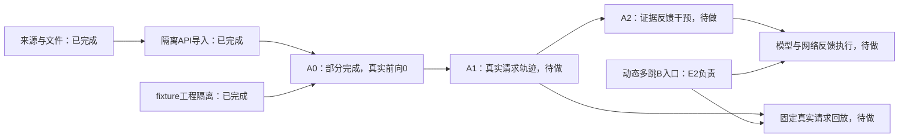

# 模型与业务实验链：做到哪里、接下来补什么

2026-10-28，E1-011；基准 `b19fbe925ba515ddedea44ac128a338a5aa98d47`。供D直接整合的模型侧映射。本轮只读核对既有代码、报告与保存记录，新模型调用/仿真/下载均为0。

**当前位置：模型文件和隔离环境已取得，工程fixture已通过；真实模型前向仍为0，停在A0加载之前。** E1-010准备任务已验收关闭，表示其有限交付合格，不表示A0或整条A链完成。后续通过A0，再做真实场景自主请求A1、证据干预A2，随后把真实请求接到动态网络；B链可独立准备。

## 1. 给总览使用的状态映射

“已完成”仅覆盖该行明示范围；“部分完成”表示入口/条件已有而关键实证未过；“待做”表示尚无对应模型运行结果。具体预算、状态写入和启动授权仍看新任务卡。

| 稳定ID | 阶段 | 状态 | 当前能确认什么 | 缺项/完成判据 | 证据 |
|---|---|---|---|---|---|
| A-PREP-SRC | 模型来源、取得与身份 | 已完成 | 固定SmolVLM2-500M revision，13项白名单已取得；已知内容SHA及5项普通Git blob身份核验 | 以后恢复核版本，不重复下载；这一步不要求已生成输出 | S1、S2 |
| A-PREP-ENV | 独立覆盖环境与API导入 | 已完成 | 新环境中Transformers4.51.3等覆盖包可用，torch只读来自原系统；模型API导入通过 | 模型加载/显存和图像处理必须由A0实测 | S2、S6 |
| A-PREP-IO | 因果/隔离工程入口 | 已完成（仅fixture） | 16项边界检查、6项来源身份检查及脚本消息链保存；到达前不可引用 | 固定脚本不算模型自主行为，不能替代A1 | S3、S4 |
| A0 | 本地模型加载、视觉输入和工具格式 | 部分完成 | 代码、文件、配置和失败记录已有；曾预检通过，加载前RAM再次不足 | 真实加载→实际图像张量→生成→合法工具/证据引用均有日志；目前未启动worker | S5 |
| A1 | 真实私有视角下自主产生业务 | 待做 | 已有验证方案及部分工具函数 | 合规场景、评分、模型驱动多轮调度与合法请求/追加/停止轨迹；所有失败保留 | P1；S7代码边界 |
| A2 | 收到证据是否改变后续请求 | 待做 | 已有前缀/迟到/缺失干预设计 | 相同前缀下实际工具选择或终止与证据处理相符，并检查最终正确性 | P1 |
| A→B | 真实请求接入动态多跳 | 待做 | 模型和网络入口分别存在；网络侧B0见E2映射 | 对齐消息/时钟/完整到达及消费；固定请求回放与模型反馈运行分别验收 | P2；后续E2映射 |

## 2. 已有代码、配置和保存结果怎么对应

| 入口/配置 | 当前作用 | 实际保存结果 | 恢复时需要注意 |
|---|---|---|---|
| [preflight.py](../../../simulation/edge_agent_entry/preflight.py) | 来源锁与M检查点、RAM/VRAM门槛 | S5中的09、12预检 | 保存值只代表当时；本轮未重新盘点当前资源 |
| [acquire.py](../../../simulation/edge_agent_entry/acquire.py)、[a0_requirements.txt](../../../simulation/edge_agent_entry/a0_requirements.txt) | 固定文件和增量依赖取得、隔离安装 | S2取得清单、账本与导入日志 | 取得目录已存在，入口拒绝重复取得；本地资产已可复用 |
| [a0.py](../../../simulation/edge_agent_entry/a0.py)、[model_backend.py](../../../simulation/edge_agent_entry/model_backend.py)、[model_worker.py](../../../simulation/edge_agent_entry/model_worker.py) | 校验来源/预算，独立上下文传给本地模型子进程 | S5的14配置、主卡快照及加载前失败 | 只做独立调用/工具核验；主卡及输出根仍固定E1-010，新卡需先适配该边界，或由M明确同卡恢复 |
| [runtime.py](../../../simulation/edge_agent_entry/runtime.py)、[event_schema.json](../../../simulation/edge_agent_entry/event_schema.json) | 私有输入、收件箱、完整到达和显式消费；JSON事件与工具校验 | S3的19事件及原始报文 | 现有工具为request/respond/consume/finish；revise/cancel/request_crop、完整ANI及真实模型多轮驱动尚未接好 |
| [cli.py](../../../simulation/edge_agent_entry/cli.py)、[fixture_config.json](../../../simulation/edge_agent_entry/fixture_config.json) | 固定脚本及纯色PNG兼容输入 | S3；2报文、411 byte、完整到达2、显式消费1 | 5次为脚本调用；411 byte为应用序列化payload，无无线头部/空口意义 |
| [test_runtime.py](../../../simulation/edge_agent_entry/test_runtime.py)、[test_source_identity.py](../../../simulation/edge_agent_entry/test_source_identity.py) | 隔离/预算、失败/超时mock、来源替换保护 | S4：16/16及6/6保存通过 | mock/合成字节不算真实模型样本；本轮未重跑检查 |

实际本地资产为 `data/agent_native/E1-010/model/`，隔离解释器为 `data/agent_native/E1-010/env/Scripts/python.exe`。配置 `data/agent_native/E1-010/a0_config.json`是上次执行快照，其任务卡hash已随后续回填变化，不能原样当作新执行配置。恢复先由M明确任务/写入范围，再处理入口固定E1-010的主卡、data与输出边界，保留只读旧资产和旧快照，生成当前执行配置；不改旧manifest。新卡不能直接套旧命令写进旧任务输出目录。

## 3. A0、A1、A2的输入—产出—过关条件

| 阶段 | 输入与前置依赖 | 应产生的可核对产物（尚未取得者不作现有证据） | 过关/失败后分流 |
|---|---|---|---|
| A0兼容 | 已取得的SmolVLM文件和隔离环境；固定合成图像/提示/图像预算；新资源与配置快照、明确调用预算 | 每次调用的spec、输入/上下文hash、stdout、result、真实生成数、图像张量shape、token/墙时/内存、原始工具输出及解析结果 | 先真实加载与视觉生成，再过格式/引用核验。加载、OOM、格式或预算失败分开；不得用fixture回答补齐失败 |
| A1真实业务 | A0通过；有来源的私有视角、根问题和外部评分；共同目录/unknown规则；模型多轮驱动及必要工具实现 | 真实生成—发送—完整到达—消费的事件链；请求目标/正文/依赖/追加或终止、推理时延、UTF-8/图像实际字节；全部根任务及错误/预算停止 | 旧计划入口判据：至少3个场景块有可核查的证据依赖型追加/终止，且至少一种合法协作者改变；同时检查根任务质量。无此行为则修改模型/场景假设，不伪装成自主负载 |
| A2证据干预 | A1已保存正常前缀；冻结模型/输入/种子；同前缀迟到/缺失分支 | 前缀与分支ID、证据到达/缺失位置、后续实际工具选择、终止及正确性对照；正常前缀复用不重复计独立样本 | 旧计划入口判据：至少3块后续工具选择或终止与证据处理相符；仅措辞变化不足。不能满足则A链真实性门槛未过，暂不归因跨层收益 |

这些判据来自[P1验证方案](../reorientation_20261027/VALIDATION_PLAN.md)§3，只是拟执行阶段的功能门槛，不是已批准运行或泛化统计保证。旧规划A0为“两模型×两输入、每次256 token”；实际E1-010只准备SmolVLM，采用最多4次、每次128 token/180秒、累计720秒的更窄授权，最后真实前向0。不得把两者合并成已完成4次A0，Qwen候选也未因本轮准备而取得或验证。未来卡重新冻结预算，不沿用已关闭卡的自动执行权。

旧计划A1为6场景块×4条件=24回合，A2另12干预回合；2开发/4评估块、所有失败入分母。这里仅保留设计规模供D映射，不启动矩阵。nuScenes mini同车多视角可作P2私有输入隔离，不证明多设备运动；实际数据包、条款执行、场景分配和评分仍待落实，不能拿合成纯色PNG替代。

## 4. 把A链交给网络侧，需要的最小接口

| A侧交付字段 | 网络侧如何使用 | 当前缺口 |
|---|---|---|
| 根任务/请求/对象/源/目标/版本及依赖ID | 逐跳、重传、重复与取消归属；所有请求保持分母 | 现有fixture只覆盖部分字段；修订/取消与多消费者语义待实现 |
| 实际正文及编码字节、生成/入队/截止时刻 | 固定请求回放，核完整交付、截尾和费用 | 实际模型请求轨迹尚无；不可将固定脚本流标为模型负载 |
| 计算排队、模型调用起止、图像预算 | 只有推理完成后才释放消息；单机共享GPU计串行/排队代价 | 真实模型时延未测，不能给每节点同时分配整张GPU独占速度 |
| 完整到达与消费事件、外部评分 | 网络交付后才影响下一调用；有效到达和实际消费分开 | 当前fixture逻辑时钟未与ns-3时钟桥接，模型反馈执行尚无 |

先交同一真实请求集合做网络回放，隔离路由/排队服务；再让实际到达改变后续模型请求，评价反馈。回放不重算模型行为，反馈分支变化后不能继续套用同一条未来轨迹。E2的B0是原生受控UDP网络入口，不能由它的通过推断A→B已接通；B侧参数、Drop/队列和可靠正文协议的完成度由E2-012映射核对。

## 5. 旧HeteroMRTA保留在哪里

| 旧资产 | 继续复用的用途 | 在新链条中的边界 |
|---|---|---|
| [原策略入口](../../../simulation/heteromrta_eval.py)及[复现报告](../HETEROMRTA_REPRODUCTION.md) | 固定权重/作者版本、种子与结果来源管理；传统任务业务对照 | 静态能力任务与冻结策略，不提供LLM/VLM自主请求证据 |
| [因果执行器](../../../simulation/heteromrta_causal.py)、[需求执行器](../../../simulation/heteromrta_demand_execution.py) | 送达缓存→决策→行动的因果分离、失败与任务后果记账方法 | 领域专用状态/组队规则，不能直接充当新的视觉消费与模型驱动器 |
| [无线服务](../../../simulation/wireless_broadcast_service.py)、[固定回放](../../../simulation/wireless_trace_replay.py)及[009报告](../WIRELESS_EXECUTION_STAGE.md) | FIFO/latest、消息/正文hash、应用与网络费用分解、历史回归 | 单竞争域/小状态业务，不能替代动态多跳、容量边界或真实模型业务；旧输出根绑定需要新卡改入口 |

现有历史文件/结果全部保留；新主线不再以完成更多同步触发器作为A0/A1的替代品。

## 6. D可直接引用的证据入口

| ID | 冻结/保存证据 | 本稿用它确认什么 |
|---|---|---|
| S1 | [SOURCE_LOCK.json](../preparation_20261028/SOURCE_LOCK.json) | revision `7b375e1b73b11138ff12fe22c8f2822d8fe03467`、白名单、许可/摘要分层 |
| S2 | [13取得manifest](../../../simulation/results/2026-10-28-E1-010-model-entry/continuation-20261028-A0/runs/20261028-13-acquisition/manifest.json)、[13模型文件哈希](../../../simulation/results/2026-10-28-E1-010-model-entry/continuation-20261028-A0/runs/20261028-13-acquisition/model_files_verified.json) | 13文件；累计下载2,048,806,781 byte、准备556.766秒；来源/取得不等于实际加载 |
| S3 | [08 fixture结果](../../../simulation/results/2026-10-28-E1-010-model-entry/runs/20261028-08-freeze-fixture/result.json)、[事件](../../../simulation/results/2026-10-28-E1-010-model-entry/runs/20261028-08-freeze-fixture/events.jsonl) | 固定脚本5调用、2报文/411 byte、到达2/消费1、真实前向0 |
| S4 | [07隔离检查结果](../../../simulation/results/2026-10-28-E1-010-model-entry/runs/20261028-07-freeze-checks/result.json)、[11来源检查结果](../../../simulation/results/2026-10-28-E1-010-model-entry/runs/20261028-11-source-identity-fix/result.json) | 分别16/16、6/6保存通过；本轮未重跑 |
| S5 | [09未过预检](../../../simulation/results/2026-10-28-E1-010-model-entry/runs/20261028-09-A0-preflight/preflight.json)、[12通过预检](../../../simulation/results/2026-10-28-E1-010-model-entry/continuation-20261028-A0/runs/20261028-12-A0-resume-preflight/preflight.json)、[14加载前失败](../../../simulation/results/2026-10-28-E1-010-model-entry/continuation-20261028-A0/runs/20261028-14-A0-local-model/failure.json)、[14 manifest](../../../simulation/results/2026-10-28-E1-010-model-entry/continuation-20261028-A0/runs/20261028-14-A0-local-model/manifest.json) | RAM门槛2GiB；14实测1,996,738,560 byte，blocked_before_forward/退出1/真实前向0；不是模型不兼容证据 |
| S6 | [15隔离环境路径/版本](../../../simulation/results/2026-10-28-E1-010-model-entry/continuation-20261028-A0/runs/20261028-15-continuation-verification/isolated_environment.txt) | torch2.3.1+cu121来自原系统；Transformers4.51.3等来自本卡覆盖环境 |
| S7 | [MODEL_ENTRY阶段报告](../preparation_20261028/MODEL_ENTRY.md)、[入口README](../../../simulation/edge_agent_entry/README.md) | 代码、失败和未实现边界；单节点工具与事件接口 |
| P1 | [VALIDATION_PLAN §3](../reorientation_20261027/VALIDATION_PLAN.md) | A0/A1/A2原规划、功能门槛及P1/P2/P3/P4分层；规划不作实际结果 |
| P2 | [已验收的准备总报告](../PREPARATION_20261028.md)、[当前任务摘要](../../../coordination/CURRENT.md) | 模型/网络阶段汇合与下一步顺序；本稿不重审E2原始网络结果 |

本稿只抽查上述入口、选定manifest/result和代码，不全量重算历史事件或大文件权重，也不重新查询当前空闲内存。独立审查/验收见[C-013](../../../coordination/tasks/C-013.md)、[M-012](../../../coordination/tasks/M-012.md)；当前映射仍待C-014与M验收。

## 7. 下一张模型卡应明确的最小依赖

先安排资源稳定的本地A0恢复：复用现有模型/环境，确认新执行快照、身份与累计预算，保留全部失败；不重下文件、不关闭无关进程。当前2GiB RAM/2.5GiB VRAM门槛是既定执行条件，不是模型峰值内存的实测结论。A0通过后，再落实真实输入、评分与模型多轮驱动，把A1从计划变成可执行任务；A2依赖A1的真实前缀。A→B须与E2另立有限接口任务，不能把模型和网络各自可导入视为完整实验链已经接通。

本窗口本轮只写本映射及E1-011主卡，没有运行研究/测试脚本、模型、下载或仿真，没有研究后台进程；共享代码、环境和历史结果未修改。交review后停写，由D整合、C独立核对、M验收。
