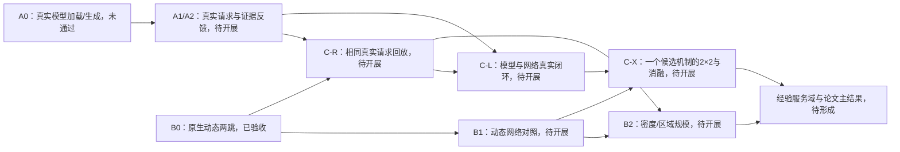

# 网络与因果评价实验链：阶段、证据与下一步

2026-10-28，E2-012，供D整合总框架。本轮只读核对现有报告、入口、两份B0核验摘要及验收卡；新模型调用、仿真、下载、训练均0。下文“已完成”指对应阶段已验收，不代表整个网络系统或论文性能已验证。

## 1. 现在做到哪里

**网络侧已到B0：原生ns-3动态两跳工程入口跑通并验收；尚未到真实Agent业务、多场景网络对照、网络扩展或跨层收益。** 模型侧已有资产、隔离环境与离线P2入口，但真实前向仍为0，A0加载/生成尚未通过。当前两条链还没有接通。

| 阶段 | 当前状态 | 已有证据 / 尚缺的关键事实 |
|---|---|---|
| 前置来源、模型资产与离线P2接口 | 部分完成 | 资产及隔离环境已取得，API可导入；fixture是脚本动作，不证明真实模型自主请求。见[阶段报告§1–3](../PREPARATION_20261028.md) |
| A0→A1/A2：模型兼容→自主需求→证据反馈 | A0未通过；A1/A2待开展 | 加载前因既定RAM门槛停止，真实前向0；不能写成模型不兼容，也不能写成视觉/自主能力已通过 |
| B0：成熟栈、两跳、移动分区与恢复 | **已完成并验收** | 两个动态种子各60秒；受控三节点、合成UDP探测。见[网络报告](../preparation_20261028/NETWORK_ENTRY.md)及[M-012最终验收](../../../coordination/tasks/M-012.md) |
| B1：动态无线机制对照 | 待开展 | 尚无静态3跳、改路、隐藏终端/空间复用、加入退出等完整矩阵和AODV/OLSR公平比较 |
| B2及后置敏感性：网络规模/移动/负载 | 待开展 | 没有固定面积加密/固定密度扩区的网络曲线，更没有64个真实模型Agent实证 |
| C-R→C-L：真实请求固定回放→真实模型闭环 | 待开展 | A1轨迹未产生；实际正文/分片/截止/消费与无线入口尚未耦合 |
| C-X：一个新网络机制的因果收益 | 待开展 | 未完成强基线、同资源2×2因子评价及机制消融，不能预先认定同步或某跨层候选获胜 |
| P1：实体设备/真实无线验证 | 待开展 | B0的3节点是仿真对象；共享GPU逻辑实例与实体设备结论分列 |

冻结旧报告中“待审”保留了交付当时的状态；本映射的**当前验收状态以M-012/C-013最终验收段为准**，不改写旧报告或原始记录。[C-013主卡](../../../coordination/tasks/C-013.md)已关闭，本轮新映射仍待C-014审查。

## 2. 主链与并行支线

这是证据依赖，不是自动执行队列。B1可先用明确标记的合成工程流独立验证协议；要解释Agent网络负载/收益，仍须接入A的实际轨迹。B2的合成压力诊断也可单独开展，但不能代替真实业务规模证据。P1、Mesh/DTN/AP域OFDMA按测出的限制另立支线，不要求第一轮全部叠加。

## 3. B0已交付的输入—入口—输出—结论

| 项目 | 当前可查入口与口径 |
|---|---|
| 原生入口 / 配置 / 启动器 | [b0-aodv.cc](../../../simulation/dynamic_network_entry/b0-aodv.cc)、[config.json](../../../simulation/dynamic_network_entry/config.json)、[network_entry.py](../../../simulation/dynamic_network_entry/network_entry.py)、[README](../../../simulation/dynamic_network_entry/README.md)；原生ns-3.46、AdhocWifiMac、AODV、802.11a DCF |
| 源码与构建 | 官方固定3.46，现有Windows MinGW工具链；构建814.531秒。来源、标准头兼容参数和进程级PATH修复见网络报告，不把hash匹配当运行证据 |
| 场景 / 业务 | N=3、实际模型端点N_A=0；端点相距200米，中继移离/返回，Friis+125米Range工程截止；每次110个512字节UDP探测，非LLM/VLM业务 |
| seed0原始结果 | [13-run核验](../../../simulation/results/2026-10-28-E2-011-network-entry/runs/20261028-13-dynamic0-supplement/verification.json)；同目录raw内有events.jsonl和三份pcap |
| seed1原始结果 | [14-run核验](../../../simulation/results/2026-10-28-E2-011-network-entry/runs/20261028-14-dynamic1-supplement/verification.json)；同目录保留原始事件/pcap |
| 收支、路径与恢复 | 每次110生成/110接受，68唯一及时收到、42窗末未收到；68成功交付均有两跳TTL和中继转发；22–38秒检查窗0收到，42秒后36条新生成探测收到 |
| 逐跳费用 | 每次AODV193次/0.026336秒；合计489次PHY尝试、MPDU尝试101160字节、空口时长之和0.146868秒；ACK/ARP/应用分别计费。这不是CCA busy、消费goodput或容量结果 |
| 失败和预算 | 前三次启动均在Simulator::Run前失败；M明确追加原两动态种子后成功。总启动5次、真实场景2次，单跳未通过；全部保留，不改成5次成功模拟 |
| 保存 / 验收 | [134项归档清单](../../../simulation/results/2026-10-28-E2-011-network-entry/ARCHIVE_MANIFEST.json)、[FINAL_CHECK](../../../simulation/results/2026-10-28-E2-011-network-entry/FINAL_CHECK.json)、[C-013](../../../coordination/tasks/C-013.md)、[M-012](../../../coordination/tasks/M-012.md) |

**可以说：** 现有成熟栈入口能记录真实两跳转发、一个受控移动分区/恢复过程和实际发射费用。**不能说：** 已验证一般衰落、路由重构时延/持续服务恢复、规模边界、动态节点加入退出、模型消费或新机制收益。42条未收到保留分母，不猜填内部队列/丢失原因；42.001712668秒是固定42秒检查点后的新探测到达，不是链路恢复瞬间起的重构时间。

当前代码仍绑定E2-011的输出根、data根与已用完的五个名额。它是**可复用实现，不是下一卡可直接重跑的命令**：后续先在分配范围内参数化任务ID/输出根/预算账本，或另建明确入口；不删除旧reservation，不覆盖旧输出，不重复下载已有源码/构建。

## 4. 后续实验映射：每一步拿什么、验什么、产出什么

| ID / 状态 | 必要输入与主要对照 | 通过本阶段所需证据 | 交给下一步的产物 |
|---|---|---|---|
| B1 / 待开展 | B0栈与计费语义；冻结移动/信道/传输。AODV、OLSRv1同资源；合成流先验工程语义 | 静态3跳、断链改路、干扰/空间复用、分区重连与服务退出分场景；实际路径/转发、失败、控制费、首次路径与持续服务恢复分别可重建 | 协议/传播配置hash、分组运行清单、逐跳/控制/中断账本；不能靠全局路由或删不可达流通过 |
| C-R / 待开展 | A1真实请求/正文/生成时刻/源目标/截止/计算时延；B0网络入口。先冻结业务，只换网络方法 | 真实序列化字节经实际网络；分片重组完整后可见；签发=完成/取消/过期/拒绝/未终结互斥结算；控制/重试全计。若有可靠性，各方法同一ACK/超时合同 | 可复放的真实业务清单、对象—目标与请求映射、网络服务结果；仅隔离服务，不宣称模型反馈 |
| C-L / 待开展 | A1/A2真实性成立；C-R的交付/时钟/身份合同；模型权重/提示/资源冻结 | 模型仅见本地和实际完整到达的证据，计算完成前不发布；网络迟到/缺失能够进入后续请求或终止；外部目标可独立评分 | 各方法真实生成业务及任务结果、到达与实际消费分列、模型/网络时延分解；不再要求方法间业务清单相同 |
| B2 / 待开展 | B1机制正确；要称Agent规模证据需用C-R的真实输入。N=8/16/32/64，两族共享N=8基点 | 固定面积加密与固定密度扩区分图；先固定N_A=4，其他节点转发；报告连通分量/直径/跳数/空间复用/控制状态与服务，不只报任务时间 | 两族经验达标配置集合；64无线节点不能写成64个实际模型Agent |
| B3 / 待开展、按现象选 | 固定一个N与基线，再独立改变移动/链路变化率、节点生存、请求强度、模态大小 | 物理失联、推理停止和服务退出分列；自然多模态正文与人工压力缩放分列；不按结果降低带宽制造“自然饱和” | 具体失效机制、反例和敏感性图；不默认扫所有变量笛卡尔积 |
| C-X / 待开展 | C-L + B1基线，选择一个实测损失对应的网络候选；不预设同步唯一主线 | 传统/候选网络N₀/N₁ × 固定/自适应应用A₀/A₁四格，固定根任务、算力、无线和调参预算；再去掉新增模块、打乱Agent状态或延迟反馈 | 四格本身、网络效应/交互项、净开销与失败；收益须超出普通路由、排队或节流即可解释的部分 |
| P1 / 待开展 | 已核验的模型/消息语义与可控无线接口；设备资源清单 | 实际多设备、本地推理和真实2跳抓包/转发路径；模型驻留、驱动/权限、时延/能量有实测。仿真、网络命名空间、共享GPU不能代替 | 关键机制可部署证据；OFDMA只在有AP/RU权限的域，深PHY/SDR另卡 |

规划量只用于对应旧方案：B1为4类×2路由×3种子=24次；B2为7个不同配置×2路由×3种子=42次；一个C-X初查为4冻结场景块×3网络种子×4格=48回合。它们**均未执行，也不是本卡授权**。B0的两次受控两跳不自动抵扣B1样本或证明其中某一类已完成。C-X初查也不是正式泛化评价，不能把决策/包数当独立样本。

### 比较口径在分配实验卡前锁定

| 要分开的因素 | 正确比较 | 常见误读及约束 |
|---|---|---|
| 固定面积 / 固定密度 | 前者区域A不变、ρ=N/A增加；后者ρ固定、A随N增加 | 密度、直径、跳数关联，给实际取值；固定频谱不等于全网吞吐不可因空间复用增长 |
| 固定总任务 / 每端任务 | 外部根问题总量或强度λ₀固定；另一族按实际模型端点N_A增加外部目标量，即λ总=N_A·λ每端 | 不按仅转发节点N强塞“每节点智能任务”；闭环子请求量是模型结果，另报；旧HeteroMRTA固定总任务/每节点任务是传统业务对照 |
| 固定总计算 / 每端计算 | 固定全体模型时间/token/图像预算；另一族每端相同、总资源随N_A增长 | P2共享GPU排队计时；多端各获独占GPU速度不能凭空并行；计算改善不算网络改善 |
| 固定业务回放 / 真闭环 | C-R固定清单和发布时间；C-L固定根目标/感知输入/模型预算，允许请求变化 | 回放证明服务作用，闭环才检验推理反馈；“少请求”可能是放弃，必须与根目标质量共同解释 |
| 网络改动 / 应用改动 | C-X四格 + 同结构无Agent信息规则；真实/打乱反馈、年龄、普通限速、修订传播分别消融 | 固定根目标、信息可见性及资源；额外模型调用/中继/移动/控制信息均计费 |

## 5. 强基线、指标与论文图表的对接

**强基线按层选，不把所有论文叠成一个对手。** 网络主干先AODV/OLSRv1；Mesh/HWMP、Babel/batman及BPv7配具体DTN路由分支按平台和断连需求核验。传输/队列保留合理限速、EDF/TTL、相同反馈和可靠性。Agent语义/反馈方向对照AgentComm、Joint Agent–Network Design及适用的HAFS/CoSMO机制；机会维护对照MOCHA/ACHORD。原论文条件复现与本任务机制适配分名，已覆盖技术不能当新贡献。OFDMA不能直接安在所有adhoc节点上。出处和选择边界沿[当前研究总稿§3、§6](../RESEARCH_REORIENTATION_20261027.md)，本卡不新增文献结论。

指标沿**当前总稿§5.4**统一：端到端去重payload吞吐、逐跳wire吞吐分列；有效到达goodput与实际消费goodput均用bit/s，按唯一正文对象—目标对去重，共享对象对应多个请求不重复计量。尾延迟给成功子集分位数，并列全体的超期/失败/截尾；控制bit、airtime、CPU/状态、重试和ACK全部计费。发射时长和、局部CCA busy、RU资源不能混为一个量。

网络重构分“事件→检测”“事件→首条路径”“事件→持续业务恢复”，最长中断/连续性另报；外部目标成功/拒绝/降级/正确性必须存在。取消与未签发需求不得通过删分母提高表面成功率：保留全体签发请求及固定根目标，合理取消的成本和原因仍可追踪。有限队列/TTL保持有界不等于长期可服务；规模输出是带阈值和不确定性的经验服务域，不是单个最大N。

| 拟图表 / 对应实验 | 当前材料能画什么 | 还缺什么才可进入论文主结论 |
|---|---|---|
| F0 工程路径/分区/恢复时间线 / B0 | 两份实际事件可画探测、中继位置、两跳及检查窗；宜作实现核验图 | 完整路由/持续服务重构定义、多场景和独立评审已分清；不把它画成容量/新机制性能图 |
| F1 推理驱动交互图与模态/尺寸变化 / A1/A2 | 当前只有接口与日志设计 | 真实模型调用和实际证据干预、来源改变/追加/终止、外部质量；脚本fixture不可顶替 |
| F2 动态网络的中断、控制费与交付 / B1/B3 | B0提供计费/路径记录范例 | 多场景、强协议对照、移动/加入退出/干扰的独立分组 |
| F3 固定面积/密度的服务域与控制面增长 / B2 | 当前仅规划 | 网络规模数据，实际N/N_A/ρ/直径/跳数、资源增长规则；旧9/18/36任务收益不能直接放此图 |
| F4 固定真实业务回放 vs 闭环 / C-R/C-L | 两类实验口径已定义 | 同根目标下网络交付差异如何改变真实生成业务、消费与任务；分开报告输入量变化 |
| F5 四格因子、机制消融与费用分解 / C-X | 当前仅候选与验收设计 | 一个实现候选、合理调参强基线、净费用、同算力/同字节对照；不只报相对最弱FIFO收益 |
| F6 服务质量—成本Pareto与场景级区间 / B2+C-X | 当前没有新系统性能样本 | 更多独立场景/拓扑块、预设主比较/阈值；块内网络seed、相邻帧和包均不得放大独立样本量 |

统计以独立场景/拓扑块做配对，网络seed在块内重复，真实模型随机流与无线随机流分开；同seed因事件数不同并不保证相同随机路径。调参只用开发场景且配置数/预算对齐；正式场景级置信区间与停止规则在新卡冻结。两个B0种子不估计泛化区间，规划中的48回合也不能直接当48个独立场景。

## 6. 给D的整合清单与最近可执行顺序

1. 总览标注“**工程P2已准备、A0真实前向0；B0已验收；A×B尚未接通**”。其他行不写完成百分比，使用本表阶段ID和证据链接。
2. 最近执行优先由E1复用已取得资产完成有界A0；资源门槛、失败保存、模型身份和提示预算由新卡固定。不能重复下载或把API导入当加载成功。
3. A0通过后，用有合法来源的私有视角做A1/A2，产生真实消息/计算时延；本模型数据流是C-R/C-L的必需输入。更大的436前向等旧规划不自动启动。
4. 网络侧先为下一卡隔离输出/预算和补正文/请求关联、分片/重组、窗口末终态及可见性合同；C-R接入真实轨迹。B1工程机制可并行，但不能等它全部完成才开始真实模型工作。
5. C-R通过再接真实闭环；以测得损失选一个网络候选做C-X；B2按两族规模推进。合成工程流、真实轨迹回放、真实闭环及P1始终分开。旧HeteroMRTA/009保留回归与传统负载价值，不回到同步唯一主线。

**本卡未决：** A0尚未实际加载/生成；合法真实场景输入、可靠正文/消费桥接、多场景强基线与网络/模型规模均待新卡。无文档交付依赖阻塞。历史报告中未来计划不视为当前执行授权。

## 7. 读取版本与交接边界

实际聊天：`01a16824-3f4e-7e61-8a83-08d2dd8c82f6`，E2，local。工作目录`D:\Multi-Agent Network`，分支`codex/baseline-reproduction-20261023`，HEAD `b19fbe925ba515ddedea44ac128a338a5aa98d47`。接手已有CURRENT/TASKS/WINDOWS及M-013新任务/核验文件的管理修改，全部保留。仅写本文件与E2-012主卡，不改代码、历史结果、其他角色文件或Git状态。

| 本轮受检输入 | SHA-256 |
|---|---|
| PREPARATION_20261028.md | 773d870f6670bac3f3d0b1d1f3f033e20ac853ee6723f3e5135b151d49784591 |
| preparation_20261028/NETWORK_ENTRY.md | ee5e4577b1130d97ea800e381b75f328167bdab8ee45524d142a3e1844220ac9 |
| reorientation_20261027/VALIDATION_PLAN.md | 5feada5d898dea03eecc2868ffc4e5d1ab9a94e57e2ab3726402545fc5b443af |
| RESEARCH_REORIENTATION_20261027.md | bfe019c52ac8d063566c061e92fd0b68ca8eb90edf209a42d9b65bee9e625a70 |
| dynamic_network_entry/config.json | d92013779548f396fa77b780d4383a257c5c39d5bb6410668c65a92a6cee4277 |
| dynamic_network_entry/network_entry.py | bf2241bb51dedb34f7556e9e5106d3dc04f4812d47bc76899dba37811d93058c |
| seed0归档verification.json | 2f126d07d695bfc44598cd243391a24226f45b6de48b65a478c0bc05ed1ae1e5 |
| seed1归档verification.json | 69e6d5d8d1fac84cb486400cf10e1a5cb03ccb2800356b4ddf58756783067f66 |
| coordination/tasks/M-012.md | 5317581111a626d6d1445947aff76d9ce0524c952f78966f609a64d812d4b75c |
| coordination/tasks/C-013.md | 0c292d7051fb245235f098e8cc1f746b8cfae1ac6794a84cc2a882a7bafa20a9 |

数字为保存证据读取，本轮未重跑B0、未重算全量事件/pcap；C-013已验收是主卡现状，非本轮重新审计。链条和局部链接做静态检查，输出hash回填E2-012。命令均已结束，无本窗口研究/下载/后台进程；交review后停写，待D整合、C-014核对与M验收。
