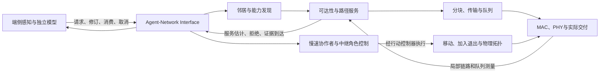

# 动态具身边缘智能网络：架构、模型与系统候选

2026-10-27，E1-009。实际独立聊天 `01a16824-294e-7eb2-85eb-d98b7a8748f1`。本稿供D整合、C独立审查、M验收；所有新机制、参数和实验均为设计，尚未实现或验证。本轮未运行模型、研究代码测试或仿真；队列式修复仅作标准库算术核对，见第11节。

## 1. 研究对象和需要改变的路线

研究方向为 **Scalable and Adaptive Networking for Distributed Embodied Edge Intelligence**。网络由能独立运行端侧模型的移动异构设备组成；设备自行产生、修改和结束跨设备请求，物理连接也持续变化。研究目标是：在给定频谱、节点无线和计算资源下，以可承受的发现与维护成本，为这些变化中的请求提供可预测的多跳服务，并量出服务失效的边界。

旧路线把最容易复现的固定任务策略逐步当成主要工作负载，又以最新状态维护为主要控制变量。静态能力目录、单竞争域和很小的状态正文，使主要问题停留在缓存与任务执行，动态网络形成及模型驱动业务一直被推迟。这是研究对象、可控变量和验证顺序的偏移；现有数据本身仍有效。009低busy只能说明该配置没有测出容量饱和。

新的近期路线并行准备真实模型请求记录和动态多跳网络。在二者形成可核验输入后，研究跨层机制；不再先扩大HeteroMRTA同步算法、再等待观测和空间阶段到来。旧状态同步归入控制面数据维护、历史业务回归和成本记账模块。

统一技术问题是：**请求仍有用的时间、可提供证据的协作者、可达路径和可获得的无线服务都在变化，协议怎样在有限且有误差的信息下协调它们？** 这一问题同时需要发现、路径、传输和资源控制，但不要求首篇系统重新实现每一层。

具体工作流可采用分布式现场核查：移动设备在各自可见图像中推理，发现缺少外部视角后请求某类证据；收到证据可能转向另一观察者、追加局部图像或撤销原分支。能力匹配的设备可能暂不可达；更近的设备可能只有较低质量证据。任务目标与感知可见性由共同环境确定，请求及其后续分支由真实模型产生。该工作流尚未接入，不能由人工预写请求序列冒充模型自主行为。

## 2. 先行研究已经做到什么

以下是本轮为架构决策定向阅读的一手来源。近期系统性检索、设备/规模表和版本核实由D-009整合；本表不声明检索穷尽，也不声称尚无工作覆盖我们的组合。

| 先行工作或协议 | 已有能力及对本设计的约束 | 本稿要进一步验证的内容 |
|---|---|---|
| Joint Agent–Network Design，arXiv:2609.37094v1，§III–IV | 已提出交互/消息、拓扑、工作量与资源联合控制；V2X示例固定V2I，无D2D | 多跳移动网络中的分布式协议、维护费用和可服务范围；联合设计、双图和接口名称均不能作新意 |
| AgentComm，arXiv:2604.13558v1，§II–IV | BS–机器人消息语义压缩、重要性保护与知识库；示例使用Claude-Sonnet-4.5/GPT-4o | 在其内容处理能力之外核查发现、路径与竞争的成本；不能把逻辑模型角色算成实体本地部署 |
| ACHORD，arXiv:2206.02245v1，§III–V | 已有Mesh、分类传输、队列/网络反馈、通信感知移动；报告最多6机器人及13中继 | 推理动态改变需求后，相比其网络反馈与移动策略还有什么增量；中继和跨层本身早已存在 |
| MOCHA，arXiv:2309.15975v1，§III–IV | P2P机会同步、实机通信和通信感知规划、规模仿真 | 连续路径服务与断连存储转发的衔接，动态请求与同步交换应分别计费 |
| CoSMO，arXiv:2609.01082v1，§III、V | 决策效用驱动状态更新、主动拒绝和卸载；已有ns-3.42、4UE/1EN/1relay/1SN | 多协作者请求与移动多跳的增量，而非重新宣称“更新应服务决策”；不把它降格成无网络排队的抽象模型 |
| gRPC deadline/cancellation；NDN Interest；BPv7 | 通用请求期限、取消传播、命名请求、InterestLifetime及Bundle生命周期都有先例 | 只有推理产生的信息能改善这些强接口的服务决策，且付费后仍有效，才值得保留Agent扩展 |

来源：[Joint Agent–Network Design](https://arxiv.org/html/2609.37094v1)、[AgentComm](https://arxiv.org/html/2604.13558v1)、[ACHORD](https://arxiv.org/html/2206.02245v1)、[MOCHA](https://arxiv.org/html/2309.15975v1)、[CoSMO](https://arxiv.org/html/2609.01082v1)、[gRPC期限](https://grpc.io/docs/guides/deadlines/)、[gRPC取消](https://grpc.io/docs/guides/cancellation/)、[NDN请求格式](https://docs.named-data.net/NDN-packet-spec/current/interest.html)、[BPv7 §4.3.1、§5](https://www.rfc-editor.org/rfc/rfc9171.html)。2026-10-19提交的[MEAN综述](https://arxiv.org/abs/2610.26297)摘要也已提出感知—通信—计算—决策—行动协同，不能把完整架构覆盖当新贡献；其全文细节留D核对。

gRPC已经允许因结果失去用途而取消，并讨论向下游传播取消；候选机制不能与一个永不取消的RPC比较后声称发现“推理撤销”。NDN的InterestLifetime是每节点接收后的近似等待期限，不直接等于严格端到端deadline。BPv7已有生命周期和存储转发语义，但BPv7标准不指定唯一的路由算法。后续对照必须保留这些能力，并分别声明实现边界。

## 3. 系统架构与可见性

### 3.1 两个图与两个控制边界

节点集合随时间变化。物理图 `G_P(t)=(V(t),E_P(t))` 为有向潜在链路图，边表示在声明的参考PHY配置下具有可用传输机会，不表示所有边可同时成功。接收成功还取决于竞争、干扰、MCS、重试和传播。

交互图 `G_A(t)=(V(t),E_A(t))` 投影当前请求及其候选协作者；一条请求可有多个替代生产者或多个必要证据。实现应保存请求/证据依赖超图，再投影为有向图；否则把“任选其一”和“缺一不可”误当成相同流量。分别记录候选交互、已选择交互和实际交付交互，候选边不等于已产生报文。

Agent控制本地推理、需求修订、证据选择与任务行动；网络控制发现范围、路径、逐跳服务及网络反馈。端侧行动可改变位置和物理图，网络服务改变收到的证据和后续交互图。这些反馈都通过显式接口进入记录。在线节点只读本地观测、已到达消息和自己的协议状态；全局真值仅用于离线评估或明确标注的诊断上界。

### 3.2 每层的状态、动作和时间尺度

表内时间尺度是实现顺序与候选范围，需由A/B链测量后冻结，不是已测硬件性能。

| 层 | 能取得的状态及取得方法 | 可执行动作 | 候选更新尺度与费用 |
|---|---|---|---|
| 身份、邻居与能力发现 | 本节点模型/工具清单；收到的信标、认证及带年龄的能力声明；链路收发事件 | 有限寿命公告、限范围查询、回应、失效与重新加入 | 事件触发+秒级软状态；信标、挑战应答、查询转发、超时均收费 |
| 可达性/路径 | 路由缓存、路由控制包、ACK/探测及已到达反馈；没有未来接触真值 | 建路、修路、候选生产者切换、转发/存储等待 | 断链事件或几十毫秒至秒级；逐跳探测、错误、路径反馈收费 |
| 传输/队列 | 本地待发块、已知截止时间、已收到的撤销、实际ACK和接收状态 | 分块、并发窗口、pacing、优先级、可靠性、重试/停止 | RTT/队列事件；重传和取消传播都收费，不能撤回已发空口 |
| MAC | 网卡/仿真本地队列、载波忙、竞争与重试记录 | 由栈/驱动允许的EDCA分类、排队与入队控制 | 帧/时隙；用户态只能间接改变竞争，不假定逐slot决定胜者 |
| PHY | 本地测得的RSSI/SNR、ACK统计、速率控制反馈；未收到帧的信道状态未知 | 支持范围内的速率、功率、信道选择；默认先沿用成熟速率控制 | 帧级或更慢；测量、切换损失和可配置粒度单列 |
| 慢速拓扑/角色 | 自身运动代价、本地地图和经付费获得的邻接/需求摘要 | 在共同安全与任务约束下选协作者、建议中继驻留/移动 | 秒至十秒级或任务事件；指令、路径迁移、移动能耗和少做的感知任务计入 |
| 推理反馈 | 本地调用开始/结束、结构化请求修订、工具返回、证据实际消费 | 等待、改变证据粒度/对象/并发、继续本地推理或降级 | 推理步骤级；推理计算、结构化解析、额外调用与接收处理另计 |

快控制改变可用服务，慢控制只依据有时间戳的估计调整，设置最短保持时间和滞回；反馈过时可回退通用网络策略。不能由LLM逐微秒调PHY，也不能由网络读取未公开的模型隐状态。所有方法采用相同硬件安全约束。

## 4. Agent-Network Interface的首版合同

使用本地结构化API加显式无线控制报文。`request()/revise()/cancel()/consume()`由应用调用；`service_hint()/status()/evidence()`由网络返回。模型输出经schema校验成为操作，不把自由文本推测出的“重要性”直接当真实效用。

| 字段/消息 | 首版表示 | 从哪里来、谁知道 | 计费与不确定性 |
|---|---|---|---|
| 身份与防重放 | `node_id:128b, boot_epoch:64b, seq:64b, schema:u8` | 本地生成；邻居认证后知道 | 加入握手、认证标签、重启公告；身份配置方式和密钥模型共同冻结 |
| 能力声明 | `cap_id:128b, modality:u8, model_hash:256b, tool_schema_hash:256b, lease_ms:u32` | 本节点加载配置；动态忙闲为本地测量 | CAP_ADVERT/QUERY/REPLY逐跳发送；模型名不证明质量，清单外能力unknown |
| 请求身份与修订 | `request_id:128b, parent_id:128b, revision:u32, branch_id:u64` | 发起端的真实调用图 | REQUEST/REVISE；修订不免费删除远端旧副本，过时修订按版本丢弃 |
| 目标与证据 | `target_mode:u8, capability_id, explicit_ids[]?, evidence_ids[], required/alternative:u8` | 当前模型动作与已取得能力目录 | 可选生产者清单、证据依赖向量按实际长度计；不广播模型全文/chain-of-thought |
| 时间和体量 | `created_local_us:u64, remaining_ms:u32, expected_bytes:u32/unknown, modality:u8, max_reply_bytes:u32` | 本地时钟、已知编码或估计 | 估计误差与正文分块头收费；不同节点没有免费精确时钟同步 |
| 有效性变化 | `cause:{satisfied,replanned,expired,overload,...}, replaces_id?, revision` | 本地证据消费/推理/策略事件 | CANCEL/REVISE/ACK；记录原因与本地时间、远端实际收到时间 |
| 正文传输 | `request_id, revision, object_hash:256b, chunk_index:u32, chunk_count:u32, payload` | 实际序列化结果 | DATA及所有逐跳头、分片、重试；大正文不能套旧1472字节单帧假设 |
| 反馈 | `observed_at_local, sample_age, queue_bytes, delivered_rtt, reachability:{known/unknown}, estimate_interval` | 本地栈/收到的探测或业务ACK | 本地API不占无线，但CPU/日志另计；远端测量必须携带报文，预测不保证截止前到达 |
| 消费回执 | `request_id, revision, evidence_id, consumed_at_local, outcome_code` | 消费方实际采用/拒绝证据 | 本地日志用于评估；若发送端或中继使用则必须发CONSUMED报文并付费 |

这是待实现wire schema，变长字段须另有长度编码和上限。最终使用CBOR/TLV等确定编码，逐个保存实际序列化字节，不能把表中字段宽度相加当真实报文测量。对纯本地字段不凭空收费无线字节；一旦远端控制依赖它，就增加控制报文及传播等待。

有效期传播优先携带剩余预算，按已知驻留时间扣减；跨节点传输时间及不同步误差由测得RTT/时钟误差界估计，误差未知时返回区间或unknown。严格端到端达标由评估时钟判断；若协议要用精确全局时间，时钟同步费用须纳入。离线统一日志时钟不自动成为线上能力。

报文状态机：本地建请求→发现/选择候选→接受或明确拒绝→路径建立/存储等待→正文交付→消费/修订/结束。重发使用相同身份，修订递增；取消是尽力传播或带预算的可靠传播，按合同选一种。收到取消前的发送和计算保持收费；收到后已经没有其他消费者的块才可删除。共享证据以消费者引用集合计数，一个分支取消不能删掉仍有合法消费者的正文。不能把取消ACK当此前正文的成功消费。

## 5. 数学模型

### 5.1 动态节点、能力和物理图

用潜在身份全集 `U` 登记设备，`chi_i(t)∈{0,1}`表示节点在线，`V(t)={i:chi_i(t)=1}`。加入过程 `J(t)`、退出/失效过程 `L(t)`给出集合演化：

\[
V(t+1)=(V(t)\setminus L(t))\cup J(t).
\]

节点位置 `x_i`、能量 `e_i`、可用模型/传感能力 `c_i` 和计算队列随时间变。暂离线设备可保留持久存储并在重连时恢复；永久故障导致的数据损失单列。加入不免费获得全网身份/能力目录。物理状态 `H(t)`含传播、遮挡和干扰，`E_P(t)`是其在参考PHY下的潜在边。拓扑动作 `z(t)`受运动学、能量和任务覆盖约束，影响后续 `x,H`；无动作时也会有外生移动和失效。

一次场景配置记为

\[
\omega=(N,A,\rho=N/A,D_P,\bar h,\nu_V,\nu_E,\lambda_0,\mathcal B,\mathcal C,B_{\rm radio},\mathcal M).
\]

`D_P`为连通分量内直径分布，另报分区比例；`bar h`报告已选路径和成功路径两套分布，不能只看成功短路径。`nu_V`为加入退出强度，`nu_E`为归一化链路变化率；`lambda_0`为外部目标到达率，`B`为真实业务大小/模态分布，`C`为端侧计算配置，`M`为移动/接触过程。密度、直径、跳数有相互关系，不把它们都宣称为可独立任意控制的变量。

### 5.2 推理、请求和反馈共同演化

节点i的本地推理上下文为 `h_i(t)`，局部观测为 `o_i(t)`，实际完整交付证据为 `Y_i(t)`，带年龄的网络反馈为 `F_i(t)`。下一步模型调用产生

\[
(h_i(t+1),\mathcal R_i^+(t),\mathcal R_i^\Delta(t),a_i^{\rm task}(t))
\sim\pi_i(\cdot\mid h_i(t),o_i(t),Y_i(t),F_i(t),\xi_i),
\]

其中 `R+`为新请求，`RΔ`为修订/取消，`xi_i`为本地模型随机量；调用完成前不提前释放结果。计算等待和实际推理时延均进入端到端时间。模型权重相同也可有独立上下文；共享GPU的多个上下文只能称独立逻辑实例，实机端侧时延和能耗需分别测量。

请求 `r=(id,i,K_r,t_r,d_r,b_r,mod_r,dep_r,rev_r)`：`K_r`是当前可接受协作者或能力谓词，`d_r`是截止时刻，`b_r`为请求及回复分列的实际正文需求或未知估计，`dep_r`区分必要/可替代证据。`G_A`由存续请求和候选集投影。目标节点离线时，请求仍留在独立生命周期账本，不能因节点从图中消失就从失败分母删除。网络不免费知道 `K_r`内所有设备的位置或质量，只能使用已经收到的声明。

计算调度另受每节点可用资源约束：时段Delta内分配的推理工作量不超过该设备测得的服务预算，`sum_l w_il(t) <= f_i(t) Delta`，驻留模型、上下文及激活内存不超过 `M_i^comp`。`w`和`f`采用同一种测量单位；无法以固定cycles描述的GPU推理用实测服务曲线/并发上限替代。上下文依赖由运行中调用形成，不预装固定任务DAG。网络机制若增加推理次数，计算等待和成本同样进入对照。

外部目标保持可追踪身份；外部目标率 `lambda_0`和模型产生的请求率 `lambda_req^pi`分别报告。网络反馈可能减少后者，不能据此说网络容量提升。固定请求回放衡量服务机制，模型反馈运行衡量整个系统；同一份未来轨迹不能在分支改变后继续假装为闭环真实请求。

### 5.3 多跳队列和干扰可行服务

将请求/回复正文分成带身份的块，控制报文也进入队列。首个分析模型采用逐跳单副本转发；DTN复制基线另增加复制项，网络成本全部保留。每类k固定一个目的端 `d_k`，请求与回复为目的端各自确定的不同类；本式描述目的端不变的单类，在线改选及类间迁移须另行扩展，不隐式改变在途块的归属。令 `Q_i^k(t)`为节点i持有的第k类待服务唯一块字节，`A_i^k`为本地新接纳字节，`S_ij^k`为在该时间步成功转交并从i出队的字节，`X_i^k`为明确取消/过期/溢出/永久故障删除量。递推式仅用于非目的端：

\[
Q_i^k(t+1)=Q_i^k(t)-\sum_j S_{ij}^k(t)-X_i^k(t)
 +\sum_j S_{ji}^k(t)+A_i^k(t),
\quad \sum_jS_{ij}^k+X_i^k\le Q_i^k(t),\quad i\ne d_k.
\]

目的端是吸收边界，始终设 `Q_{d_k}^k=A_{d_k}^k=X_{d_k}^k=S_{d_k j}^k=0`。令 `D_k(t)`为累计成功转入目的端交付/重组账本的唯一字节，则

\[
D_k(t+1)=D_k(t)+\sum_{j\ne d_k}S_{j d_k}^k(t).
\]

约定非目的端步内新到达下一步才可出队；目的端本步接纳的到达直接进入D，不再加入网络Q。目的端尚未重组完整或尚未消费的正文仍占接收/重组存储；D表示网络交付，不等于第5.4节的有效消费goodput。无法接纳进接收存储的传输不计成功S，原源/中继块继续等待或按明确原因删除，实际发射费用仍计入。本地生成且本地消费的内容不作为网络新接纳A。

对固定类k、初始交付及累计删除均为0，所有量以byte计；在潜在身份全集上求和（含暂离线存储），每步满足

\[
\sum_{i\ne d_k}Q_i^k(t)+D_k(t)
+\sum_{\tau<t}\sum_{i\ne d_k}X_i^k(\tau)
=\sum_{i\ne d_k}Q_i^k(0)+\sum_{\tau<t}\sum_{i\ne d_k}A_i^k(\tau).
\]

各节点总队列及重组存储不超过声明的缓存上限，网络队列溢出须在X中按原因记录，目的端交付后的重组/消费失败另记，不能回写为网络Q删除。离线但存储尚在的Q仍保留，只有永久毁坏才进X。ACK丢失的重复发送、复制以及相同正文服务多个消费者需在包级账本扩展，不把物理发射字节强塞进上述单副本守恒式；接收重复不重复计goodput。DTN多副本Q要加复制入队项和副本清理项，不能据此多算源需求。

调度 `s(t)`选择链路、信道、功率、MCS及资源分配，须属于

\[
s(t)\in\mathcal S(H(t),V(t),z(t),\text{radio hardware},\text{MAC}).
\]

例如同信道活动链路集合L中，链路(i,j)的接收SINR为

\[
\gamma_{ij}=\frac{P_i g_{ij}}{N_0 W+\sum_{(u,v)\in L,u\ne i}P_u g_{uj}},
\]

并受单射频半双工、信道宽度、合法功率、MCS误包模型和载波侦听约束。实际成功字节 `S≤`调度尝试的服务量；用仿真/实机成功事件计量，不由Shannon公式直接保证交付。冲突图可作分析近似，须另验证隐藏终端/累计干扰；当前009单域模型不能代替这个集合。

普通DCF/EDCA的可实现策略是入队、优先级和pacing，它不能任意实现全局最优 `s(t)`。完美CSI/全局调度仅作标明假设的上界。OFDMA的RU分配仅在支持的AP调度域内建模，并计触发、反馈和争用开销；不能把同一份RU预算分给不受同一AP协调的任意D2D节点。[ns-3 Wi-Fi设计 §35.1.3.2.8–9](https://www.nsnam.org/docs/models/html/wifi-design.html)

### 5.4 有效服务、取消与未完成的守恒

每个请求修订版本在截止或有效取消时结算。终态互斥分为：有效完成、主动取消、到期未完成、拒绝、故障失败；评估窗口末尚未终结者为右截尾。设本轮产生的请求数为R，采用统一结算规则后

\[
R=R_{\rm useful}+R_{\rm cancel}+R_{\rm expire}+R_{\rm reject}+R_{\rm fail}+R_{\rm censored}.
\]

已成功消费后再发取消不改为cancel；取消前已做的无效传输继续计费。修订与父请求、外部目标的对应关系保留，不能通过拆成小请求提高成功率。主动拥塞降载、证据满足、任务转向和设备失效等取消原因分别统计；“因长期等不到而放弃”不能计作节约服务的成功。

网络吞吐记录所有实际链路接收字节；端到端payload goodput只计最终端第一次完整接收的唯一正文。有效goodput进一步要求证据在有效期内、满足依赖并被实际消费：

\[
G_{\rm eff}(T)=\frac{\sum_{r\in\mathcal R(T)} b_{r,\rm unique}\,1\{r\text{首次有效消费}\}}{T}\quad[\mathrm{byte/s}].
\]

不同模态/压缩尺寸并不等价于相同语义效用，所以同时报告外部目标成功率、质量/证据正确性、每类请求及时完成率和降级比例。先固定编码比较网络；编码可调时另报告质量—字节曲线，不能把更大正文带来的更大G_eff解释为更好推理。取消前已消费的部分块只进入“部分消费字节”，不与整请求完成goodput重复相加。

### 5.5 成本、服务可行域与规模边界

总空口成本按每次实际发射及逐跳/重试计：

\[
C_{\rm air}=\sum_{\text{tx attempts}}\mathrm{airtime},\qquad
C_{\rm ctrl}=C_{\rm join}+C_{\rm discover}+C_{\rm route}+C_{\rm request/revise}
+C_{\rm cancel}+C_{\rm ack/probe}+C_{\rm role/sync}.
\]

控制类别互斥并保存原报文ID；数据报文头部与其发射统一计入总空口，不能再在控制费用重复相加。对复用广播按实际一次发射收费；多个接收者的处理量另记。全网发射时长之和可因空间复用超过观察时间；busy是各接收位置/竞争域的局部区间并集，不存在一个可不加说明使用的全网单信道busy比例。能耗[J]、计算[s或J]、存储[byte]和移动/任务机会成本分别列出，若加权须给单位归一化及固定权重。

对固定开放请求、平稳拓扑过程和声明的无线/计算资源，可讨论稳定域 `Lambda`：存在可实现因果策略，使长期平均总队列有界且接纳/丢弃及及时服务满足预设约束。队列因到期删除而有界不能单独证明稳定可服务。传统约束多跳队列已经有稳定域和最大权重调度理论；本稿没有推出其在内生请求和任意分区下的新定理。[Tassiulas–Ephremides作者机构技术报告](https://drum.lib.umd.edu/items/571fda52-aefb-4497-9a2d-69d8c7c907b9)

更适合首阶段的是有限场景服务可行域：

\[
\mathcal F_{\pi,T}=\{\omega:\ p_{\rm ontime}\ge p_0,\ D_{95}\le D_0,
\ C_{\rm ctrl}/T\le C_0,\ P(\text{service gap}>g_0)\le\epsilon,
\ U_{\rm ext}\ge u_0,\ f_{\rm reject+overload}\le\delta_0\}.
\]

阈值由应用合同与E2评价方案预先冻结。`p_ontime`同时给所有发起请求和接纳请求两种分母；cancellation、截尾和降载不可从主表消失。D95为成功服务时延，须配超期率和生存/截止前完成曲线，避免幸存者偏差。队列趋势、缓存溢出和控制面内存/CPU也一起报告。这里的域是给定T、工作负载和置信约定下的经验域，不是无限时域容量定理。

固定密度、固定每节点外部需求且资源合同不变时，可定义测试网格上的 `N*` 为连续达标区间的边界；出现不单调结果则报告域的各分量，不强压成单个N。固定面积加密的边界另记。多跳、信道数、频谱、每节点CPU或中继同步增长时必须注明资源增长规则。

对期限内必须穿越分区割集的一组不可压缩正文，按时间展开图可给必要条件：需要跨割的最低数据量不超过该期限窗口内可用成功服务容量；无时间可达路径时及时交付不可能。该条件是离线诊断必要条件，未计完整竞争耦合时不充分，也不能把未来接触图免费交给在线算法。短期限请求应明确失败，允许等待的业务才进入DTN存储转发。

## 6. 三个具体系统候选及否证条件

### 候选A：需求修订下的发现、路径与传输联合服务（优先验证）

**可测需求：** 能力匹配对象不是固定地址；请求的必要证据、替代分支或消费者集合在传输中改变，路径和发现状态可能比需求更长寿。先从真实模型记录测量这种变化的频率、剩余有效期、造成的跨跳无效字节与建路费用。

**机制：** 本地以请求revision和显式依赖标识推理变化；发现按能力谓词建立有限候选集，路径估计包括去程请求、对方计算和回复方向服务时间。对仍可达且有剩余服务预算的候选发出查询/建路；接收局部修订后更新路径和块队列，只清除已经无合法消费者的数据。断连时在同一截止合同下选择存储等待、换协作者或显式返回不可服务。保留小规模普通发现兜底，失去估计时退回通用协议。

首版规则可先按质量合同筛选候选，再筛掉保守往返服务估计已超剩余期限的路径，在其余候选中最小化预计控制与传输空口成本；没有足够测量则显式unknown，不虚构精确概率。依赖修订只依据当时已经产生的结构化工具调用、父分支完成和证据消费事件；离线标出的“最终无用”不得倒灌在线撤销。以同一请求revision关联发现查询、路径和块队列，才可能让新依赖信息在多个层次提前停止不再需要的服务；这项增量仍须与信息匹配RPC比较。

**最小强对照：** AODV/OLSR或HWMP合理路径维护 + 能力服务发现 + 有deadline、动态deadline更新、应用级cancel及其下游传播的RPC + 相同分块/可靠传输/pacing；另加NDN式命名请求、合理兴趣生存期和缓存策略，以及DTN受限复制/过期规则。不是仅比较最短路/FIFO。完整NDN/BPv7实现与取其语义的适配分别命名，不声称协议等价。

**待证的增量：** 通用RPC已经知道期限及取消。Agent扩展只可能来自：本地真实可观测的证据替代集合、修订传播范围和多个消费者的共享依赖，能在终止取消之前做出更合算的发现/路径/分块服务选择。不能假定该增量一定存在。必须加“通用RPC也取得同样依赖字段”的信息匹配对照；若其同样奏效，结论应归为通用依赖服务机制，而非Agent专属。

**隔离与停止条件：** 依次关闭依赖字段、联合候选选择、路径服务估计，控制报文全部收费。若真实轨迹没有足够修订/替代行为，或收益全来自通用cancel/更少正文，停止把A作为主要新机制。错误撤销可能损害共同消费者，需单列其失败率。

### 候选B：网络反馈与推理请求节奏的联合调节（与A衔接）

**可测需求：** 接入同等网络条件时，模型可能反复向不可达协作者请求、并发追加大正文、在超时后重复推理，又被迟到证据改变方向。先区分真实现象与框架重试器造成的流量。

**机制：** 网络给本地模型一个带年龄与误差范围的服务提示，包括请求/回复时延估计和可用并发额度；模型只能从共同允许的动作中选择等待、粗/细粒度证据、换协作者、继续本地推理或显式降级。快环继续用通用拥塞控制/排队；慢一层按实际推理阶段调整请求并发和预算，设置滞回及反馈失效回退。多跳资源价格若采用邻居队列摘要，摘要及传播必须收费；本地队列项不能假装已知全路径拥塞。

**强对照：** 相同传输与路由上的标准拥塞控制/pacing、EDF或合理优先级、固定/自适应并发RPC，以及通用应用自适应规则；还要与Joint Agent–Network Design的工作量—资源联合思路、CoSMO已有主动拒绝/效用反馈作明确机制对照。加相同请求预算、相同总计算预算、信息匹配规则基线。

**待证的增量：** 推理阶段和证据依赖比普通queue/RTT/deadline反馈多解释什么，能否在相同外部目标质量和资源预算下减少无效多跳服务、提高及时有效交付。请求变少仅记工作量适配；只有固定请求组的服务域扩大才能称网络服务能力改善。

**隔离与停止条件：** 固定请求回放 / 通用负载调节 / 真模型反馈三组；再交换有误差的阶段标签和去掉阶段标签。若只靠限制请求数即可复制收益，保留通用负载控制，不宣传推理感知增益。禁止通过无限增加模型思考或人工设定完美价值排序取得收益。

### 候选C：协作者选择与中继角色的多时间尺度适配（条件成熟后）

**可测需求：** 固定密度扩区域后，关键能力设备反复位于分区边缘；单靠更快传输不能让证据在期限内跨过割集。需要先测可达能力覆盖、短期请求热点及接触持续时间。

**机制：** 快环继续执行路径和队列服务；慢环比较换协作者、移动中继驻留和维持任务位置的代价，以有限寿命的需求摘要形成局部角色建议。可撤销的移动租约与最短驻留时间抑制来回摆动；执行前仍通过任务/安全控制器。角色消息、移动时间、无线切换、能源和失去的感知覆盖均进入共同目标。

**强对照：** ACHORD式网络/队列感知移动、MOCHA通信感知规划/数据摆渡、固定中继、相同数量与能量的通用连通性维护及无移动策略。不能靠增加中继、频道或改变任务覆盖让方案获益；提供固定外生轨迹组隔离路由收益，允许移动组再比较整体系统。

**待证的增量与停止条件：** 面对动态推理请求，需求摘要比单纯连通性/队列状态能否更早形成有用路径，并补回移动代价。若需要完美未来请求或全球地图才有效，或者任务覆盖损失超过服务收益，不继续扩大该候选。

推荐先做A/B共有的测量与接口，不同时实现三套大系统。先确认通用deadline/cancel、合理发现和拥塞控制还留下可重复损失；有证据再选择A或B为首个系统主机制。C依赖真实移动和任务覆盖合同，作为后续扩展。OFDMA/PHY优化须等瓶颈定位，不是首阶段的强制贡献。

## 7. 验证路线及实现边界

### A链：真实端侧模型通信负载

规划从3–4个独立逻辑模型实例的小场景起步，先检查模型是否自主选择协作者、请求证据、追加/取消；不是当前批准运行预算。冻结模型/量化/提示词、任务目标、每节点可见观测和工具schema。保存每次调用起止、设备/进程/上下文身份、实际请求和修订因果、字节、依赖、证据消费及分支结束。实体设备上的推理分布另测，不用集中GPU性能替代。

至少分开“每设备独立模型”“单机多逻辑实例”“云API代理”三种证据。外部图片或物理场景有来源，额外多模态正文来自编码测量；合成增大正文仅作容量诊断。模型选型及可取得硬件交D/E2确认，本稿不指定未经预检的实时模型性能。

### B链：成熟动态无线模型与协议

首选评估ns-3的Wi-Fi adhoc + IP MANET路由作为去中心化主线，并将802.11s/HWMP作为另一类Mesh栈；DTN增加存储转发与声明的机会路由。比较时固定频谱/功率/射频数量，说明不同栈头部与默认参数，原协议与公平适配分别报告。[ns-3 Wi-Fi](https://www.nsnam.org/docs/models/html/wifi-design.html)、[Mesh及限制](https://www.nsnam.org/docs/models/html/mesh-design.html)、[AODV RFC3561](https://www.rfc-editor.org/rfc/rfc3561.html)、[OLSRv2 RFC7181](https://www.rfc-editor.org/rfc/rfc7181.html)

版本、平台及模块可用性尚未本机验证。ns-3 Mesh文档明确列出未实现的部分功能，不能从Wi-Fi模块支持802.11ax推导Mesh栈具备任意OFDMA/信道切换能力。若采用ns-3内置OLSR，应核对具体实现版本，不能把它自动写成OLSRv2。

先以外生移动、有限区域和可复现链路扰动，检查多跳、隐藏终端、路径断裂、加入退出、分区和重连。采用两个配套负载：A链真实轨迹固定回放隔离网络；A/B交互执行观察网络反馈导致的新请求。网络时间与模型墙时要有因果桥接；预录固定推理时延只能作为重放配置，不能冒称实时联合实机。

### C链：规模和跨层归因

| 实验族 | 主要变化 | 保持和记录 | 主要回答 |
|---|---|---|---|
| 固定面积加密 | N、密度、竞争邻居数 | 面积/频谱/每节点射频固定；外部总目标固定和每节点目标固定分别做 | 拥塞与干扰增长、发现控制面是否恶化 |
| 固定密度扩区域 | N、区域、直径/跳数 | 每节点负载/能力构成、功率/频谱规则固定；报告跨区域请求比例 | 多跳成本与空间复用怎样相抵 |
| 动态性 | 移动速度、链路寿命、加入退出、分区时长 | 先分别控制，再少量交互点；传播随机种子与模型种子分开 | 重构时间、发现滞后与服务连续性 |
| 业务与推理反馈 | 外部目标率、正文模态/体量、依赖/修订强度 | 真实轨迹为主；受控诊断说明修改方式 | Agent元数据是否比deadline/cancel有增量 |
| 资源归因 | 每节点计算固定 vs 总计算固定；固定射频 vs 增加频道 | 两套资源增长合同分别报告 | 收益是否只是更多算力、无线或中继 |

首轮只需小规模多跳功能场景和少量边界探点，之后由E2冻结规模网格及独立重复数量；不直接列数百节点虚构可执行预算。固定密度并不保证能力可达，应报告每个请求可接受能力的时间可达性。利用时间展开真值判定无解只作诊断，不自动从主成功率分母剔除。

主指标是唯一正文及有效goodput、截止前完成曲线、尾时延、逐跳交付、网络控制空口/字节/CPU/内存、频谱利用和空间复用、路由重构时间、服务中断分布、外部目标质量及经验可服务域。网络重构从声明的加入/断链事件到恢复第一条可用路径计，再单列恢复持续服务的时间；纯检测、建路与积压排空分别记录。端到端频谱效率可记有效交付bit/(秒·全网使用的独立Hz)，同时报告区域/每节点/每跳负担，避免把复用发送量当唯一业务收益。

统计单位是独立外部场景/移动轨迹/模型请求实现；包、token和多跳副本不是独立场景样本。按相同场景配对，嵌套报告网络随机性和模型随机性。失败、拒绝、取消、截尾均保留；停止预算、调参集、主对照和达标阈值先冻结。具体统计与样本数交E2-010整合。

### 仿真、协议原型、SDR分别证明什么

- 网络仿真可检查大规模、多跳、衰落/干扰及可控消融；证明范围受冻结模型及实现限制。
- 现成Linux设备上的用户态/协议原型先验证发现、请求修订、路由反馈、分块和取消；需核对驱动可获得的队列/速率/功率接口。ping或TCP回环不构成无线空口、移动或端侧智能证据。
- AP弱中心变体可在可编程AP/仿真中研究OFDMA，多AP之间仍需协调和中继路径；该变体与去中心化D2D主线分别评价。
- SDR可验证自定义MAC/PHY控制粒度，另付同步、信道估计、实时基带和设备开发成本。不能承诺任意商品网卡RU控制，也不把SDR作为本轮已具备能力。

## 8. 仓库复用与缺失能力的只读核对

| 资产 | 可复用部分 | 本轮检查及限制 |
|---|---|---|
| `simulation/wireless_broadcast_service.py` | payload与逐帧账本、latest/FIFO、时长计费、功能回归 | 读入口/常量；固定单竞争域、无真实路径与空间复用；不能直接升级为动态多跳结论 |
| `simulation/message_service.py` | submit/pop_due接口、排队/交付记录 | 读类与接口；instant/delay/FIFO抽象服务，非无线拓扑 |
| `simulation/heteromrta_wireless_eval.py` | 因果交付、刷新来源、冻结输入输出、旧业务回归 | 读入口；固定作者权重/静态目录/旧输出路径；不证明LLM/VLM行为 |
| `simulation/mocha_runtime_probe.py`及阶段记录 | 原同步状态机与费用探针、参考适配语义 | 读模块说明与函数入口；历史本机回环不证明无线部署，本轮未执行 |
| `simulation/route_pilot.py` | 历史运动/感知成本处理 | 读入口和geometry；这里的route是1–2节点任务行走规划，不能当MANET路由实现 |
| `simulation/heteromrta_requirements.txt` | 独立的作者策略依赖版本入口 | 本轮确认包含torch等；因此此前E1-008“通用requirements不含torch”的观察不能扩写为仓库完全没有推理依赖清单；当前运行时依赖仍未导入验证 |
| `coordination/templates/RUN_MANIFEST.json` | 新运行公共来源字段 | 已读取；以后新实验按模板扩展模型/提示词/拓扑/协议/控制权限及预算字段，历史manifest保持原字节 |

当前指定源码入口及接管记录未提供成熟MANET/Mesh/DTN栈、真实LLM/VLM多实例请求驱动、动态能力发现、无线多跳闭环或硬件RU控制的完成证据；本轮没有做全仓库依赖/二进制扫描，不声称系统中绝不存在这些软件。缺失能力应逐项作为新实现卡验收。

历史成果的归属不变：HeteroMRTA作为传统任务策略；MOCHA/AutoCast组件作为已有机制入口；因果缓存与信息账本作为消息—决策关联方法；008作为旧任务规模切片；009作为简化服务回归和轻负载下的成本现象。暂停继续将状态版本/消费者维护扩张成唯一论文贡献，不删除或重跑旧结果。

## 9. 推荐顺序与交D整合的关键项

1. **统一负载与服务合同。** E1给出本稿schema、图与队列模型；D核准应用及相关工作边界；E2冻结真实/合成业务、外部目标和资源增长合同。重点确认模型是否真的暴露比deadline/cancel更多的可用依赖信息。
2. **分别准备A、B最小证据。** 未来另卡采真实模型请求，并建立成熟路由/无线多跳功能场景。先看通用强基线的损失来源和可服务域；不以已有低负载现象推断新场景拥塞。
3. **选择A或B实现。** 若修订/替代证据导致多跳无效工作，先A；若请求自激与重试反馈占主导，先B。若合理通用协议已解决，则报告其适用性，转向真正未解释的成本，而非增加Agent标签。
4. **完成规模归因后再C/PHY。** 只有分区或资源瓶颈证据支持，才引入移动中继或AP/OFDMA变体。每次先登记新卡、写入范围、共同配置和预算。

交D：补齐近期强相关工作对上述候选的覆盖，特别是动态请求、分布式信息取得及实测反馈；核查硬件与真实端侧模型可用性；确认通用RPC/NDN/DTN与Agent扩展的信息匹配基线。交E2：明确服务阈值、资源增长两族、真实轨迹/交互执行的因果桥接和嵌套统计。交C：检查取消/降载分母、费用漏记、在线信息泄露、协议支持范围，以及是否仍以传统同步为实际唯一主线。

本轮边界：只写本文件与E1-009主卡；未安装下载、推理、仿真、测试、Git写操作、创建子代理/聊天或跨聊天发送消息。报告含新增候选而无胜出结果；M-002至M-009仍是M聊天子代理的历史执行，不能计作本独立窗口经历。

## 10. 本轮核对证据

接手实测工作副本为 `D:\Multi-Agent Network`，分支 `codex/baseline-reproduction-20261023`，HEAD `8654d7355d3d63002110c93fd0f62b7b22c04920`。已有M-011管理文件和其他窗口交付继续保留。只读核对范围为上述入口、完整用户要求及进展报告、已有RELATED_WORK中的定向条目、本稿列出的源码入口/接口和依赖清单；没有扫描全部历史实验。

一手网页于2026-10-27定向访问。论文版本号见第2节；协议网页为当日访问页面，ns-3滚动文档尚未对应到本机安装版本。在线资料的可实现性描述不等于本机可运行验证。旧实验数字与测试状态沿保存记录，本轮没有重算原始结果。

静态检查：新文档无行尾空白，显示公式分隔符和代码围栏成对；这不是模型证明、Markdown渲染测试或研究代码测试。下表记录本轮输入文件SHA-256供后续确认版本，不包含M仍在编辑的共享管理文件。

| 输入文件 | SHA-256 |
|---|---|
| coordination/handoffs/M-011-user-request.md | 6787d265c90dfc799c3e495b946c490201b8cec4ee519506b4831359af825b4e |
| research/agent_native_network/RESEARCH_PROGRESS_AND_PROBLEM_STATEMENT.md | 19ae467b874d0523d69161bc0039f692f265daa612717130f7a3b43e1158a304 |
| simulation/wireless_broadcast_service.py | dbbd7909de51603f16ecc12f8756f369afe663f658a371b2261e505974398fc7 |
| simulation/heteromrta_wireless_eval.py | 6835051153f5dc92523d8b7eacca998d1c47e9b3e65b3e5e53e27432382dc898 |
| simulation/message_service.py | de4c4e507b083e82462dfd233e13507a813aeb673935c6c0b227f366f9e240c0 |
| simulation/route_pilot.py | d512ae362e812797f3f7ba8f142802d86f9e0722aebc09ae9c4ec7724da0487a |
| simulation/mocha_runtime_probe.py | 7b524d3555c56eeba28e292faf9299c6b3d1d28f855783ab2b121fb0c6f0af44 |
| simulation/heteromrta_requirements.txt | f87660d071a00e4d75423f90ef65fe9b12383a61072118c9a6fb3e3ec04a4e02 |
| coordination/templates/RUN_MANIFEST.json | aa09f184f908c53345c34a476ce0f32fd56770f6ba828c11068a1812a2199ac7 |

## 11. C-012目的端队列边界修复

2026-10-27，根据C-012初审P2修正第5.3节。原稿SHA-256为 `cc170292d7015f46eaa1f85037af3bccedb19574a50db3325f39099ecd9386c5`。原式没有目的端吸收边界；现设每类固定目的端、目的端Q恒为0，成功到达累计为D，删除仍只记X，并给出网络积压+累计交付+累计删除的字节守恒式。中继新到达下一步才可发送，目的端本步接纳后即离开网络队列；交付与重组/消费分开。

用 `.venv/Scripts/python.exe -I -B -S -` 从标准输入执行纯标准库算术代入，未导入研究模块、启动网络或模型、生成新脚本/实验输出。三个节点为0→1→2，目的端为2，初始源持有10 byte，无新接纳；逐步断言出队上限及 `sum(Q_before)=sum(Q_after)+D_increment+X_increment`。进程退出码0，所有断言通过：

| 情况 | 网络队列Q（节点0、1、2） | 累计交付D，byte | 累计删除X，byte |
|---|---|---:|---:|
| 一跳0→2送达 | (0,0,0) | 10 | 0 |
| 两跳第一步0→1 | (0,10,0) | 0 | 0 |
| 两跳第二步1→2送达 | (0,0,0) | 10 | 0 |
| 第一跳后在中继取消（独立分支） | (0,0,0) | 0 | 10 |

这只是三种静态情形的算术核对，不是网络仿真、协议实现测试或一般正确性证明；多消费者、多副本和改选目的端仍按第5.3节的扩展边界处理。新文件hash记录在E1-009主卡，交C复核、M验收。
