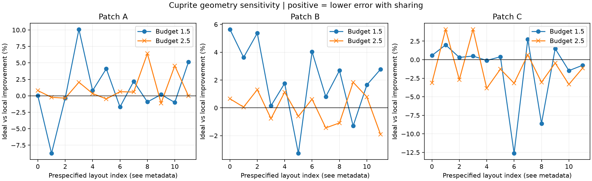

# 起终点与分区稳健性检查

2026-10-21。结论：B区紧预算仍有局部共享信号，但不足以确认强烈、稳定的在线通信需求。暂不建立新的网络理论模型。

## 方案与口径

执行前固定 [方案](../../ROBUSTNESS_PROTOCOL.md)：x/y分区轴、30/40/50分界、正反起终点共12布局，保留A/B/C全部区域；每布局2预算、2噪声、12种子、联合静态/本地/理想共享3策略，共5184次执行。数据、NNLS估计器、采样规则及终局离线汇总保持一致。参数仍是未经实测校准的网格量，不对应真实米数或设备速度。不同布局的直达距离及预算也随之变化，所以跨布局比较不是单一几何因素的严格因果效应。

相对改善为100×(基线RMSE−共享RMSE)/基线RMSE，正值有利。先在各布局内平均配对种子改善，再对12布局等权平均。下表为噪声标准差0.002；范围为布局均值范围，非置信区间。

| 区域 | 预算倍数 | 对本地均值% | 对本地范围% | 优于本地布局 | 对静态均值% | 同时优于两者布局 |
|---|---:|---:|---:|---:|---:|---:|
| A | 1.5 | 0.82 | −8.75～10.09 | 7/12 | −1.97 | 4/12 |
| A | 2.5 | 1.10 | −1.12～6.42 | 7/12 | 0.42 | 2/12 |
| B | 1.5 | 1.99 | −3.27～5.65 | 10/12 | 1.24 | 7/12 |
| B | 2.5 | 0.05 | −1.91～1.84 | 7/12 | 0.76 | 6/12 |
| C | 1.5 | −1.30 | −12.64～2.75 | 7/12 | 1.58 | 6/12 |
| C | 2.5 | −1.10 | −3.86～4.09 | 3/12 | 0.41 | 1/12 |

原布局B区紧预算的5.37%不能代表所有布局。扩大后对本地平均1.99%、对静态1.24%；对静态有9/12布局改善，范围−4.18%～3.59%。这些布局不是从真实任务分布随机抽取的，不能将比例解释为现场成功率。三个区域来自同一航空影像，种子主要改变代理噪声，无噪声重复完全确定；5184次执行不是5184个独立地质样本。



## 验证与限制

25项单元检查通过；每次运行均检查节点按预算到达终点。原x-40-forward布局的432条对应记录与上轮样本数一致、RMSE差小于1e-14。元数据保存数据质控和4份源码/方案SHA256，依赖沿用 [锁定环境](../../requirements-lock.txt)。

新增诊断在高维光谱上加入9维投影不可见的扰动：终局高维库改变，但规划路径和采样位置不变。这说明当前覆盖规则只使用9维投影，尚未利用新增高维证据中的全部信息。该检查不是“高维反馈必然有效”的证据，也不能推出需要发送完整187维数据。

所有条件允许结束后汇总采样；差异来自作业内选择的样本。没有引入无线限速、时延、丢包或多跳。本实验仍使用航空像元代理近地观测及人工9通道，不能宣称真实地面光谱、矿物识别、铁矿品位或实地通信收益。

## 下一步判定

停止围绕单一有利布局扩充参数。先回到文献，核查实际科学任务中“新近地观测→解释/不确定性更新→下一采样点”的反馈机制及其对静态计划的增益，寻找可复现的任务基线。只有文献支持且能在当前数据条件下诚实实现，才新增反馈策略，并保留静态、本地和所有负例。若可用反馈任务仍无稳定共享收益，则暂停该任务的在线网络分支；不能通过等待对端、放大报文或削弱静态对照制造需求。

## 文件与复现

- [metrics.csv](metrics.csv)：全部5184次指标。
- [layout_paired.csv](layout_paired.csv)：每布局配对比较，含无噪声及全部不利结果。
- [summary.csv](summary.csv)：跨布局描述统计。
- [episodes.json.gz](episodes.json.gz)：全部节点路径和决策记录；本轮未保存逐条共享事件。
- [metadata.json](metadata.json)：源文件哈希、参数、原布局复现计数。

仓库根目录运行（原始数据需按已有fetch_cuprite入口取得，输出目录须为空）：

```powershell
.venv/Scripts/python.exe -m simulation.route_robustness --output simulation/outputs/geometry-rerun
.venv/Scripts/python.exe -m unittest simulation.test_prospecting simulation.test_observation simulation.test_routes -q
```
