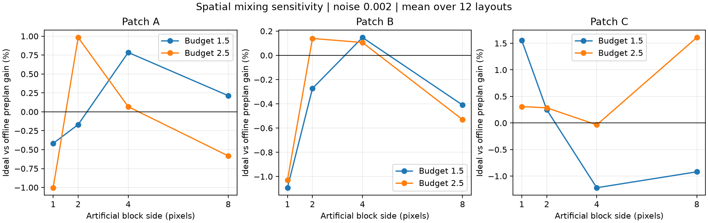

# 空间混合敏感性与阶段判定

2026-10-21。结论：空间混合让观测产生此前未知的规划输入，但本轮仍没有跨设定稳定胜过合理静态计划和本地自治的共享收益。暂停以当前光谱覆盖策略支撑在线网络选题；不继续放大混合程度来追求正结果。

## 为什么补做

前一 [因果审计](../2026-10-21-cuprite-feedback-audit-v1/INTERPRETATION.md)指出：此前只降低光谱维度，保留了精细空间先验；无噪声9维局部观测在出发前已知。P31及 [P35](https://arxiv.org/html/1904.12255)讨论的空间尺度差异未被当前代理表达。依据这一动机，在运行前固定 [方案](../../SPATIAL_MIXING_PROTOCOL.md)，加入1/2/4/8像素边长的块平均。1为负对照，其余为数学敏感性条件，不是真实传感器、物理丰度或铁矿数据。

## 全部有噪声结果

每个区域、尺度、预算中先对6个种子配对平均，再对12布局等权平均。正值为ideal降低RMSE。无噪声只运行seed0，全部结果保留在CSV。

| 区域 | 混合块边长 | 预算倍数 | 对本地% | 对旧静态% | 对预演静态% | 同时优于三者布局 |
|---|---:|---:|---:|---:|---:|---:|
| A | 2 | 1.5 | 0.34 | 0.07 | -0.17 | 2/12 |
| A | 2 | 2.5 | 1.03 | 0.67 | 0.98 | 6/12 |
| A | 4 | 1.5 | 0.83 | 1.17 | 0.78 | 5/12 |
| A | 4 | 2.5 | 0.26 | -0.09 | 0.07 | 3/12 |
| A | 8 | 1.5 | -0.24 | -0.91 | 0.21 | 1/12 |
| A | 8 | 2.5 | -0.46 | -0.66 | -0.58 | 2/12 |
| B | 2 | 1.5 | 0.40 | -1.75 | -0.27 | 0/12 |
| B | 2 | 2.5 | 0.22 | -0.14 | 0.14 | 2/12 |
| B | 4 | 1.5 | 0.27 | 0.18 | 0.15 | 2/12 |
| B | 4 | 2.5 | 0.11 | 0.05 | 0.11 | 3/12 |
| B | 8 | 1.5 | -0.31 | 0.15 | -0.41 | 3/12 |
| B | 8 | 2.5 | -0.20 | -0.07 | -0.53 | 2/12 |
| C | 2 | 1.5 | -0.40 | 1.04 | 0.25 | 1/12 |
| C | 2 | 2.5 | 0.85 | 1.03 | 0.29 | 4/12 |
| C | 4 | 1.5 | 1.13 | -2.10 | -1.22 | 1/12 |
| C | 4 | 2.5 | 0.38 | 0.50 | -0.04 | 5/12 |
| C | 8 | 1.5 | 0.15 | 1.34 | -0.92 | 3/12 |
| C | 8 | 2.5 | 0.77 | 1.38 | 1.61 | 9/12 |

18个非平凡混合组合中，只有C区8像素、宽预算在9/12布局同时胜过三种对照；其对预演静态平均改善1.61%，对本地0.77%。它是局部信号，不能代表其他尺度/预算/区域。无噪声情况下，同样18组合的同时占优布局数最多6/12。没有预先规定实质应用收益阈值，因此不把“超过半数”当成正式统计检验或成功门槛。

## 验证和适用边界

共2016组条件、8064条策略评分，所有节点满足预算并抵达终点。尺度1的ideal/preplanned共1008条对应指标与前一审计完全一致。30项代码检查通过，涵盖投影等价、无噪声事前计划、块均值和布局预算。原始数据未提交；所有源码/方案哈希见 [metadata.json](metadata.json)。

聚合先验可含留出位置的低分辨率贡献，策略无法读取该位置的细谱标签；所有策略使用相同先验和终局汇总。终局预测仍是从粗9维输入拟合所采187维库，不承诺恢复任意子像元细节。不同尺度的信息量不同，不能直接把跨尺度误差变化说成算法收益。原始影像方向未独立校验，空间/时间单位无实地标定。没有障碍、失败、无线队列或非确定性行程。

这个实验也没有复现P35的MCTS或P31的完整路径优化；仅检查现有可解释覆盖策略在有来源的空间混合动机下是否形成共享需求。否定范围严格限于这套代理和策略。

## 阶段处理

不再运行当前覆盖策略的更大混合比例或挑选C区单独建网络理论。后续任务基线须有独立的科学解释/类别或参数学习目标，并把“相同规划器有无新观测”与“规划器本身更强”分开。没有稳定在线任务增益时保持静态或本地自治为默认可行方案。

[metrics.csv](metrics.csv)、[layout_paired.csv](layout_paired.csv)、[summary.csv](summary.csv)保留所有条件；[episodes.json.gz](episodes.json.gz)保留每条评分的节点路径/决策和样本，未保存逐消息事件。依赖沿用 [锁定环境](../../requirements-lock.txt)。

复现：`.venv/Scripts/python.exe -m simulation.spatial_mixing --output simulation/outputs/spatial-rerun`。
