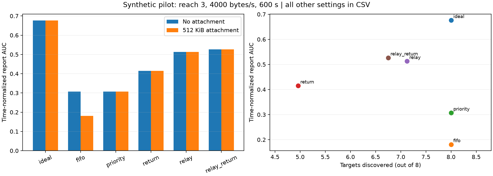

# 救灾发现回报：首轮任务级结果

2026-10-21。完成5184次合成执行。发现回报的时效损失可以分解为连通性等待与传输积压；现有摘要优先已基本解决本模型中的后者。值得进一步验证的是搜索、返回和有限中继的取舍，不是立即提出新的消息调度算法。

## 范围与指标

运行前固定 [方案](../../RESCUE_REPORT_PROTOCOL.md)。两个地面搜索节点、两条12房间合成走廊，每支路4个未知目标，24种子、3覆盖、2速率、3附件尺寸、2任务预算和6策略。参数没有现场校准。以1秒步长计算移动与字节服务，不是SimPy事件实现、SubT复现、逐包无线或火灾仿真。

report_auc为正确回报数量随时间的面积除以8×任务时长；越早发现并交付、数量越多，值越大。不等于救援成功率，未给目标人工紧急权重。所有节点保留返回入口预算；即使最终都回报，也可以有不同的运行中信息可用性。未发现目标不计贡献，避免只优化容易送达的少数目标。

下面展示一个预设分层：600秒、可达深度3、4000字节/秒、512KiB附件，均值为24种子：

| 策略 | 发现数 | 截止回报数 | report_auc | 首次可达前等待（秒） | 首次可达后至交付/截止等待（秒） |
|---|---:|---:|---:|---:|---:|
| ideal | 8.00 | 8.00 | 0.676 | 0 | 0 |
| fifo缓存续传 | 8.00 | 2.00 | 0.181 | 220.5 | 76.7 |
| priority摘要优先 | 8.00 | 8.00 | 0.307 | 220.5 | 1.0 |
| return摘要优先+返回 | 4.96 | 4.96 | 0.415 | 74.0 | 1.0 |
| relay摘要优先+中继 | 7.13 | 7.13 | 0.513 | 70.8 | 1.0 |
| relay_return | 6.75 | 6.75 | 0.527 | 51.2 | 1.0 |

中继组额外使用最多2台中继及每次10秒部署时间，不是与零中继组等资源的算法改进。返回减少了发现数；如果应用只看最终发现总量，其结论可能与AUC排序不同。

## 负对照与反证

全连通、无附件、600秒下，ideal的AUC为0.676，所有实际策略约0.674，差异来自1秒离散传输更新，没有制造普遍退化。无附件时fifo与priority逐次指标完全相同，不能用大附件负载下的差距主张所有机器人短消息都有拥塞。

全部36组条件里，priority及带返回/中继的摘要优先组都在预算截止前交付了全部已发现目标。各条件的平均首次可达后等待介于1.00–1.03秒；这是当前小摘要、理想可靠服务下的结果，不能外推真实ACK/争用/误码。附件是否完整收到单列；并未把未传完证据判作摘要无效。

更长任务不保证额外返回有利：可达深度3、4000字节/秒、512KiB附件、900秒时，不返回priority的AUC为0.538，固定120秒返回为0.530；中继不返回为0.667，中继加返回为0.644。随后已连续完成 [返回周期留出补查](../2026-10-21-rescue-return-v1/INTERPRETATION.md)，不把120秒视为优化后的强基线。

## 验证与限制

35项检查通过，其中5项新增检查覆盖生成/交付因果、无附件等价、同路线公平性、预算/中继资源及重复性。每次运行检查预算内返回；保留全部5184条 [metrics.csv](metrics.csv)、216组分层均值 [summary.csv](summary.csv) 和种子0的全部216个任务日志 [episodes_seed0.json.gz](episodes_seed0.json.gz)。[metadata.json](metadata.json)保存源码与方案哈希，依赖沿用既有锁定环境。

所有目标检测与定位完美，没有假阳性、节点失效、救援调度或任务级跨机器人反馈。队列中保留未交付数据，未收到的报告延迟按截止截断，不能称为最终交付均值。首次可达后等待仍可能包含再次失联，不是纯排队时间。字节服务按跳数收费但无逐跳缓存及真实MAC。没有模拟机器人间机会携带、移动中继或最优调度；现有策略集合未穷尽。应用字节没有加协议头，传输理想上界无实际网络字节成本。

因此，本轮只确认设定下的因果机制与已有措施取舍，不能把合成走廊长度、速率、附件大小或断连时间当作火灾现场分布。也没有确认Agent-Native特有问题或论文创新。

复现：`.venv/Scripts/python.exe -m simulation.rescue_reporting --output simulation/outputs/rescue-rerun`。
