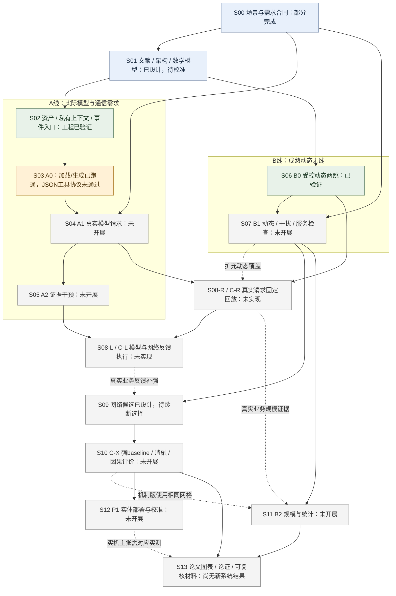

# 实验框架与进度总览

更新：2026-10-29。当前研究入口：[动态多跳网络服务与扩展成本框架](NETWORK_RESEARCH_FRAMEWORK.md)。固定模型、计算和业务条件，以网络维护、转发及服务成本为主变量；原S00–S13编号和历史结果保留。

**当前位置：网络模型与损失诊断设计已形成，下一步在固定合成业务下推进B1；动态两跳B0已有有限验证，尚无新机制收益。A0三次真实生成的严格JSON均失败，A线继续准备后续真实业务验证。**

**下一步：按有限网络诊断设计另立执行卡，区分路由维护陈旧、拥塞与物理分区 → 据损失选择一个维护或转发候选 → 做同成本强对照与扩展评价。** B线不等待A0 JSON；A线并行推进工具协议和真实请求，取得后再做外部业务及反馈验证。[网络总稿](NETWORK_RESEARCH_FRAMEWORK.md)及[实验合同](network_focus_20261029/NETWORK_EXPERIMENTS.md)建议36次诊断启动，本轮0实验。

| 现在可以确认什么 | 证据和范围 |
|---|---|
| 模型文件与隔离API已准备好 | SmolVLM固定revision的13文件已取得/校验，模型API可导入；[模型报告](preparation_20261028/MODEL_ENTRY.md)。下载和环境准备完成不等于模型已加载 |
| A0加载/生成已跑通，工具格式未通过 | 用户直接批准恢复后，02红v0输出red、03红v1输出#FF0000（按原颜色词规则失败）、04蓝v1输出blue；严格JSON均失败。累计4worker/3生成、113.968秒，最终37项工程检查；[本轮A0记录](A0_EXECUTION_20261028.md)。[E2新增核验](a0_20261028/VALIDATION.md)1519项记录检查通过，原保护停止与首次冻结保留 |
| B0已在成熟网络栈运行 | 原生ns-3.46、3个仿真无线节点、AODV、移动中继分区后返回；两个种子各60秒。**每次**110生成、68及时收到、42窗末未收到；分区窗0收到，42秒后36条新探测收到；[网络报告](preparation_20261028/NETWORK_ENTRY.md) |
| 尚缺哪一段 | 真实模型产生的请求、证据改变后续需求、模型计算时序与无线交付的对接均未验证；没有机制收益、网络扩展边界或实机结论 |

M-012准备阶段已通过独立审查并验收，见[阶段报告](PREPARATION_20261028.md)、[C-013审查](../../coordination/reviews/C-013.md)和[M-012](../../coordination/tasks/M-012.md)。它验收的是已保存的工程与有限运行证据，未把A0资源停止改为推理通过。最新任务状态从[CURRENT](../../coordination/CURRENT.md)读取。

此前快照保留：M-012在加载前RAM门槛停止，worker 0；M-013只完成阶段与缺口映射；M-014首次1worker/0生成因低RAM保护停止，随后用户直接批准资源改善后的人工恢复，新增3次真实生成。旧报告/原始失败与首次E2审查快照保留。

[模型与业务链](experiment_framework/MODEL_CHAIN.md)、[网络与因果评价链](experiment_framework/NETWORK_CHAIN.md)是M-013历史映射。本轮新控制器`a0_task.py`已适配E1-012的卡/输出/预算，旧`a0.py/preflight.py`默认路径保留，旧模型/env只读复用。网络仍为E2-011及已用完的五个名额；后续须按明确任务范围运行，不能删账本或套旧命令续写旧输出。A0新模式、两次预检和保护停止详见[阶段报告](A0_EXECUTION_20261028.md)。

## 1. 一张图看全链条

实线表示输入依赖，虚线表示后续补强或条件分支。B线可先以固定合成业务在S07诊断并进入S09/S10网络比较，S08另做真实业务与反馈验证；S03不阻塞B线。

S编号是本页稳定阶段ID，A0/A1/A2/B0/B1/B2/C沿用[验证方案](reorientation_20261027/VALIDATION_PLAN.md)名称。图中“已验证”只覆盖节点内写明的范围；M-011给出的完整网络模型和接口尚待实验标定，不算整套系统实证完成。

## 2. 阶段表：输入、做到哪里、怎样完成

状态只用具体事实，不估算完成百分比。代码未实现时直接记“未实现”，不把设计文档当运行入口。

| ID / 对应实验 | 当前状态 | 输入与依赖 | 要回答的问题、产出 | 现有代码 / 配置 / 证据 | 完成判据 |
|---|---|---|---|---|---|
| S00 场景与需求 | **部分完成** | 应用来源、合法观测、固定外部根目标 | 哪些证据需要跨设备取得？形成输入/评分/资源合同 | [方向修订§2、7](RESEARCH_REORIENTATION_20261027.md)、[数据来源](preparation_20261028/SOURCES_AND_LICENSES.md) | 选定真实输入并记录许可/hash、私有视角划分、根问题真值、截止及资源阈值；目前场景包与统一合同未冻结 |
| S01 文献与模型 | **已设计，待校准** | S00及直接先行机制 | 解释需求演化、动态可达性与共享无线服务；给可执行状态/动作和假设 | [12项文献矩阵](reorientation_20261027/LITERATURE_REVIEW.md)、[架构/模型](reorientation_20261027/ARCHITECTURE_AND_MODEL.md) | 方法/部署/强对照来源可查；队列、计算、干扰和成本口径闭合；用A/B数据校准后才能验证模型预测 |
| S02 资产与P2工程 | **工程已验证，新增人工恢复边界** | S01、固定来源与本机环境 | 文件能否追溯，私有上下文、到达与消费是否被正确隔离？ | [来源锁](preparation_20261028/SOURCE_LOCK.json)、[模型代码](../../simulation/edge_agent_entry/README.md)、[本轮工程记录](A0_EXECUTION_20261028.md) | 最终37项检查含原隔离/来源、预算/监测、人工批准恢复及双输入不能因运行完成而判通过；不同检查版本不累加模型样本 |
| S03 / A0 | **部分完成；加载/生成已完成，严格JSON工具协议未通过** | S02已适配；下一卡需协议/输出适配方案及新预算 | 模型能否真实加载、接收图像、生成并解析工具输出？ | `a0_task.py / model_worker.py`；[12汇总](../../simulation/outputs/E1-012/20261028-12-A0-user-approved/summary.json)、[14蓝图](../../simulation/outputs/E1-012/20261028-14-A0-blue-diagnostic/summary.json)、[阶段报告](A0_EXECUTION_20261028.md)、[独立核验](a0_20261028/VALIDATION.md) | 累计4worker/3生成；红v0与蓝v1颜色词正确，红v1的#FF0000按原规则失败；三次JSON/引用失败。实际视觉张量512×512；E2确认记录一致，A0未整体通过，不得以自由文本适配替代原协议通过 |
| S04 / A1 | **未开展** | S03通过，S00真实私有视角/评分冻结 | 模型是否自主选对象、提出/追加/终止请求？产出真实通信与计算轨迹 | 现有runtime只有request/respond/consume/finish；多轮模型驱动及revise/cancel/request_crop待实现，见[模型映射](experiment_framework/MODEL_CHAIN.md) | 请求来自模型输出，只有到达证据可见；正文/图像实际字节、调用时序、根目标结果及全部失败可追踪；固定脚本不代替 |
| S05 / A2 | **未开展** | S04真实轨迹、相同推理前缀 | 证据到达/缺失/延迟是否改变后续请求与答案？ | 干预运行器/成对输入清单未实现，见[A2设计](reorientation_20261027/VALIDATION_PLAN.md) | 配对干预与证据ID相连，输出差异不是只靠随机抽样解释；正常记录复用时不当作新增独立样本 |
| S06 / B0 | **受控动态两跳已验证** | S01、固定ns-3源码/合成业务/移动合同 | 成熟栈能否真正转发、在无路时停止交付、恢复后交付新探测？ | [网络代码](../../simulation/dynamic_network_entry/README.md)、[固定配置](../../simulation/dynamic_network_entry/config.json)、[B0归档](../../simulation/results/2026-10-28-E2-011-network-entry/ARCHIVE_MANIFEST.json) | 两个60秒运行已有实际中继/TTL、分区0送达、恢复新送达及逐跳费用；3无线节点、N_A=0，只验这一场景 |
| S07 / B1 | **有限诊断已设计，未运行** | S06、新任务入口/OLSR构建与包级追踪，固定业务/无线合同 | 改道、干扰/复用、分区和服务变化分别损失在哪里？ | [下一有限实验](network_focus_20261029/NETWORK_EXPERIMENTS.md)：8节点/2流、3场景×2路由×2负载×3seed，建议36次；代码/新日志待交付 | 首两项是总36次内的工程门槛，失败即停；全部终态/控制/ACK/重试可重建，不要求出现正收益；3seed不当独立真实场景 |
| S08 / C-R→C-L | **两步均未实现** | 回放需S04真实请求+S06；反馈执行还需S05；S07补动态范围 | 同一请求的损失来自计算、可达性、排队还是需求过时？ | 无共同事件桥；[对接细表](experiment_framework/NETWORK_CHAIN.md) | S08-R先固定业务，只换网络并核正文/分片/截止；S08-L再让真实到达改变后续模型请求，生成—到达—消费全程可查 |
| S09 机制与理论 | **网络候选已设计，待诊断选择** | S07固定业务网络诊断；S08/S05为后续真实业务补强 | 局部维护或拥塞转发能否改善服务—成本曲线？ | [网络模型](network_focus_20261029/NETWORK_MODEL.md)、[总框架§4](NETWORK_RESEARCH_FRAMEWORK.md) | 首轮只选一项，固定计算/业务；同成本对照、失败条件与权限明确；令牌预算性质不等于性能或稳定性结果 |
| S10 / C-X | **未开展** | 网络机制版需S07/S09；真实业务版另需S04/S08，应用反馈版需S05 | 相同业务下网络机制是否有效，真实业务下是否仍成立？ | [当前网络比较](NETWORK_RESEARCH_FRAMEWORK.md)；原[C链](reorientation_20261027/VALIDATION_PLAN.md)保留反馈评价 | 先网络强基线/消融、后真实业务/反馈四格，应用与计算固定；协议、失败及控制费用完整报告 |
| S11 / B2与正式统计 | **未开展** | S07先测网络基线；Agent业务版需S08-R真实输入，机制版还需S10 | 加密、扩区、更多模型、变化速率怎样改变达标范围？ | [B2网格/统计方案](reorientation_20261027/VALIDATION_PLAN.md)，无新规模结果 | 密度/面积、无线N/模型N_A、总/每端算力及负载分开；报告控制/服务曲线、失败边界和独立场景不确定性 |
| S12 / P1实体 | **未开展** | 已验证A0/网络执行；机制实测需S10 | 仿真/逻辑实例能否在多个真实设备和无线中实现？ | 当前无多实体本地模型试验；[实机边界](reorientation_20261027/VALIDATION_PLAN.md) | 设备/模型/输入/无线映射、端侧计算与能量实测可查；3个仿真无线节点不等于3台实体设备 |
| S13 论文与材料 | **研究稿已成；新系统结果未成** | S01可先组织叙述；结果主张依S10/S11，实机主张依S12 | 把机制、证据与适用范围写成可审查论证 | [总体稿](RESEARCH_REORIENTATION_20261027.md)、[本阶段报告](PREPARATION_20261028.md)、下节图表计划 | 每个结果图对应冻结实验/原始数据/配置及失败；结论强度与实际验证范围一致，复核材料可定位 |

模型细表中的`A-PREP-SRC / ENV / IO`都映射到S02，A0/A1/A2映射S03/S04/S05，A→B映射S08。网络细表的B0/B1/B2映射S06/S07/S11，C-R/C-L分别映射S08-R/S08-L，C-X映射S10，P1映射S12；B3为后置移动/负载等敏感性，在S07/S11按问题分配，不自动追加矩阵。

原规划的A1功能门槛为至少3个场景块出现证据依赖追加/终止并有合法来源改变，A2要求相同前缀的后续工具选择/终止与证据干预相符。它们只是未来功能检查的设计，须按新输入/预算冻结，不是现有结果或泛化统计保证。

## 3. 如何判断A/B已经接通

S08是目前明确缺失的汇合点。先做S08-R/C-R：使用同一真实请求清单和发布时间，隔离网络服务作用；再做S08-L/C-L：固定根目标、感知输入和模型资源，允许到达证据改变后续请求。模型反馈分支一旦改变，就不能继续套用同一条未来业务轨迹。

| 对接合同 | 应保存什么 | 当前情况 |
|---|---|---|
| 请求与证据身份 | 根目标/请求/修订/正文/目标节点ID，必要证据与替代证据分开 | P2局部消息ID已实现，修订/取消/多消费者与网络分片映射待实现；模型多轮调度未接好 |
| 可见性 | 生成、完成发送、完整到达、显式消费；未到达内容不得进入提示 | fixture有隔离检查，真实模型+无线共同记录未实现 |
| 时间 | 实际计算/排队结束后才能发送；网络到达触发后续推理 | P2逻辑时钟、模型墙时与ns-3虚拟时间尚无共同桥接，不能给各逻辑节点免费独占GPU速度 |
| 字节和费用 | UTF-8/编码图像正文，协议头、逐跳、重试、ACK及控制分别记录 | fixture已有正文411 byte记录；B0已有PHY尝试账本；二者未对同一请求核账 |
| 工作负载条件 | 回放固定签发清单；模型反馈运行重新产生后续请求 | 当前尚无A1实际轨迹，因此两类耦合实验均未开展 |

接口字段与双图用于上述映射。默认交互图是活动已选请求，候选来源图和实际交付图单列；物理机会链路不意味着可同时成功服务，见[架构原文](reorientation_20261027/ARCHITECTURE_AND_MODEL.md)。

## 4. 从损失选择机制，再作公平比较

当前按[网络总框架](NETWORK_RESEARCH_FRAMEWORK.md)收敛为两个候选：有预算的局部路由维护，以及拥塞感知逐包转发。先在S07固定业务诊断后选一项，不以A0/A1成功为前置。下面三个候选保留为2026-10-27的应用反馈探索，仅在后续证据支持时再展开；已有方法作为强比较起点。

| 诊断到的主要损失 | 对应候选及最小改变 | 至少保留的强对照 | 用什么判断值得继续 |
|---|---|---|---|
| 替代证据到达后，旧请求仍占队列；改选来源与路径修复脱节 | 需求修订下的发现—路径—传输协调：有界候选、剩余服务估计、修订贯穿分片/路径与有界撤销 | 成熟路由+能力发现+RPC deadline/cancel/传播；同依赖信息RPC，适用时NDN、MOCHA/DTN | 在同信息和质量下减少无效逐跳服务/依赖等待，或降低维护复杂度；普通取消已解释的部分单列 |
| 模型追加请求形成突发/互阻，反馈又过时 | 服务预算与请求节奏：快速普通流控，推理阶段按有年龄预算调并发/粒度/来源 | 普通限速/EDF/自适应RPC，HAFS、Joint、CoSMO；进入合法接入域时比较Agentic MAC | 保持外部目标质量与计算预算，改善尾延迟/达标范围；分解少发字节、额外推理和网络控制效果 |
| 移动/分区后关键协作者不可达，回连或中继角色切换频繁 | 快速路由+慢速协作者/中继租约、驻留与滞回，安全控制器执行移动 | ACHORD、MOCHA、Mesh维护、合理连通/队列中继及DTN | 同设备/能量/覆盖预算下减少持续中断；移动、失去的感知覆盖和控制消息均计费 |

详细先行能力见[文献矩阵](reorientation_20261027/LITERATURE_REVIEW.md)。普通Wi-Fi先控制可执行的队列/传输，OFDMA只在支持的AP域验证；MCS/功率/信道及SDR动作分别核权限。S09可研究算法、复杂度、控制成本或明确假设下的理论；S01现有有限服务域设计尚无校准数据，不凭架构完备宣称新定理。

S10先做固定业务下的网络强对照与消融。后续反馈评价保留“网络机制N0/N1 × 应用行为固定/可适应A0/A1”四格，这里的因子与阶段名是两套记号，表列名用**网络传统/候选、应用固定/适应**。交互项为`(Y11−Y01)−(Y10−Y00)`，四格原值同时给出。所有方法匹配模型、调用/图像预算、计算资源、无线和控制信息，开发调参预算一致。

## 5. 统一指标与规模口径

详细定义沿[总报告§5](RESEARCH_REORIENTATION_20261027.md)及[验证方案§6–7](reorientation_20261027/VALIDATION_PLAN.md)。下表是填写实验结果时最容易混用的口径。

| 指标 | 公式/分母和必须同时报告的内容 |
|---|---|
| 有效到达与消费goodput | 各自为`8 × 窗口内唯一对象—目标对的有效byte / T`，单位bit/s；前者要求完整有效按期到达，后者还要求按期实际消费。同一正文共享请求不重复算；部分消费单列 |
| 请求结果与应用质量 | 所有已发起请求分解为有效完成/取消/到期/拒绝/故障/窗末截尾；主分母不删除失败或取消，补接纳请求口径。根目标集固定，另报正确性、降级与放弃 |
| 时延与未完成 | 生成前计算、网络到达、消费等待分列；成功子集p95/p99须配全部请求的失败/超期/截尾。B0的42条未收到未定位内部去向，不能猜成某层丢包 |
| 路径与恢复 | 目的端TTL加中继实际转发支持多跳；检测、首条可用路径、持续业务恢复及排空分开。B0的42秒检查点新探测不等于完整重构时延 |
| 控制、频谱与能量 | 发现/路由/请求修订/取消/ACK探测/角色同步互斥；逐跳、重试、头部付费。发射时长之和与CCA忙时并集分开，频谱效率给bit/(Hz·s)，另报面积与能耗/覆盖成本 |
| 无线与模型规模 | `N=全部无线节点`，`N_A=实际模型端点/实例`。规划B2的N=8/16/32/64固定N_A=4，其余为中继；当前只跑3无线节点B0，未跑64模型Agent |
| 面积、密度与直径 | 一族固定面积加密，一族固定密度扩区；报告实际连接分量/分区、直径、已选与成功路径跳数。移动参数与实际链路变化率均记录 |
| 负载与计算 | 固定总外部需求和固定每模型端点需求分组，后者按N_A增加根任务，不按仅转发节点N强塞智能任务；外部目标率与策略子请求率分开。模型扩展时固定总算力/固定每端算力分组，不能把算力增长记为无线收益 |
| 边界与统计 | 预先冻结及时率、质量、尾延迟、控制预算、拒绝与服务空窗阈值，再画经验达标域。缓冲/TTL有界不证明长期稳定。独立场景/拓扑块是统计单元，帧/相机/包/种子重复不直接变成新场景 |

旧规划A0–A2合计最多436前向、C最多576前向、B1/B2建议24/42次均是后续候选矩阵。规划A0为两模型×两输入/每次256 token，M-012实际只准备SmolVLM、授权最多4次/每次128输出token，最终前向0；两种模型未因这次准备变成已验证。B0总5次启动中3次模拟前失败、2次进入无线运行，名额已用完。后续数量须另卡，不从旧规划或失败中自动获得预算。正式样本量按场景独立性、精度和资源重新冻结；两个B0种子只支持该微场景检查。

M-014的E1-012总预算最多4次worker、每次256新token/180秒、累计720秒。首次两次正式预检后，1次worker因512MiB保护停止，生成0；用户释放资源后明确批准人工恢复，另批一次正式预检，保留原账本与停止事件。当前累计预检3次、worker4次、生成3次、113.968秒，提示修订1次；14蓝图复用第三次预检。4次启动已用完，不继续调用。直接GPU+父监测模式仍1.5GiB启动/512MiB保护，默认旧模式仍2GiB；详见[A0报告](A0_EXECUTION_20261028.md)。

模型随机流与无线随机流分别保存，调参只使用开发场景并对齐配置数/预算。事件数不同会改变随机调用顺序，同seed本身不保证不同方法经历相同路径；分析以场景/拓扑块配对，并明确块内重复。

## 6. 数据和资产现在在哪里

P1指多实体设备各自本地推理，P2指共享硬件上的独立上下文/逻辑实例；P3远端API、P4单模型跨设备切分另列。当前P2已有单输入私有上下文的3次真实生成，尚无合法协作工具轨迹；仿真无线节点也不是P1设备。

| 输入 | 取得状态 | 用途及边界 |
|---|---|---|
| SmolVLM模型/隔离环境 | 已取得；M-014在12/14分别重新核13项身份，只读复用`data/agent_native/E1-010/`，下载0；[当前记录](a0_20261028/MODEL_RUN.md) | 三次真实CUDA/FP16加载与生成，worker有实际依赖/参数/峰值记录；简单颜色结果不替代严格JSON工具协议，模型许可与数据授权分开 |
| Qwen3-VL较强模型候选 | 仅在旧方案列为候选，本次未取得/未验证，见[模型链预算对照](experiment_framework/MODEL_CHAIN.md) | 后续异构模型比较另核来源/许可、资源及实际取得，不填作已有第二模型 |
| 合成PNG | 旧[fixture归档](../../simulation/results/2026-10-28-E1-010-model-entry/runs/20261028-08-freeze-fixture/)保留；本轮中性名红/蓝64×64图均有真实生成，见[12输入](../../simulation/outputs/E1-012/20261028-12-A0-user-approved/inputs/) | 实际视觉张量为512×512，不能按原图尺寸解释成本；红/蓝颜色词各有正确输出，三次JSON均失败，不能推泛化视觉能力或真实需求 |
| nuScenes mini | 已定位且官网数据条款已读，场景包未取得，见[来源说明§3](preparation_20261028/SOURCES_AND_LICENSES.md) | 数据CC BY-NC-SA及附加条款与devkit代码许可分开；同车多相机只支持逻辑私有视角，不当多设备移动拓扑 |
| WILDTRACK | 官方入口已定位，完整数据许可仍未知，未取得 | 七静态相机适合作后续视角候选；公开链接不替代使用/再分发许可 |
| ns-3.46与B0配置 | 固定源码/本地包hash、Windows工具链已运行，见[NETWORK_ENTRY](preparation_20261028/NETWORK_ENTRY.md) | Friis+Range移动合同、512字节UDP探测是合成工程输入；无实测覆盖、一般衰落或模型负载结论 |
| 实体设备与现场输入 | 现有项目平台背景保留；本条新路线尚无P1试验/输入合同 | 后续按实际设备/端侧模型/无线映射核验，不从参数量或仿真节点数推定可部署 |

## 7. 论文图表将由哪些实验产生

下列为产物计划，不代表论文终图已经生成。已有数据只能支持对应范围，其余等阶段判据满足后填写。

| 产物ID | 拟呈现内容 | 依赖阶段与数据 | 目前能支持的结论 / 还缺什么 |
|---|---|---|---|
| T01 相关工作与强基线表 | 实际模型部署、拓扑、控制权限、规模和反馈 | S01，[12项矩阵](reorientation_20261027/LITERATURE_REVIEW.md) | 已可整理文献对比；不从“特征未全覆盖”直接推出新意 |
| F01 系统与事件时序图 | 感知/推理—请求—无线—消费及局部反馈 | S01设计 + S08实际事件 | 设计图已有依据，实际时序需A/B对接后验证 |
| T02 平台/资源/数据配置表 | P1/P2/P3/P4、模型/精度、包、图像、无线与算力预算 | S02/S03/S06，后续S12 | 已有三次CUDA/FP16加载/生成时延、worker版本、实际512×512张量及分阶段PyTorch显存峰值；连同原保护失败和ns-3配置报告，只支持当前模型/输入兼容诊断 |
| F02 真实请求及证据干预图 | 请求对象/尺寸/修订、消费与后续行为变化 | S04/A1、S05/A2 | 已有3次颜色自由文本生成，尚无合法工具行为/协作轨迹；不能据此进入A1或用fixture绘成自主行为图 |
| F03 路径—分区—恢复与费用图 | 移动、实际转发、签发/接收、控制空口 | S06/B0；动态范围推广需S07 | 现有事件/pcap可支持同一受控两跳场景的两个种子；不支持一般重构时间/扩展边界 |
| F04 损失分解图 | 路由未知/陈旧、物理不可服务、拥塞、到期及接收等待 | S07固定合成业务先行，S08后补真实请求共同事件 | 当前仅设计；不能从B0未收到条数猜各层损失 |
| F05 机制收益与消融图 | 强baseline、网络/应用四格、反馈年龄及新增环节 | S09/S10/C-X | 未选择/实现主机制，当前没有网络收益结果 |
| F06 规模/动态达标域 | 固定面积/密度、N/N_A、负载、算力和控制成本 | S11/B2及独立场景统计 | 未开展；9/18/36旧任务规模和3节点B0均不替代此图 |
| F07 实机校准与成本图 | 实际设备时延/能量、无线连续性、仿真差异 | S12/P1 | 未开展，结论须限定实际设备和控制权限 |
| T03 完整失败与来源表 | 拒绝/取消/到期/截尾、启动失败、环境/预算及原始证据 | 各阶段公共manifest及冻结归档 | 现有工程失败已保留；后续科研失败随同纳入，不只收成功案例 |

子映射中的图号是局部编号，整理论文时统一使用本节产物ID。规模与C结果可进一步形成服务质量—成本Pareto及场景级区间，仍归F06；当前没有对应系统性能样本。

## 8. 旧成果放在什么位置

| 已有工作 | 在本链条中的用途 | 不替代的证据 |
|---|---|---|
| [HeteroMRTA原方法](HETEROMRTA_REPRODUCTION.md)、[缓存接口](HETEROMRTA_NETWORK_INTERFACE.md) | S02消息/事件语义与传统业务回归，必要时作辅助负载 | S04/S05的LLM/VLM自主需求与证据干预 |
| [MOCHA原协议](MOCHA_RUNTIME_ENTRY.md)、Latest/FIFO | S07/S10的缓存、恢复、可靠服务和维护成本构件/对照 | 完整动态Mesh、多跳规模及新机制收益 |
| [因果执行](CAUSAL_SERVICE_STAGE.md)、[008需求执行](DEMAND_EXECUTION_STAGE.md) | 信息—动作可追踪经验与维护业务参考；原条件结论保留 | S08真实模型/无线事件桥、S11网络多维扩展 |
| [009无线阶段](WIRELESS_EXECUTION_STAGE.md) | 单竞争域、低负载的维护成本和局部行为诊断；原结果保留 | 容量饱和、动态多跳扩展和真实Agent模型证据 |

旧报告与原始manifest不改写，历史来源见[RESEARCH_PROVENANCE_INDEX](RESEARCH_PROVENANCE_INDEX.md)。同步恢复保留为控制面模块，当前研究进度由上方新阶段表跟踪。

2026-10-29网络主线依据见[六篇已发表文献](network_focus_20261029/PUBLISHED_NETWORK_FOUNDATIONS.md)、[网络服务模型](network_focus_20261029/NETWORK_MODEL.md)、[实验设计](network_focus_20261029/NETWORK_EXPERIMENTS.md)和[总框架](NETWORK_RESEARCH_FRAMEWORK.md)。近期A³/Agentic MAC/PragComm的正式出版定位及本次摘要核查范围见总框架§2；它们与经典机制共同限定比较边界。E1/E2文稿冻结后已整合，新执行仍须新卡；本轮模型/仿真/训练/安装/模型或数据下载均0。

## 9. 后续只更新哪些位置

每次新任务验收后，更新首屏“当前位置/下一步”、S表对应行、证据链接和图表表对应行；新增失败也登记。阶段ID与A/B/C名称保持稳定，不因换窗口重编号。一个阶段的文稿设计、代码实现、运行、独立审查分别记录，某种子失败不会被覆盖成“未运行”。

需要增添的证据至少包含：主卡ID、冻结配置/源码/模型版本、run-id与原始输出、成功/失败清单、公共manifest、审查及验收入口。取数先核冻结hash，后续只链接已冻结交付，不把活动稿或历史测试写成当前通过。本页是日常总览；细节继续由[准备报告](PREPARATION_20261028.md)、[验证方案](reorientation_20261027/VALIDATION_PLAN.md)和各阶段报告保存。

历史快照为M-012验收及M-013框架映射，基准`b19fbe925ba515ddedea44ac128a338a5aa98d47`；两份映射与旧报告保留。本次基准`7f92debd36310a7d5e37ef52d23c019138284cdd`，已纳入M冻结的人工批准恢复结果：累计worker4/生成3、严格JSON未通过。E2正式核验共2/2次：首次510项对应旧阶段，第二次1519项/994份冻结前后匹配对应恢复阶段；均为记录检查，不是模型样本。不改阶段ID。审查/验收见[D-012](../../coordination/tasks/D-012.md)、[C-015](../../coordination/tasks/C-015.md)、[M-014](../../coordination/tasks/M-014.md)。D/E2无模型调用，新网络仿真/下载/训练均0。
