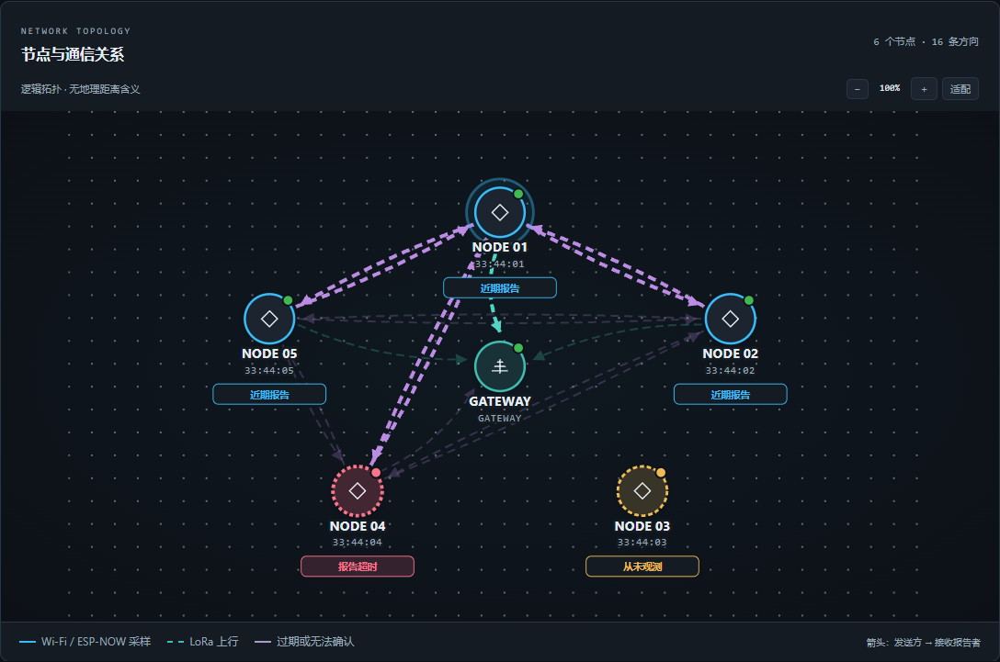

# M-064：旧工程核心观测迁移与拓扑可辨性

2026-11-24（Asia/Shanghai，UTC+08:00）。本报告为同一实施会话的开发与隔离验证，**不是独立 C 审查、当前真机状态报告或生产发布许可**。

## 结论

本轮已在 baseline 工作区完成 F-01/F-02/F-03/F-06 的可用旧合同适配，以及 F-04 的**本机 loopback 构建产物同源方案**。默认新 Vue、显式旧入口均保留。F-05 外部 Java / Network-v1 / 飞控 / 视频服务、公开部署鉴权及设备现场故障根因不在此完成声明内，deploy 仍冻结。

- **可辨性**：默认清晰逻辑布局；报告超时为红色，登记/标签存在但无直接报告为琥珀色；顶部摘要、可点节点卡、加粗方向箭头、选中邻接高亮、入/出向关系表与样本年龄。未观测节点不补造报告、GPS 或连接。修正扩大画布后旧固定网格高度造成的底部状态/图例裁切。
- **来源**：接原来源列表、自动/手动偏好、实际来源与 epoch；未验证来源不能手选。切换或服务实例重启时隔离旧观测，保留“手动偏好不等于当前实际来源”的区别。
- **SQLite**：接原 start/stop/sessions/session，不另造演示库替代；25 帧分页、全局时间轴、跨页定位、原时间戳/来源。stop 返回的是已关闭 ID，前端正确清空录制状态；较早轮询不能把它复活。关闭浏览器不结束后端录制，重新连接恢复状态。历史帧不套当前 fleet，也不叠加当前工程健康信息。
- **身份/健康**：接合并 fleet/registry、原接收器健康与 recovery。清单缺失/冲突或恢复记录缺失、过期时明确未知/错误，不假称全部正常或恢复成功。
- **业务证据**：独立显式启动的 State/timeline 取证区，原始身份、载荷 HEX/UTF-8、目的自报实收、冲突、板端计划路径与局部片段、Agent 累计计数及 RAM/采样缺口。累计计数、本跳成功与提交不等于交付。初始与落后追赶从最近最多 512 个 cursor 开始，明确提示省略窗口；保留 128 包、每包 48 事件、前两种冲突字节及独立收件证明，原始时间线最多保留 512 条。
- **Wi-Fi/IP**：与 LoRa 分离的图层，使用原样本时间/boot 失效/新鲜度；只有两个方向都新鲜并互证才显示双向互证，剩余有效期受最早过期方向/报告共同限制。LoRa 邻居缺少有效窗口，仍是历史/当前未知。
- **兼容修复**：修正旧自检构造签名与过期 demo 预期；解包原 timeline 的 `data/type/node_id/cursor` 信封，不将信封本身误当业务事件；原录制处理器不消费 JSON 请求体，工程桥让动作连接关闭，避免遗留字节污染下一次复用 HTTP 请求。未修改原后端与原 GET-only 桥。

## 验证证据

| 验证 | 当前结果 | 范围 |
|---|---|---|
| Vue/Vitest | **60 文件，473 测试通过** | 含 roster、独立工程桥、stop/轮询竞争、跨页回放、原 timeline 信封、原 JS 模型差分、原字节冲突/覆盖、新鲜互证及反向先过期、历史元数据隔离 |
| vue-tsc + Vite | **通过** | 构建三 HTML；仍有既有大 chunk 告警，不作性能/生产验收 |
| Node 原只读桥 + 新工程桥 + 静态服务 | **27 通过** | Host/Origin、显式头、loopback、限方法/路径/体形状、凭据/重定向/大小保护、静态路径穿越/未知 API 不回退 HTML |
| 修复后的原 Studio 自检 | **25 检查通过** | 原 Studio/Handler/SQLite，隔离新目录及未监听 PC 端口；0 串口打开/物理板；101 帧分页、故障帧、stop ID、重开时间戳 |
| Edge 158 构建产物浏览器 | **22 检查通过** | 独立/平台入口、390px、英文重载后需显式重连、告警与箭头样式、独立 Wi-Fi 与原包证据、录制跨刷新/重连、103 帧跨页、原采集时间、换源无旧在线残留、接收中断、回放不叠当前元信息 |
| 现有 10518 URL | **通过** | 新构建、默认断开、0 工程后端读取；默认启动器识别同根并可复用；探测时 8780/8794 无监听 |
| 保留范围 | **通过** | 原 16 张 dirty 角色卡逐字节一致；旧 CMD 原 SHA256 一致；原 Studio/State/Sources/Replay/Server 与 GET-only 桥对起始提交无差异 |

浏览器测试是 **Vue 构建产物 → 实际 HTTP 桥 → 原 Sources / State / Replay / StudioHandler**，不是 response fulfill。原 State 与来源的输入明确为 TEST ONLY 夹具，SQLite 是新建的真实文件；数据库关闭后重新打开仍保留 103 帧。**物理板 0、设备命令 0、既有数据库未打开，API fulfillments 0、pageerror 0。** 平台壳既有 `localhost:8080` Java GET 轮询被单独记录并阻断，未访问/伪造外部服务；它们不是工程模块的后端能力。不能把“无意外请求”写成平台壳没有尝试这些已知外部请求。

原始与最终证据：

- [全部原始运行及失败尝试](../../outputs/M-064/20261124-145000-core/)；[源/构建/保留范围校验](scope-verified.json)。
- [473 测试](frontend-tests.log)、[构建](build.log)、[27 Node 测试](native-core.log)、[25 原后端自检](studio-selfcheck.json)。
- [22 项最终浏览器报告](browser-report.json)、[实际保留 URL 检查](current-preview.json)。
- [证据映射与边界](SOURCE.json)、[归档字节校验](ARTIFACT_SHA256.json)。

失败尝试原样保留：首次构建暴露目标 lib 不支持 Array.at；首次前端回归为新增词条/测试路径与互证用例修正；首次浏览器发现 timeline 信封未解包和原网格裁切并实际修复。后续扩展浏览器的语言按钮可访问名称、语言重载后默认断开，以及平台壳外部 Java 轮询均明确区分，最后脚本按真实语义验证，没有把平台服务伪造成成功。

## 画面

**以下均为 TEST ONLY 隔离合同输入，非当前现场。** 红色 NODE 04 是超时，琥珀色 NODE 03 是未观测；紫色粗虚线保持“历史/当前未知”，不能读成当前双向互通。



[原始业务证据](TEST-ONLY-original-evidence.png) · [第103帧](TEST-ONLY-replay-103.png) · [390px告警](TEST-ONLY-mobile-alerts.png) · [平台共享模块](TEST-ONLY-platform.png) · [观测通道中断](TEST-ONLY-interrupted.png)

## 使用与边界

当前保留的本机页面：**http://127.0.0.1:10518/studio.html**；平台共享模块：http://127.0.0.1:10518/#/network 。本轮仅启动 real-only 构建前端，不自动开采集或板内观察服务，初始为空且断开。刷新后显示本轮构建；此构建服务不提供源码 HMR。

- 双击 [默认入口](../../../START_STUDIO.cmd)，仍按原入口逻辑复用/启动后台；[旧入口](../../../START_STUDIO_LEGACY.cmd) 显式保留，原字节 SHA256 `40074f56fdfcb569a0902bc7fe0bcb83c3c98eb58df39944f4888494b7b2dbcf`。
- 完整工程功能使用“本地网关”+旧协议+`http://127.0.0.1:8794`，检查后显式连接。8780 直连接收器仍只有拓扑。板内证据/IP 图层的显式操作可能令原后台发起只读状态查询，不是启动 Agent、发业务或配置设备。
- 本机 [静态服务](../../../scripts/network-studio/serve.mjs) 同源提供构建产物和受限 API 桥；原 [只读桥](../../../scripts/network-studio/gateway-relay.mjs) 仍 GET-only，新 [工程桥](../../../scripts/network-studio/engineering-relay.mjs) 只允许来源选择及本地 SQLite start/stop。识别 observation-only 服务不等于认证数据实测性质，全部旧协议继续 unknown。仅 loopback 的该方案不能直接公开公网。
- 旧 SQLite 仅含 LoRa 拓扑，不含当前 IP/Agent 原包时间线。新 UI 不提供刷写、做卡、串口配置、飞行或业务发送控制。
- 上午现场“3号缺报、4号间歇”的历史结论未被本轮测试解决或重新确认；当前硬件状态未验证。未覆盖独立 C 审查、公开部署、Java/Network-v1/视频后端，Control/lh 与 deploy 未由本会话修改。

## 复现

```powershell
# 仓库根目录；仅构建/单测
npm --prefix frontend test
npm --prefix frontend run build
npm --prefix frontend run test:network-core
# 所有输出目录必须全新，切勿复用历史目录
python -X utf8 -m tools.mobile_gateway.check_studio --output simulation/outputs/M-064/<new-run>/studio
python -X utf8 scripts/network-studio/core_browser_check.py --output simulation/outputs/M-064/<new-run>/browser --web-port 10524
# 只服务本机构建，不启动后台/Mock/设备
npm --prefix frontend run network:serve
```

依赖为已有 Node 24 / Python 3.11 / Edge + Playwright 环境。浏览器检查自行建立/关闭 fixture 后端和10524静态服务，拒绝占用端口；其原始数据明确非硬件。本轮保留 10518 服务供用户使用，临时 fixture 服务均关闭；最终进程与完成元数据另见 [SOURCE](SOURCE.json)。

## 来源与协作

起始 HEAD `162665bf93265333e725486539a26098b1466a31`；并行 M-065/066/067 期间 HEAD 已推进，16:25 校验为 `57af0f5d19fec98837d420668cd2774e231db887`，提交主题为 M-067 重建基线，**不是本会话提交**。本轮实际被测产品/测试文件和构建文件用 [工作区字节清单](scope-verified.json) 记录，不把 Git HEAD 或首次349文件导入清单当作本轮源码快照。本会话无 stage/commit/push/reset/checkout/clean；其他窗口文件、卡片、提交均保留。

主任务继续 review 等待后续独立检查，本次开发目标的完成不替代生产/现场验收。详见 [主卡](../../../coordination/tasks/M-064.md) 与 [迁移说明](../../../docs/BASELINE_FRONTEND_MIGRATION.md)。
