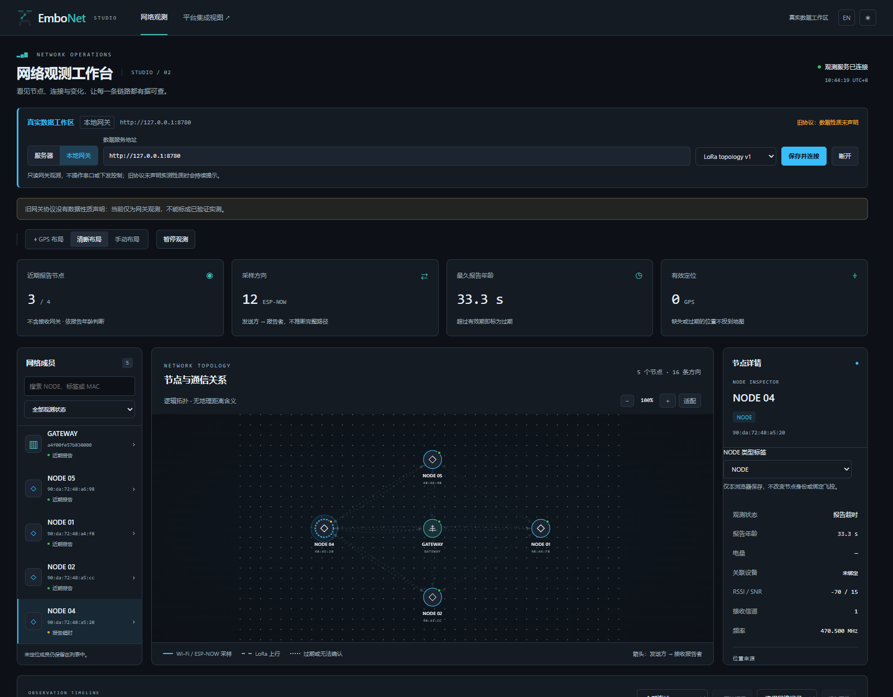

# M-064：迁移后前端真实网关现场验证

日期：2026-11-24。用户 10:31 明确表示已连接网关、启动全部节点，要求验证迁移后前端。产品提交 `162665bf93265333e725486539a26098b1466a31`，本轮未修改产品源码。

## 结论

**迁移后的 Vue Studio 已能读取现有真实接收服务，节点/方向/无线信息与后端数据对应，刷新、暂停继续、超时变色及恢复均验证成立。** 但不能认定现场“全部节点在线且稳定”：只收到 1、2、4、5 号自身报告，标签清单中的 3 号未出现；4 号有间歇超时。

接收异常在原始接口中即存在，不是前端丢弃已收到的 3 号报告。另一方面，前端的 `4/4` 只代表已观测的 4 个节点，并不代表清单里 1–5 全部在线；这体现了原设备清单/registry 尚未完整接入的功能边界。

这是本次实施会话的只读现场验证，不是 C 独立审查，也不是飞行/下行业务或生产发布验收。所有数据均读取现有服务，**未使用 Mock、未伪造 API 响应、未改变设备状态**。旧协议本身没有统一 provenance 声明，UI 保持 unknown 提示，不能仅因本次现场接线就修改协议性质。

## 实际连接链路

`节点 LoRa 上报 → E870L-470 接收服务 / UDP1680 → 127.0.0.1:8780 → baseline 开发只读桥 → Vue Studio / 10518`

- 原接收服务 PID39744 和旧 Studio8794/PID38492 均保留，不重启。
- 10518 原先没有监听，只补起 baseline 的 `--real` 预览，未启动 Mock 服务。
- 通过实际 HTTP 获取 baseline 框架来源元数据，确认不是旧 ControlSystem/5188 的预览。
- 浏览器只允许本机10518的 GET、且代理仅允许指向8780的 topology GET；没有 API fulfillments、设备控制请求、意外外联或 pageerror。
- 本轮临时浏览器会话均已关闭；保留10518供用户打开。没有替用户普通浏览器保存连接设置。

## 第一窗口：120秒接口采样，25个样本

时间 **10:38:22–10:40:22（UTC+8）**。

- 网关持续可观测，worker 始终 running，无 HTTP 错误；累计解析帧 75→112，增加37；bad_frames 最大0。
- 30秒报告超时阈值来自接口，未为通过测试而放宽。
- 四个已观测节点均有序号推进，boot 未发生变化。
- **全节点新鲜/稳定验收未通过，采样器返回码1**：4号在结束时已超过30秒，没有把“有部分接收”包装成“整体健康”。

| 节点 | 报告序号（首→末） | 观测到的不同报告数 | 最大报告年龄 | 超过30秒的样本 | 结论 |
|---|---:|---:|---:|---:|---|
| 1 | 49→61 | 13 | 10.462s | 0/25 | 本窗口持续更新 |
| 2 | 49→60 | 12 | 10.642s | 0/25 | 本窗口持续更新 |
| 3 | 无 | 0 | 未知 | 不适用 | 标签中存在，但没有收到自身报告 |
| 4 | 48→55 | 3 | **54.975s** | **9/25** | 间歇上报，超时后有恢复 |
| 5 | 49→61 | 13 | 6.894s | 0/25 | 本窗口持续更新 |

这些数值不是包丢失率；序号缺口不能直接判定 RF 丢包原因。未通过串口/节点控制接口核实3号供电、启动状态、固件或信道；也没有确认4号间歇的根因。不能据此断言硬件损坏。

标签来自现有接收服务的 MAC→1–5 映射，而默认 fleet 配置为空。该清单可能包含历史设备；结合用户“全部已启动”的背景将3号列为优先核对项，不把标签本身伪装成独立实物盘点。

## 第二窗口：真实浏览器端到端

时间 **10:40:34–10:40:49**。不是昨日的合成测试。

- 页面显示 **GATEWAY + NODE01/02/04/05，共5个成员**；其中实际报告节点4个。ID和数字标签逐项与真实响应比对一致。
- 清晰布局显示5个成员，**12个 ESP-NOW 采样方向、4个节点→网关 LoRa 上行**；并未把采样方向解释为当前完整连通路径。
- 节点详情和两类方向详情可打开；LoRa频率470.500MHz/接收信道1等实际射频字段可查看。Wi-Fi旧采样仍保守标为历史/未知，没有冒充现在仍双向互证。
- 实际响应帧计数120→122，快照时钟前进；暂停仅冻结浏览器快照，继续后重新读取现有服务。
- 390px宽度无横向溢出；没有 Mock 标记、没有模拟数据填充、0 pageerror。
- **0个有效GPS**，GPS模式不绘造假坐标；切清晰布局后能看到完整的已观测逻辑拓扑。
- 旧协议的录制按钮仍禁用，原接收来源选择控件不存在。这些昨日记录的功能缺口并没有因为现场能显示拓扑而自动完成。

此时4号已恢复，所以该短窗口的页面一度显示4/4；不抵消此前2分钟内的超时事实。

## 第三窗口：90秒UI/原始年龄同步核验，19个状态样本

时间 **10:43:35–10:45:11**，其中连接准备后进行90秒观察。实际接收帧178→208。

- 仍然只有1、2、4、5号报告，无3号；4号再次经历近期→超时→恢复。
- 后端4号年龄32.651s、36.778s时，页面显示“报告超时”，指标降到3/4；后端恢复到3.591s后，页面回到“近期报告”。
- 截图中4号年龄33.3s，左侧黄点、详情“报告超时”、全局3/4相互一致。证明超时状态不是只在接口日志中出现，**Vue可见状态确实随真实数据变化**。
- 无需停服务或拔电制造故障；本轮没有人为注入503/超时。

## 现在如何打开

1. 打开 [baseline 真实 Studio](http://127.0.0.1:10518/studio.html)。
2. 选“本地网关”，地址填 `http://127.0.0.1:8780`，协议选 `LoRa topology v1`。
3. 点“保存并连接”，再选“清晰布局”。

本机预览默认断开，普通浏览器与自动验证会话互不共享设置，因此不能承诺用户第一次打开就已连接。保留默认断开是现有安全设计，不是服务没启动。

## 应优先处理什么

1. **现场接收链路**：先核实3号是否确为当前清单中的设备、是否实际发送 LoRa；检查4号间歇上报。需要另行授权的硬件诊断，不能仅靠改页面掩盖。
2. **前端清单/计数语义**：应将“应在线设备清单”与“已观测报告节点”分开，显式提示清单中的未观测3号，避免用户把4/4理解成全部5块板正常；不能简单预填成在线节点。
3. **无GPS的进入体验**：现在默认GPS空图已有文字提示，用户仍容易误判为无数据；可改进首次布局选择/引导，但不伪造地理位置。
4. **功能完备性**：真实来源管理、SQLite录制回放、原业务证据/恢复/身份链等仍按[昨日差距报告](../20261123-M064-vue-ts-framework/validation/REPORT.md)继续处理；本轮不自动扩大为实现或deploy迁移。

## 证据

原始目录：`simulation/outputs/M-064/20261124-103525718831-live-frontend/`，新建、未覆盖昨日数据。

- [现场汇总](LIVE-SUMMARY.json)、[25点接口采样](TELEMETRY-REPORT.json)。后者明确保留未通过的健康判断。
- [首次真实浏览器核验](BROWSER-REPORT.json)、[90秒UI与原始响应核验](UI-MONITOR-REPORT.json)。响应为实际读取，非拦截替换。
- [清晰布局现场截图](live-topology.png)、[GPS缺失状态](live-gps.png)、[4号超时截图](live-node4-stale.png)、[最后拓扑截图](live-final-topology.png)。
- [完成记录](COMPLETION.json)、[字节校验清单](ARTIFACT_SHA256.json)。

未验证：3号实际电源/固件状态、4号间歇根因、完整性意义上的真实丢包率、节点控制或业务交付、断电恢复、GPS硬件、生产静态部署；无任何设备控制/刷写/重启或ECS/deploy操作。

归档补充：首次归档链接检查因先检查尚未生成的校验清单而中断；随后仅补齐清单并再核验，没有覆盖或重跑现场数据。见[归档补充记录](ARCHIVE-SUPPLEMENT.json)。
